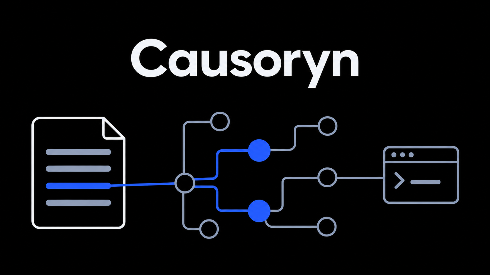
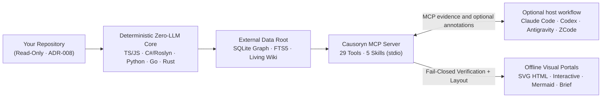

<p align="center">
  
</p>

<p align="center">
  <a href="https://www.npmjs.com/package/causoryn"></a>
  <a href="https://github.com/MrBekoX/Causoryn/actions/workflows/ci.yml"></a>
  <a href="LICENSE"></a>
  = 24" />
  
</p>

# Causoryn (`v0.2.3` — Pre-1.0 Public Preview)

**Causoryn** is an open-source codebase and change intelligence platform with a **local, LLM-free MCP engine (`ADR-002`)**. It builds an evidence-backed dependency, symbol, route, contract, and test graph for **TypeScript / JavaScript**, **C# / Roslyn**, **Python**, **Go**, and **Rust**, and exposes **29 MCP tools** and **5 agent skills**. Source analysis is read-only (`ADR-008`). Architecture exports work with static evidence alone and accept optional caller-supplied `annotations` (`K-023`).

> **Release status (`ADR-010`):** `v0.2.3` is a **Pre-1.0 Public Preview** (not `1.0.0`; historical `v0.1.0` remains frozen at `4c9c188f`). Remaining `1.0.0` gates are tracked transparently in [`CHANGELOG.md`](CHANGELOG.md).

---

## Why Causoryn?

AI coding agents typically explore large codebases with ad-hoc `grep` and partial file reads — missing downstream callers, breaking API/schema contracts, or skipping architecture boundaries.

- **LLM-free analysis (`ADR-002`):** The MCP server runs static analysis, search, verification, and export locally without model calls, model credentials, or embeddings. An external coding agent can use `architecture-blueprint` to supply optional architectural annotations.
- **Evidence-backed results (`ADR-010`):** Edges carry `verified`, `heuristic`, or `unresolved` resolution labels. Every `verified` edge carries source evidence. Caller-supplied prose remains part of the export annotation layer.
- **Read-only source analysis (`ADR-008`):** Persistent graph and wiki databases live outside the analyzed roots. Automatic configuration also puts exports outside the workspace. A custom `output.allowedOutputDirs` authorizes explicit exports and can include a directory in the workspace. [CLI & Configuration](docs/en/cli-and-configuration.md)
- **Offline visual architecture portals (`v0.2.2`–`v0.2.3`):** Layered SVG zero-JS HTML portals (`causoryn-architecture.html`), interactive pan/zoom/filter/Inspector portals (`causoryn-architecture-interactive.html`), clean subgraph Mermaid diagrams, and fail-closed Host-LLM `annotations`.
- **Universal repository compatibility & non-blocking startup (`v0.2.1`–`v0.2.3`):** Analyzes `.ts`/`.tsx`/`.mts`/`.cts` and `.js`/`.jsx`/`.mjs`/`.cjs` (ESM + CommonJS) with safe read-only `tsconfig.json`/`jsconfig.json` path-alias resolution (`@/*`, `~/*`, monorepos); reads root `.gitignore`, `.git/info/exclude`, and nested `.gitignore` files; preserves `bin/*.ts|js` and `src/bin/*.rs` while ignoring `.NET` `bin/` outputs; yields during async inventory scans; and checks SQLite `PRAGMA data_version` before reusing cached snapshots.
- **Built for the full change loop:** `Discover → Preflight → Edit → Verify → Explain` across 4 coding agent hosts.



---

## Visual Architecture Exports (`v0.2.2`–`v0.2.3`)

The architecture renderer produces byte-identical artifacts for the same snapshot (including metadata), format, view, options, and annotation input under the same renderer version. A new index build can change timestamps and revision metadata. MCP request IDs, job progress, and host-generated prose can vary between calls. See [ADR-002](docs/en/adr/ADR-002-no-llm.md) for the reproducibility boundary.

`causoryn_export_documentation` can render directly from the graph. Callers may also supply structured `annotations` for domains, summaries, flows, tours, decisions, and risks. The optional `architecture-blueprint` skill guides a host LLM through this workflow. The renderer rejects malformed inputs and invalid graph references with `INVALID_ARGUMENT`. It checks the schema and graph membership of cited IDs and paths. The prose remains caller-provided.

| Format & `view` | Generated Artifact | Key Capabilities & Offline Security |
|---|---|---|
| `html` · `view: "architecture"` *(default)* | `causoryn-architecture.html` | **Zero JS**, strict offline CSP (`default-src 'none'`), 5 pure-CSS tabs (Overview, Architecture Map, Flows, Modules & Dependencies, Risks & Contracts), layered Sugiyama SVG diagram, zoom presets, Tarjan SCC cycle highlights, inline SVG flow strips |
| `html` · `view: "interactive"` | `causoryn-architecture-interactive.html` by default | Offline interactive viewer with zoom, pan, search, filters, evidence inspector, and Mermaid copy. Distinct default filename avoids overwriting `causoryn-architecture.html`. |
| `mermaid` · `view: "architecture"` | `causoryn-architecture.mmd` | Adaptive directory-tree clustering (`maxModules`, default `32`), domain subgraphs, weighted cross-module call edges, cycle styling |
| `markdown` · `view: "architecture"` | `causoryn-architecture.md` | Architecture Brief with executive summary, embedded Mermaid diagram, domain breakdown, critical flows, contracts & risks |
| `json` · `view: "architecture"` | `causoryn-architecture.json` | Compact blueprint with modules and `evidenceCatalog` |
| `snapshot` · raw | `architecture-snapshot.json` | Canonical snapshot for Git-based architecture comparison |
| `html`, `mermaid`, `markdown`, `json` · `view: "full"` | Raw graph artifact | Legacy node, edge, and evidence export |

### Bundled Canonical Skills (`skills/`)

Installing Causoryn via `npx causoryn@0.2.3 setup` or native host marketplaces ships **5 canonical agent skills**:

1. **`causoryn`** — End-to-end `Discover → Preflight → Edit → Verify → Explain` orchestration runbook
2. **`map-system`** — Paginated L0–L3 codebase structure and symbol navigation
3. **`preflight-change`** — Pre-edit blast radius, contract compatibility, and candidate test plan
4. **`verify-change`** — Post-edit deterministic architecture rule and contract drift verification
5. **`architecture-blueprint`** — 6-step Host-LLM + Causoryn MCP workflow for generating grounded offline visual architecture portals

---

## Measured Performance (1,000 TypeScript Files)

Historical measurements from 2026-11-10 used `InMemoryTransport`, including input validation and MCP envelope serialization, on a deterministic 1,000-file TypeScript fixture. [Benchmarks](docs/en/benchmarks.md)

| Benchmark | MCP Tool Call | Median Latency |
|---|---|---|
| Warm workspace summary | `causoryn_workspace_summary` | **11.8 ms** |
| Local symbol neighborhood (`depth: 1`) | `causoryn_get_symbol_context` | **13.0 ms** |
| Architecture map (`L2`, `maxNodes: 200`) | `causoryn_map_system` | **10.7 ms** |

---

## Real MCP Output Example (`examples/fixture-ts-orders`)

Running `causoryn_preflight_change` before editing `src/services/orders-service.ts` returns deterministic, evidence-backed blast-radius candidates (trimmed for readability):

```json
{
  "schemaVersion": "2.0",
  "status": "ok",
  "coverage": {
    "tier": "L2",
    "resolvedEdges": 30,
    "unresolvedEdges": 1,
    "totalEdges": 31,
    "coverageRatio": 0.9677
  },
  "data": {
    "intentLabel": "Add idempotencyKey parameter to createOrder",
    "candidateOnly": true,
    "identifiedTargets": [
      { "kind": "File", "qualifiedName": "src/services/orders-service.ts", "origin": "file" }
    ],
    "impactCandidates": [
      {
        "kind": "File",
        "qualifiedName": "src/routes/orders.ts",
        "certainty": "direct",
        "resolution": "verified",
        "minDepth": 1,
        "pathEvidenceIds": ["evidence:7d09d378..."]
      },
      {
        "kind": "File",
        "qualifiedName": "src/app.ts",
        "certainty": "direct",
        "resolution": "verified",
        "minDepth": 1,
        "pathEvidenceIds": ["evidence:7847f95a..."]
      }
    ]
  }
}
```

---

## Supported Hosts

Causoryn ships as a multi-file npm distribution package (`causoryn` v`0.2.3`) and multi-host plugin repository supporting:

1. **Antigravity** (`agy` / Antigravity IDE)
2. **Claude Code**
3. **Codex** (Codex CLI / Desktop)
4. **ZCode (GLM)** — Z.ai's official GLM coding environment & ZCode Plugin Marketplace

---

## Runtime, Zero-Compile & Offline Matrix

Causoryn is **not** a single-file JS bundle (`ADR-010`) — its runtime properties vary transparently by component:

| Component | Runtime Requirement | Compilation | Offline Behavior |
|---|---|---|---|
| **Core MCP server & SQLite** (`dist/mcp-server.mjs` + N-API v10 `better-sqlite3` prebuilds) | **Node.js >= 24** | Zero-compile | 100% offline |
| **TypeScript / JavaScript** (L2 + L3: `.ts/.tsx/.mts/.cts/.js/.jsx/.mjs/.cjs`, ESM + CJS, `tsconfig`/`jsconfig` paths) | In-process TS Compiler API + bundled `dist/typescript-lib/lib*.d.ts` | Zero-compile | 100% offline |
| **C# / Roslyn** (L2 + L3) | **.NET 10 runtime** (`dotnet exec`) | Prebuilt deterministic Release Roslyn DLL (zero-compile) | 100% offline |
| **Python** (L2 + L3) | **Python 3.10+** (`python -B`, stdlib `ast`) | Zero-compile | 100% offline |
| **Go** (L1/heuristic + L3) | **Go 1.22+** (stdlib `go/parser`, zero external modules) | On-demand `go run` (or prebuilt `CAUSORYN_GO_WORKER_BIN`) | 100% offline |
| **Rust** (L1/heuristic + L3) | **Rust / Cargo** (`syn` 3 sidecar) | On-demand `cargo build --locked` into `~/.causoryn/cache/rust-worker-target` | An uncached build can fetch locked crates from `crates.io`; a populated cache supports offline use |

Missing optional sidecar toolchains (`dotnet`, `python`, `go`, `cargo`) never crash the server — they degrade honestly to L0/L1 file-level provenance (`npx causoryn@0.2.3 doctor` inspects sidecar readiness).

---

## Quick Start

### Option 1: One-Command CLI Setup (`npx causoryn setup`)

```bash
# Preview planned changes without modifying any files
npx causoryn@0.2.3 setup --all-detected --dry-run

# Configure all detected hosts (backs up existing configs to *.causoryn.backup and stages a persistent ~/.causoryn/runtime copy)
npx causoryn@0.2.3 setup --all-detected --yes

# Or configure a specific host
npx causoryn@0.2.3 setup --client antigravity --yes
npx causoryn@0.2.3 setup --client claude-code --yes
npx causoryn@0.2.3 setup --client codex --yes
npx causoryn@0.2.3 setup --client zcode --yes

# Verify runtime, sidecars, and host config/skill alignment (100% read-only)
npx causoryn@0.2.3 doctor

# Uninstall cleanly from a host
npx causoryn@0.2.3 setup --client claude-code --uninstall --yes
```

### Option 2: Native Host Plugin Marketplaces

- **Claude Code:**
  ```text
  /plugin marketplace add MrBekoX/Causoryn
  /plugin install causoryn@causoryn
  ```
- **ZCode (GLM):**
  Open **Settings → Plugin Management / Marketplace → Discover → + (New)**, enter `https://github.com/MrBekoX/Causoryn` (reads root `marketplace.json` + `.zcode-plugin/plugin.json`), and install `causoryn`.
- **Codex:**
  Register the repository marketplace (`.agents/plugins/marketplace.json` + `.codex-plugin/plugin.json`) or run `npx causoryn@0.2.3 setup --client codex --yes`.
- **Antigravity:**
  Install from `https://github.com/MrBekoX/Causoryn` (`plugin.json` + `mcp_config.json`) or run `npx causoryn@0.2.3 setup --client antigravity --yes`.
- **Standalone Skills (`skills.sh`):**
  ```bash
  npx skills add MrBekoX/Causoryn
  ```

---

## Core Product Loop (`Discover → Preflight → Edit → Verify → Explain`)

- **Discover:** `causoryn_map_system`, `causoryn_get_agent_context`, `causoryn_find_symbols`, `causoryn_get_symbol_context`, `causoryn_trace_execution`, `causoryn_trace_business_flow`
- **Preflight:** `causoryn_preflight_change` (`candidateOnly: true`), `causoryn_analyze_impact`, `causoryn_check_contracts`, `causoryn_detect_contract_drift`, `causoryn_derive_test_plan`
- **Verify:** `causoryn_verify_change`, `causoryn_check_architecture` (`.causoryn/architecture.rules.yaml`)
- **Explain, Visual Architecture Portal & Living Wiki:** `causoryn_get_evidence`, `causoryn_compare_architecture`, `causoryn_architecture_timeline`, `causoryn_generate_onboarding`, `causoryn_export_documentation` (layered SVG offline HTML portals, subgraph Mermaid diagrams, Architecture Brief Markdown, and fail-closed Host-LLM `annotations` guided by the bundled `architecture-blueprint` skill), and 7 `causoryn_wiki_*` tools

See [`packages/causoryn/README.md`](packages/causoryn/README.md) for the standalone npm package reference.

---

## Documentation (English & Türkçe)

Full bilingual engineering, CLI, analyzer, security, and host documentation is available under `docs/`:

- **[English Documentation Hub](docs/en/README.md)** — [Architecture](docs/en/architecture.md) · [CLI & Configuration](docs/en/cli-and-configuration.md) · [5-Language Analyzers](docs/en/language-analyzers.md) · [MCP Tool Contracts (29 Tools)](docs/en/tool-contracts.md) · [Living Wiki Spec](docs/en/wiki-spec.md) · [Compatibility Matrix](docs/en/compatibility-matrix.md) · [Security Audit](docs/en/security-pass.md) · [Benchmarks](docs/en/benchmarks.md) · [ADR-002: No-LLM](docs/en/adr/ADR-002-no-llm.md)
- **[Türkçe Dokümantasyon Merkezi](docs/README.md)** — [Mimari Özeti](docs/architecture.md) · [CLI ve Konfigürasyon](docs/cli-and-configuration.md) · [5-Dil Analizörleri](docs/language-analyzers.md) · [MCP Araç Sözleşmeleri (29 Araç)](docs/tool-contracts.md) · [Living Wiki Belirtimi](docs/wiki-spec.md) · [Uyumluluk Matrisi](docs/compatibility-matrix.md) · [Güvenlik Denetimi](docs/security-pass.md) · [Performans Ölçümleri](docs/benchmarks.md) · [ADR-002: No-LLM](docs/adr/ADR-002-no-llm.md)
- **[Bilingual Architecture & Project Overview (TR · EN)](docs/project-overview.tr-en.md)**

---

## Development (Monorepo)

Matches [`.github/workflows/ci.yml`](.github/workflows/ci.yml) (`ubuntu-latest`, `windows-latest`, `macos-latest`):

```bash
# Install dependencies with --ignore-scripts (blocks untrusted lifecycle scripts;
# Causoryn ships verified better-sqlite3 prebuilds)
npm ci --ignore-scripts

# Build native sidecar workers
dotnet build native/roslyn-worker/Causoryn.RoslynWorker.csproj -c Release -p:DebugType=none -p:ContinuousIntegrationBuild=true -p:SatelliteResourceLanguages=en
cargo build --manifest-path native/rust-worker/Cargo.toml --locked

# Run full build and quality gates
npm run typecheck
npm run build
npm run build:bundle --workspace packages/mcp-server
npm run build:package --workspace packages/causoryn
node packages/causoryn/scripts/verify-package-ready.mjs
npm run lint
npm run secret-scan
npm test
```

---

## Governance, Security & License

- **Security policy & vulnerability reporting:** [`SECURITY.md`](SECURITY.md)
- **Contributing guide:** [`CONTRIBUTING.md`](CONTRIBUTING.md)
- **Code of Conduct:** [`CODE_OF_CONDUCT.md`](CODE_OF_CONDUCT.md)
- **Third-party notices & licenses:** Generated and bundled inside the published npm package as `THIRD-PARTY-NOTICES.md` and `licenses/` (reproducible locally via `npm run build:package --workspace packages/causoryn`)
- **License:** [MIT](LICENSE)
