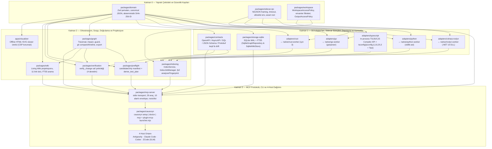

# Causoryn Mimari Özeti (kod-face)

> Kanıt: TŞ v2.1 §3, §5, §6, §8, §9, §10, §16A, §17, §25 · Ayna sayfa: `wiki/architecture.md` · **Dil / Language:** **Türkçe** | [English](en/architecture.md)
> Bu sayfa kod yazan ajan/kullanıcı içindir: repodaki paketler ile TŞ'nin istediği mimari arasındaki eşlemeyi gösterir.
> Durum notu: bu belge `v0.2.3` (**Pre-1.0 Public Preview**, `K-020`..`K-026`) sürümündeki
> kod halini yansıtır (tarihsel `v0.1.0` etiketi `4c9c188f` üzerinde kilitlidir; toplam **18 npm workspace paketi** + kök monorepo
> = 19 `package.json`: `12 packages/*` + `5 adapters/*` + `1 integrations/zcode/causoryn`, ayrıca standalone `apps/visualizer`,
> 4 `native/*` sidecar, kök 4-host açık kaynak pazaryeri manifestleri, 5 GitHub Actions iş akışı (`.github/workflows/{ci,release,security,codeql,scorecard}.yml`) ve
> `integrations/antigravity/causoryn` eklenti dizini); durum kolonları
> [docs/implementation-status.md](implementation-status.md) kanıtlarıyla ADR-010
> dürüstlük kuralına tabidir.

## Pipeline

```
Workspace Gateway → File Inventory → Language/Framework Adapters → Normalization
  → Symbol/Contract Resolution → Unified Evidence Graph → Immutable Snapshot
  → Domain Queries → MCP structuredContent → Host-selected model
```

Pipeline, TŞ v2.1 §5’e dayanır. Analiz Causoryn içinde yerelde ve LLM bağımlılığı olmadan çalışır. Host modeli isteğe bağlı bir MCP istemcisidir. [ADR-002](adr/ADR-002-no-llm.md)

### LLM-free Motor, Evrensel Uyumluluk ve Opsiyonel Host Anotasyonları

Statik analizörler ve kontrat ayrıştırıcıları graph oluşturur. SQLite ve FTS5 sorgu yüzeyini besler. `SqliteGraphRepository` en fazla dört snapshot’ı bellekte tutar ve `PRAGMA data_version` ile başka bağlantıların yazımlarını kontrol eder. Snapshot yazımında O(1) konum sayaçları ve toplu transaction kullanılır. Polyglot indekslemede ortak pathless dış veya sanal düğümler birleştirilir; dosyaya bağlı kimlik çakışmaları reddedilir.

Evrensel uyumluluk katmanı (`v0.2.3`, `K-024`) TypeScript yanında tam JavaScript/CommonJS (`.js`/`.jsx`/`.mjs`/`.cjs`, `require`/`exports`/`module.exports`) analizi, kök-hapsedilmiş `tsconfig.json`/`jsconfig.json` yol alias yükleyicisi (`configureConfinedCompilerHost`), kök `.gitignore` + `.git/info/exclude` + iç-içe `.gitignore` keşfi, `.NET` odaklı akıllı `bin/` ayrımı (Node `bin/*.ts|js` ve Rust `src/bin/*.rs` korunur) ve event-loop dostu non-blocking `collectInventoryAsync` tarayıcısını sunar.

`packages/graph`, adaptif modül projeksiyonu, Tarjan SCC ve Sugiyama tarzı SVG yerleşimiyle çevrimdışı mimari çıktılar üretir (`view="interactive"` varsayılan dosya adı `causoryn-architecture-interactive.html`, sıfır-JS `view="architecture"` için `causoryn-architecture.html`). Aynı renderer, metadata dahil aynı snapshot, format, görünüm, seçenekler ve anotasyon girdisiyle bayt düzeyinde aynı çıktı üretir. Yeni indeks işleri zaman ve revision metadata’sını değiştirebilir. [ADR-002](adr/ADR-002-no-llm.md)

`causoryn_export_documentation` tüm üst ve iç içe girdi alanlarında zengin JSON Schema `.describe()` rehberliği yayınlar (`K-026`) ve `architecture-blueprint` skill'i harici host LLM’ine doğal dil istemlerinden istenirse `annotations` hazırlamada yol gösterir. Sunucu şemayı, referans ID’lerini ve modüle ait dosya yollarını fail-closed doğrular; anlatı çağıranın girdisi olarak kalır. [MCP Araç Sözleşmeleri](tool-contracts.md) · [Prompt ve Mimari Portal Rehberi](prompting-and-architecture-portals.md)

## Katmanlı bağımlılık ve dağıtım diyagramı



## Paket ↔ sorumluluk eşlemesi (bu repodaki hâliyle)

| Paket / Dizin | Rol | TŞ kaynak | Durum |
|---|---|---|---|
| `packages/domain` | Graph/Evidence sözleşmeleri, Zod şemaları, canonical JSON, deterministik ID | §8 | Done: 27 node + 20 edge türü, verified kenar ≥1 evidence |
| `packages/sidecar-ipc` | Ortak sidecar süreç IPC çekirdeği: satır-bazlı NDJSON framing, timeout, `responseMaxChars`/`stderrMaxChars` bütçeleri, `stdin` EPIPE yutma, allowlist env kurucu, `resolveCausorynAssetRoot` | §7, K-020 | Done (sıfır dış npm bağımlılığı; 4 sidecar adapter tarafından paylaşılır) |
| `packages/workspace` | Workspace Gateway: trusted roots, inventory, polinom zamanlı sıfır-RegExp `ignore-matcher.ts`, symlink escape, binary/size filtresi, `OutputAccessPolicy` | §5, §9, §25/2 | Done (fail-closed policy, null-byte ve symlink kaçış korumalı) |
| `packages/indexing` | IndexCoordinator: 5-dil pipeline orkestrasyonu (TS/JS in-process + C#/Python/Go/Rust sidecar yönlendirme, `INDEXED_ADAPTERS` 5 kayıt), non-blocking `collectInventoryAsync`, job manager, watcher (in-process), fingerprint `fp2`, `tsconfig`/`jsconfig` önbellek geçersizleştirme, `symbol_fts` besleme, çoklu-süreç SQLite yarış kurtarması | §9, §25/4-5, K-024 | Done; **B7 Partial kalıntısı**: per-file parse reuse yok ve watcher MCP aracı değil (`refresh_index mode=full\|incremental` aktif) |
| `packages/graph` | Snapshot sorguları, traversal/cursor, impact, guard (policy DSL), compare/timeline (salt-okunur git), adaptif mimari projeksiyon + Sugiyama SVG yerleşim + fail-closed Host-LLM `annotations` (JSON Schema `.describe()`) + çok-görünümlü export (`json`/`markdown`/`mermaid`/`html`/`snapshot`; `view: architecture\|interactive\|full`, varsayılan etkileşimli ad `causoryn-architecture-interactive.html`), onboarding/agent-context, evidence chain | §8, §9, §12, §13, §15, §16, K-023, K-026 | Done (`view="architecture"` sıfır-JS katmanlı SVG portal + `view="interactive"` offline portal + `format="snapshot"` `OutputAccessPolicy` korumalı) |
| `packages/storage-sqlite` | SQLite + FTS5 store (`SqliteGraphRepository` + `symbol_fts` + `PRAGMA data_version` korumalı sıcak snapshot önbelleği + O(1) pozisyon sayacı), migration (`user_version=2`), atomic snapshot + `SqliteWikiStore` (`wiki_*` şeması, FTS/alias indeksleri, annotation CAS) | §9, §16A.7 | Done |
| `packages/contracts` | Salt-okunur sözleşme keşfi: OpenAPI/AsyncAPI/SQL/JSON Schema/protobuf + parse güvenlik kotaları (1 MiB/derinlik/alias) + compatibility/drift çekirdeği | §11, §10.2 | Done (belgeli sınır: openapi keşfi yalnızca istek şeması — yanıt-şeması drift yüzeyde görünmez, K-015(5)) |
| `packages/preflight` | candidate-only Preflight Manifest (`candidateOnly` sabit `true` — kod yazmaz) + `derive_test_plan` (`direct`/`call-site`/`naming`) | §10.2/§10.3, §15 | Done (TS `Test` + `TESTS` kenarlarıyla `direct` sinyal aktif; C#/Python/Go/Rust sidecar'larda `TESTS` kenarı üretimi açık) |
| `packages/verification` | `verify_change` saf çekirdeği: 4 denetim, 8-kuralı verdict zinciri, test durumu dürüstlüğü (`not_run`/`observed`+kanıt), byte-deterministik rapor | §10.4 | Done (E3 `passed` doğrulaması host beyanı üzerinden — K-016(3)) |
| `packages/wiki` | Living Wiki projeksiyonu: link çözümleme (11 tür), FTS5 arama, incremental invalidation, annotation overlay (CAS), offline markdown+HTML export | §16A | Done (link-düzeyi invalidasyon sınırlı — mcp-server incremental yayımı indeksleri tam graph'tan yeniden yazar) |
| `packages/mcp-server` | `stdio` transport, input validation (`.describe()` rehberliği dahil), authorization, bloklamayan başlangıç (`deferAutoIndex` + `.gitignore`/`.git/info/exclude`/iç-içe `.gitignore` + akıllı `bin/`), sıfır-ayar `--allow-cwd` + MCP `roots/list` + `--auto-data-dir`, `storage.dataDbPath` kalıcı SQLite / varsayılan `InMemoryGraphRepository`, 29 araç kablolaması + MCP `annotations` (`readOnlyHint`) + `outputSchemaProfile`, 10 alanlı envelope + sabit hata kodları, bundle girişi (F1) | §5, §10, K-024, K-026 | Done (`tools/list` TAM OLARAK 29 araç; SDK 1.32.2 v1.x — K-009 sapması; 35 dosyalık `bundle-manifest.json`) |
| `packages/causoryn` | Yayınlanabilir açık kaynak çoklu-host CLI ve plugin dağıtım paketi (`causoryn` `v0.2.3` Pre-1.0 Public Preview, `MIT`, sıfır dış npm `dependencies`): `causoryn mcp\|setup\|doctor`, `plugin-mcp-launcher.mjs`, `build-package.mjs` ile sahnelenen `dist/mcp-server.mjs` + `mcp-server.mjs.LEGAL.txt` + `better-sqlite3` (`better-sqlite3/LICENSE` dahil) + `dist/typescript-lib/lib*.d.ts` + 4 `native/` worker + 5 `skills/` (`architecture-blueprint` dahil) + 4 host plugin manifesti + `THIRD-PARTY-NOTICES.md` | §17, K-021..K-026 | Done (`npm pack` `.tgz` arşivinden izole 4-host `setup`/`doctor` + sıfır-ayar `stdio` E2E kanıtlı) |
| `adapters/typescript` | Compiler API AST + symbol resolution + JS/CJS (`require`/`exports`/`module.exports`) + kök-hapsedilmiş `tsconfig.json`/`jsconfig.json` yükleyicisi + framework linkers (Express/Next.js TS/JS/CJS) + BDD `Test` node & `TESTS` kenarı çıkarımı (L1/L2/L3) | §6, §7, §15, §25/4, K-024 | Done (cross-file receiver etiket sınırı belgeli) |
| `adapters/csharp-roslyn` | Roslyn worker TS adapter: spawn (`dotnet exec`), istek/yanıt, 30 sn timeout, graceful fallback | §7 | Done (worker yok → L0/L1 + açık coverage; L3 `aspnet-core-route-attributes (L3)`) |
| `adapters/python` | Python stdlib `ast` sidecar TS adapter: `python -B` spawn, satır-JSON protokol v1, 30 sn timeout, L0/L1 fallback | §7, §23 | Done (`decorator-route-pattern (L3)`; aynı modül `verified`, import `heuristic`) |
| `adapters/go` | Go `go/parser`+`go/ast` sidecar TS adapter: `go run` / `goWorkerBinaryPath`, 120 sn timeout, Windows ağaç-kill, L0/L1 fallback | §7, §23 | Done (`heuristic-only (semantik L2 yok)`, `symbolResolution:false`; L3 HTTP/router kayıtları) |
| `adapters/rust` | Rust `syn 3` sidecar TS adapter: literal `cargo` build (`--locked` + `~/.causoryn/cache/rust-worker-target`) + worker spawn, framing/timeout, L0/L1 fallback | §7, §23 | Done (`heuristic-heavy`; L3 attribute-macro route tespiti) |
| `apps/visualizer` | Offline HTML+SVG viewer üretici: sıfır bağımlılık, inline CSS/JS, kısıtlayıcı CSP, resolution renk ayrımı, selection→evidence paneli | §16 | Done (DOM-düzeyi vitest + statik inceleme; etkileşimli HTML MCP yüzeyi `packages/graph` `view="interactive"` ile `causoryn-architecture-interactive.html` üzerinden açıktır; gerçek tarayıcı koşusu açık) |
| `native/roslyn-worker` | C# Roslyn sidecar (stdin/stdout protokol v1; deterministik Release derlemesi, sıfır `.pdb`/`.resources.dll` sızıntısı) | §7, §23/B1 | Done (`.NET 10` koşumlarıyla; CI 3-OS matrisinde derlenip doğrulanır) |
| `native/python-worker` | Python saf stdlib `ast` sidecar (`worker.py`, sıfır dış bağımlılık, satır-JSON protokol v1 + `PROTOCOL.md`) | §7, §23 | Done |
| `native/go-worker` | Go stdlib `go/parser`+`go/ast` sidecar (`cmd/worker`, satır-JSON protokol v1 + `PROTOCOL.md`) | §7, §23 | Done |
| `native/rust-worker` | Rust `syn 3` + `serde_json` Cargo sidecar (`causoryn-rust-worker`, satır-JSON protokol v1 + `PROTOCOL.md`) | §7, §23 | Done |
| `integrations/zcode/causoryn` | ZCode geliştirici plugin paketi: `.zcode-plugin/plugin.json` (`mcpServers` + `userConfig`) + skills + dev marketplace (`.claude-plugin/marketplace.json`) | §17, §25/8, K-002 | Done (manifest doğrulama; GUI kurulum koşulmadı — kırmızı kural 6) |
| `integrations/antigravity/causoryn` | Antigravity eklenti dizini: `plugin.json` (`$schema`'sız yerel yükleyici uyumlu) + `mcp_config.json` (birincil yerel yükleyici tanımı) + `mcp.json` (TŞ §17.1 taşınabilir manifest) + `README.md` + `build:bundle` ile sahnelenen `scripts/mcp-server.mjs` (+ vendored `better-sqlite3`) | §17.1, §22 | Partial — doğrudan `stdio` spawn doğrulandı (29 araç); `agy` CLI yok: kurulum/smoke NOT RUN; `skills/`/`agents/`/`rules/`/`hooks.json` ayrı dilim |
| `scripts/` | Kök yayın, tedarik zinciri ve güvenlik betikleri: `scripts/secret-scan.mjs` (13 dizin kökü + 13 kök metin dosyası sır/kişisel-yol tarayıcısı), `scripts/generate-sbom.mjs` (CycloneDX 1.5 SBOM + `SHA256SUMS.txt`), `scripts/export-public-tree.mjs` (Seçenek 1 temiz açık kaynak ağacı dışa aktarıcısı) | §19, K-022 | Done |
| `examples/fixture-ts-orders` · `examples/fixture-ts-express` · `examples/fixture-ts-nextjs` · `examples/fixture-csharp-orders` · `examples/fixture-contract-drift` · `examples/fixture-python-app` · `examples/fixture-go-app` · `examples/fixture-rust-app` | 8 deterministik dil ve sözleşme-drift fixture'ı (TS×3, C#, Python, Go, Rust, contract-drift) | §22, §25/4 | Done |
| `tests/` | Entegrasyon + smoke + güvenlik (F6) + benchmark (F7) + `secret-scan` + kamu ağacı dışa aktarım + SBOM/release iş akışı + açık kaynak dağıtım + host/release doküman doğrulama testleri | §22 | Done (`tests/bench-release` varsayılan süitten ayrıktır; ayrıntı [docs/implementation-status.md](implementation-status.md)'de) |

Toplam monorepo envanteri: **18 npm workspace paketi** (`12 packages/*` + `5 adapters/*` +
`1 integrations/zcode/causoryn`; kök monorepo ile birlikte toplam **19 `package.json`**),
standalone `apps/visualizer`, 4 `native/*` sidecar, kök 4-host açık kaynak pazaryeri manifestleri
(`marketplace.json`, `.claude-plugin/marketplace.json`, `.agents/plugins/marketplace.json`,
`plugin.json` + `mcp_config.json`, `mcp.json`, `server.json`, `skills/`),
5 GitHub Actions CI/CD ve tedarik zinciri güvenlik iş akışı (`.github/workflows/ci.yml`,
`.github/workflows/release.yml`, `.github/workflows/security.yml`, `.github/workflows/codeql.yml`,
`.github/workflows/scorecard.yml`), `.github/dependabot.yml` ve
`integrations/antigravity/causoryn` eklenti dizini. TŞ §18 sonu ilkesi (ilk gün boş paket kurma yok)
aynen işledi: `sidecar-ipc`, `causoryn`, `contracts`, `preflight`, `verification`, `wiki` ve dört
sidecar worker gerçek implementasyonla birlikte açıldı (Faz B1, C2, D, E, Sprint-8 ve K-020..K-026).

## Bağımlılık sınırları (değişmez — TŞ §5.1)

1. `packages/domain` hiçbir MCP/adapter/host paketini import etmez (yalnızca kendi modülleri + `zod`).
2. Adapter'lar dil adapter arayüzlerine bağlanır; bir adapter veya sidecar çökerse motor çökmez,
   ilgili dil dürüstçe L0/L1 dosya düzeyine (`partial` + açık `warnings`) düşer.
3. `packages/mcp-server` yalnızca ApplicationService arayüzlerini tüketir; parser detayı tool handler'a sızmaz.
4. Görselleştirme (`apps/visualizer`) graph JSON'u render eder; yeni edge veya kanıt icat etmez.
5. Plugin skill/rule metni host modeli yönlendirir; host modelini seçemez veya değiştiremez.

## Graph domain sözleşmesi (özet — TŞ §8)

- **Node türleri (27 tür):** `Workspace`, `Repository`, `Project`, `Module`, `File`, `Class`, `Interface`,
  `Type`, `Function`, `Method`, `Endpoint`, `Handler`, `Event`, `Database`, `ApiContract`, `Test`, `Config`,
  `UnknownExternal`… (tam katalog `packages/domain/src/graph-schema.ts`, TŞ §8).
- **Edge türleri (20 tür):** `CONTAINS`, `IMPORTS`, `DECLARES`, `CALLS`, `REFERENCES`, `IMPLEMENTS`,
  `INHERITS`, `INJECTS`, `ROUTES_TO`, `READS`, `WRITES`, `PUBLISHES`, `SUBSCRIBES`, `HANDLES`,
  `PRODUCES_CONTRACT`, `CONSUMES_CONTRACT`, `VALIDATES`, `TESTS`, `DEPENDS_ON`, `CONFIGURES`.
- **Resolution:** `verified | heuristic | unresolved`. `verified`, çalışma zamanı garantisi
  DEĞİLDİR; doğrulanan şey statik sembol/eşleştirme ilişkisidir (bkz. [docs/language-analyzers.md](language-analyzers.md)).
- **Evidence:** `relativePath`, `startLine`/`endLine`, `sourceHash`, `analyzerId`, `analyzerVersion`,
  `rationale` taşır (ADR-004 Evidence First: `verified` kenar ≥1 kanıt).
- **Invariant'lar:** `verified` kenar ≥1 evidence · dangling edge yok (çözülemeyen dış hedefler açık
  `UnknownExternal` node'dur) · deterministik SHA-256 ID (`workspaceId` + `relativePath` + sembol kimliği;
  duvar saati ID'ye girmez) · immutable snapshot (ADR-005) · aynı giriş → aynı Graph JSON · sıralama ve
  opak base64url cursor (`{v:1,o:<int>}`) deterministik.

## Storage ve veri izolasyonu (TŞ §9, ADR-008)

SQLite + FTS5 (`WAL`, `foreign_keys=ON`, `synchronous=NORMAL`, `busy_timeout=5000`, şema `user_version=2`).
Tablo ailesi: `workspaces`, `files`, `file_versions`, `snapshots`, `nodes`, `edges`, `evidence`,
`contracts`, `contract_versions`, `findings`, `tests`, `index_jobs`, `schema_migrations`, `symbol_fts`
ve Living Wiki `wiki_*` (`wiki_fts` dahil) ailesi. Composite indeksler: `(snapshot_id, kind)`,
`(snapshot_id, from_id)`, `(snapshot_id, to_id)`, `(snapshot_id, relative_path)`.

- **Atomic publish:** Yeni indeks `building` durumunda hazırlanır (`building` satırları hiçbir okuma yolunda
  görünmez); bütünlük kontrolünden sonra `ready` veya kapsam eksikse `partial` olarak tek transaction'da
  yayımlanır. Varsayılan sorgular en son yayımlanan snapshot'ı döndürür; daha yeni yayın veya aktif `building`
  varsa `stale=true` işaretlenir.
- **Yazma sınırları:** Çıplak `stdio` varsayılan olarak `InMemoryGraphRepository` kullanır. Kalıcı graph ve wiki veritabanı yolları yetkili köklerin dışında doğrulanır. Otomatik yapılandırma dışa aktarım yolunu da çalışma alanı dışında oluşturur. Açıkça beyan edilen `output.allowedOutputDirs` için ayrı bir izin politikası uygulanır. [CLI ve Konfigürasyon](cli-and-configuration.md)
- **SQL güvenliği:** Tüm SQL sorgularında dış girdiler parametre bağlamasıyla (`?`) kullanılır; SQL metni asla
  dize birleştirmeyle kurulmaz.

## Paketleme, CI/CD ve tedarik zinciri güvenlik mimarisi

- **Çok-dosyalı deterministik bundle (`ADR-010`):** `packages/mcp-server/scripts/build-bundle.mjs` tek-dosya
  dağıtım iddia etmez (`better-sqlite3` native `.node` eklentisi gömülemez). Üretilen **35** dosyalık
  `bundle-manifest.json`, `mcp-server.mjs`, üçüncü-parti lisans bağlantılarını taşıyan `mcp-server.mjs.LEGAL.txt`,
  `node_modules/better-sqlite3/LICENSE` (`better-sqlite3/LICENSE`), JS sarmalayıcı (`lib/**`, `package.json`) ve
  8 platform-mimari çifti için N-API v10 `prebuilds/*.node` ikililerinin SHA-256 özetlerini kilitler; aynı çıktıyı
  `integrations/antigravity/causoryn/scripts/` altına sahneler.
- **Birleşik dağıtım paketi (`packages/causoryn`):** `build-package.mjs` sıfır-ayar CLI giriş noktasını
  (`src/cli-stdio.ts` → `dist/mcp-server.mjs`), yerleşik TypeScript kütüphane bildirimlerini
  (`dist/typescript-lib/lib*.d.ts`), taşınabilir Roslyn Release DLL setini (`native/roslyn-worker/`),
  Python/Go/Rust sidecar kaynaklarını, 5 kanonik `skills/` dizinini (`architecture-blueprint` dahil), 4 host plugin manifestini ve
  `THIRD-PARTY-NOTICES.md` + `licenses/` dosyalarını birleştirir; `verify-package-ready.mjs` `prepack`
  aşamasında tüm SHA-256 özetlerini, LF satır sonlarını ve Roslyn binary temizliğini (sıfır kullanıcı yolu /
  `.pdb` / `.resources.dll`) fail-closed doğrular.
- **5 GitHub Actions İş Akışı ve Tedarik Zinciri Sertleştirmesi (`K-025`):** Tüm aksiyonlar 40 karakterlik commit SHA'sına sabitlenir ve tüm Linux işleri `step-security/harden-runner` (`egress-policy: audit`) ile izlenir:
  - **`.github/workflows/ci.yml`:** 3-OS matrisi (`ubuntu-latest`, `windows-latest`, sabit `macos-15`) üzerinde 5 dil araç zincirini kurar; `npm ci --ignore-scripts`, `npm audit --audit-level=high`, kilitli deterministik Roslyn derlemesi (`-p:RestoreLockedMode=true`), kilitli Rust derlemesi (`--locked`), typecheck, build, bundle, paket doğrulama, lint, `npm run secret-scan`, `node scripts/export-public-tree.mjs --verify-temp --ref HEAD` ve `npm test` kapılarını koşar.
  - **`.github/workflows/release.yml`:** İki aşamalı SLSA tedarik zinciri ayrımı uygular: izole `build-and-verify` (`contents: read`, `package-manager-cache: false`, etiket/`main` soy doğrulaması, kilitli derlemeler, `npm pack`, izole tarball CLI/`doctor`/MCP `initialize` smoke testi, `scripts/generate-sbom.mjs` ile CycloneDX 1.5 SBOM `causoryn-sbom.cdx.json` + `SHA256SUMS.txt`) → `attest-and-publish` (`environment: release`, `id-token: write`, `attestations: write`, `contents: write`, `sha256sum -c SHA256SUMS.txt`, `actions/attest-build-provenance`, token'sız npm OIDC Trusted Publishing `npm publish --provenance --access public` ve GitHub Release yayımı).
  - **`.github/workflows/security.yml`:** `zizmor` iş akışı güvenlik denetimi (`strict-collection: true`, `min-severity: medium`), PR'larda `dependency-review` (`fail-on-severity: high` + copyleft lisans reddi + Scorecard özeti) ve çok-ekosistemli zafiyet taraması (`npm audit --audit-level=high` + `dotnet restore --locked-mode` ile fail-closed NuGet JSON zafiyet denetimi, tüm önem düzeyleri; Rust `Cargo.lock` ise `ci.yml`/`release.yml` `--locked` derlemesi ve PR `dependency-review` ile kilitlidir).
  - **`.github/workflows/codeql.yml`:** 5 dilde CodeQL SAST (`javascript-typescript`, `python`, `csharp`, `actions` `build-mode: none`; `go` `build-mode: manual` ile `native/go-worker` derlemeli) ve `security-extended` sorgu paketi.
  - **`.github/workflows/scorecard.yml`:** OpenSSF Scorecard (`ossf/scorecard-action`) analizi ve GitHub Code Scanning SARIF yüklemesi.
  - **`.github/dependabot.yml`:** Dış bağımlılık taşıyan ekosistemler (`npm` tek kök `directory: "/"` workspace taraması + `typescript` major koruması, `cargo` `/native/rust-worker`, `nuget` `/native/roslyn-worker`, `github-actions`; saf stdlib Python/Go sidecar'ları sıfır harici paket taşır) için haftalık gruplanmış ve **7 günlük bekleme süreli (`default-days: 7`, paket ekosistemlerinde `semver-major-days: 14`)** güncellemeler.
- **Temiz açık kaynak ağacı dışa aktarımı:** `scripts/export-public-tree.mjs`, `git archive` üzerinden iç
  çalışma kayıtlarını dışlayarak kamuya açık kaynak ağacını dışa aktarır ve sızıntı denetimini (`--verify-temp`) fail-closed uygular.

## Teknoloji yığını (TŞ §6, bu repodaki kilitli sürümler)

| Alan | Tercih | Bu repoda |
|---|---|---|
| Çekirdek | TypeScript strict, Node.js LTS | TS 5.9.3 (strict), Node ≥24 |
| MCP | `@modelcontextprotocol/sdk` resmî SDK | `^1.32.2` (`packages/mcp-server`) — **v1.x hattı; TŞ §6 SDK v2 hedefine yükseltme yapılamadı (`npm install` kısıtı), sapma kaydı K-009** |
| Paketleme | Çok-dosyalı deterministik ESM bundle | `esbuild` `^0.28.2` (`better-sqlite3` external — native `.node` gömülemez, `35` dosyalık `bundle-manifest.json`, ADR-010) |
| Validasyon | Zod + JSON Schema | `zod` `^4` (`packages/domain`, `workspace`, `contracts`, `wiki`, `mcp-server`) |
| TS analizi | TypeScript Compiler API + symbol resolution | `adapters/typescript` (in-process + paketli `lib*.d.ts`) |
| Çok-dil sidecar'lar | C# Roslyn, Python `ast`, Go `go/parser`, Rust `syn 3` | `native/roslyn-worker`, `native/python-worker`, `native/go-worker`, `native/rust-worker` + `adapters/*` + `packages/sidecar-ipc` |
| Graph store | SQLite + FTS5, WAL | `better-sqlite3` `^13.2.0` + `@types/better-sqlite3` (`packages/storage-sqlite`) |
| Git | Salt okunur CLI; checkout/reset/clean yasak | `packages/graph/src/git-read.ts` (`execFile` allowlist: `cat-file`, `ls-tree` vb., `shell: false`) |
| Test | Vitest + fixture/golden + MCP integration | `vitest` `5.1.0` |
| Lint | typescript-eslint recommended | `eslint` `^10.15.0` + `typescript-eslint` `^8.73.0` |

Sürüm politikası (TŞ §6): SDK/paket sürümleri implementasyon başında yeniden doğrulanır;
istikrarsız/transitif paketler kilitlenir. TypeScript `5.9.3` kasıtlı olarak kilitlidir:
`typescript-eslint` `typescript >=4.8.4 <6.1.0` bekler; TypeScript 7 native serisi bu aralıkta değildir.

## Build/typecheck/test/güvenlik sözleşmesi

- `npm run test` → Vitest (`packages/*/test`, `adapters/*/test`, `integrations/**`, `tests/**` altındaki tüm
  `*.test.ts`; **`tests/bench-release/**` hariçtir** — F7 benchmark duvar-saati duyarlı performans ölçümüdür,
  doğruluk kapısı değil; paralel süit yükü altında flaky-potansiyellidir).
- `npm run bench` → yalnızca `tests/bench-release/` (`vitest.bench.config.ts`);
  `docs/benchmarks.md` yenileme: `CAUSORYN_BENCH_WRITE_DOCS=1 npm run bench`.
- `npm run build` → `tsc -b` (kök solution `tsconfig.json` **14** doğrudan referans:
  9 paket (`domain`, `sidecar-ipc`, `workspace`, `indexing`, `graph`, `storage-sqlite`,
  `mcp-server`, `causoryn`, `wiki`) + 5 dil adapter'ı (`typescript`, `csharp-roslyn`, `rust`,
  `python`, `go`); `contracts`/`preflight`/`verification` bu zincirle transitif derlenir;
  `apps/visualizer` ve `integrations/*` vitest/esbuild tarafından işlenir).
- `npm run build:bundle --workspace packages/mcp-server` → `dist/mcp-server.mjs` +
  `dist/mcp-server.mjs.LEGAL.txt` + vendored `better-sqlite3` (`better-sqlite3/LICENSE` dahil) +
  `35` dosyalık `dist/bundle-manifest.json` + `integrations/antigravity/causoryn/scripts/` deterministik sahnelemesi.
- `npm run build:package` (`npm run build:package --workspace packages/causoryn`) → açık kaynak `causoryn`
  npm dağıtım paketini sahneler; `node packages/causoryn/scripts/verify-package-ready.mjs` hazır olma kapısını denetler.
- `npm run typecheck` → `tsc -p tsconfig.typecheck.json` (`noEmit`; src + test + config'ler).
- `npm run lint` → ESLint flat config (`typescript-eslint` recommended; `dist`/`node_modules` ignore).
- `npm run secret-scan` → `node scripts/secret-scan.mjs` (**13** dizin kökü + **13** kök metin dosyası üzerinde
  kimlik bilgisi, API anahtarı, kişisel e-posta ve yerel kullanıcı profili yolu taraması; eşleşmede veya eksik kökte `exit 1`).
- Module çözümleme: `NodeNext` — tüm göreli TypeScript importları `.js` uzantısıyla yazılır.

## İlgili belgeler

- [Dokümantasyon Merkezi](README.md) · [Proje Genel Bakış (TR · EN)](project-overview.tr-en.md)
- [Prompt ve Mimari Portal Rehberi](prompting-and-architecture-portals.md)
- [CLI ve Konfigürasyon Başvurusu](cli-and-configuration.md)
- [5-Dil Analizörleri ve Sidecar Protokolü](language-analyzers.md)
- [MCP Araç Sözleşmeleri (29 Araç)](tool-contracts.md) · [Living Wiki Belirtimi](wiki-spec.md)
- [Host Uyumluluk Matrisi](compatibility-matrix.md) · [Güvenlik Denetimi](security-pass.md) · [Performans Ölçümleri](benchmarks.md)
- [Uygulama Durumu](implementation-status.md) · [ADR-002: No-LLM Sınırı](adr/ADR-002-no-llm.md)
