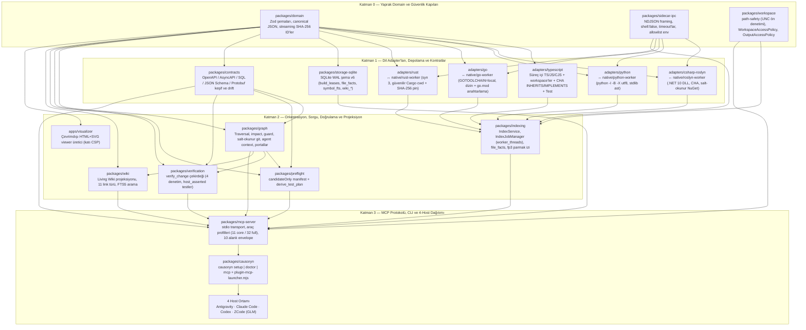

# Causoryn Mimari Genel Bakış (Koda Dönük)

> **Dil / Language:** **Türkçe** | [English](en/architecture.md) · [Dokümantasyon Merkezi](README.md)
>
> **Durum:** Causoryn 0.3.2'i yansıtır (1.0 öncesi; varsayılan `core` araç profili, workspace başına tek paylaşılan `graph.sqlite`, `worker_threads` ile indeksleme). Durum kolonları proje dürüstlük kuralını izler — çalışmayan hiçbir şey Done olarak yazılmaz — ve [Uygulama Durumu](implementation-status.md) ile çapraz denetlenir.
>
> **Kapsam:** monorepo **18 npm workspace paketi** içerir (`12 packages/*` + `5 adapters/*` + `1 integrations/zcode/causoryn`; monorepo kökü dahil **19 `package.json` manifesti**); bunlara ek olarak standalone `apps/visualizer`, 4 `native/*` dil sidecar'ı, kökteki 4-host plugin marketplace manifestleri, 5 GitHub Actions iş akışı (`.github/workflows/{ci,release,security,codeql,scorecard}.yml`), `.github/dependabot.yml` ve `integrations/antigravity/causoryn` bulunur. Tarihsel `v0.1.0` etiketi `4c9c188f` üzerinde kilitli kalır.

Bu sayfa, bu depodaki paketleri uyguladıkları mimariye eşler: hangi paketin neyin sahibi olduğunu, bağımlılıkların hangi yöne işaret edebileceğini, verinin bir workspace'ten MCP yanıtına nasıl aktığını ve hangi build, determinizm ve paketleme sözleşmelerinin geçerli olduğunu gösterir.

## Uçtan uca pipeline

```text
Workspace Gateway (UNC/device pre-check + allowRoots + root-safety checks)
  -> File Inventory (collectInventoryAsync, ignore rules, size/binary filters)
  -> Language/Framework Adapters (TS/JS in-process; C#/Python/Go/Rust sidecars)
  -> Normalization & Symbol / Hierarchy (CHA) / Contract Resolution
  -> Unified Evidence Graph -> Immutable Snapshot (streaming SHA-256 ID)
  -> Published in the shared graph.sqlite (single writer via build_leases)
  -> Domain Queries & Verification -> MCP structuredContent (11-tool core profile)
  -> Host-selected model (external MCP client)
```

Tüm analiz Causoryn içinde, yerelde ve hiçbir LLM, embedding veya model bağımlılığı olmadan çalışır. Host kodlama ajanı, yapılandırılmış çıktıyı okuyan harici bir MCP istemcisidir ([No-LLM karar kaydı](adr/ADR-002-no-llm.md)).

## Veri akışı

1. **Başlatma ve kök yetkilendirmesi.** `causoryn mcp` (veya host plugin başlatıcısı) stdio sunucusunu başlatır. `--root <path>`, `--allow-cwd` veya MCP `roots/list` aday kökleri sağlar; her kök Workspace Gateway'den geçer ve gateway UNC/device yollarını herhangi bir dosya sistemi çağrısından önce sözcüksel (lexical) olarak reddeder. `--allow-cwd` ve `roots/list` adayları için `inspectProjectRootSafety` (`packages/mcp-server/src/runtime-cli.ts`) ayrıca dosya sistemi köklerini, `$HOME` ve üst dizinlerini, Causoryn veri ve plugin kurulum dizinlerini, hassas kullanıcı dizinlerini (`~/.ssh`, `~/.aws`, `~/.gnupg`, `~/.kube`, `~/.claude`, `~/.codex`, `~/.zcode`) ve işletim sistemi dizinlerini reddeder.
2. **Depolama seçimi.** `--auto-data-dir` veya `--data-dir` ile (ikisini de `causoryn setup` kaydeder), `buildWorkspaceAutoConfig` workspace başına tek bir SQLite dosyasını `<base>/workspaces/<slug>-<hash12>/graph.sqlite` konumuna ve yanına bir `exports/` dizini yerleştirir; `storage.dataDbPath` ile `wiki.dataDbPath` değerlerinin ikisini de bu dosyaya ayarlar. Taban dizinin önceliği her host için `--data-dir` > `~/.causoryn` şeklindedir; `ZCODE_PLUGIN_DATA` yalnızca `~/.causoryn` oluşturulamadığında veya yazılamadığında yedek olarak kullanılır. Dizinler `0700` moduyla oluşturulur ve yetkili köklerin kesinlikle dışında olmalıdır. Mevcut bir `graph.sqlite` bu build'in desteklediğinden daha yeni bir şemayla damgalanmışsa ona asla yazılmaz; sunucu onun yerine `graph.schema-<N>.sqlite` (N = bu build'in şema sürümü) kullanır. `graph.sqlite` henüz yoksa 0.3.0 öncesi bir sürümden kalan en yeni geçerli `graph-<client>.sqlite` bir kez ona kopyalanır (salt-okunur `quick_check` + çevrimiçi yedekleme); eski dosyalar yerinde kalır ve `causoryn doctor` bunları listeler. Beyan edilmiş bir `storage.dataDbPath` yoksa sunucu süreç-yerel `InMemoryGraphRepository` kullanır.
3. **Bloklamayan ilk indeks.** stdio giriş noktası ilk indeksi erteler (`deferAutoIndex`): `initialize` ve `tools/list` hemen yanıt verir; yayımlanmış bir snapshot zaten yoksa arka planda tam bir indeks başlar. Sıcak başlangıçta (yayımlanmış bir snapshot varken) araçlar hemen o snapshot'tan yanıt verir ve arka planda çalışan bir incremental yenileme, sunucu kapalıyken düzenlenen dosyaları yakalar. Graph deposu bir SQLite dosyası olduğunda `IndexJobManager` (`packages/indexing/src/job-manager.ts`) işi bir `worker_threads` worker'ında (`index-worker-core.ts`, `dist/index-worker.mjs` olarak bundle edilir) çalıştırır; in-memory depoyla ya da worker girişi kullanılamıyorsa aynı pipeline'ı süreç içinde ve asenkron olarak çalıştırır. `_meta.progressToken` gönderen istemciler `notifications/progress` alır.
4. **Envanter ve analiz.** `collectInventoryAsync` her 64 girdide bir event loop'a kontrolü bırakır. TypeScript/JavaScript süreç içinde çalışır; `.cs`, `.py`, `.go` ve `.rs` dosyaları kendi sidecar adapter'larına yönlendirilir ve tüm çıktılar tek bir snapshot'ta birleşir. Paylaşılan yolsuz (pathless) dış veya sanal düğümler (örneğin `UnknownExternal`) analizörler arasında birleştirilir; dosyaya bağlı düğümler arasındaki kimlik çakışmaları reddedilir.
5. **Incremental yeniden indeksleme.** `action: "refresh"` (`mode: "incremental" | "full"`) ile çağrılan `causoryn_status` bir işi kuyruğa alır. Incremental koşular dosya başına olguları `file_facts` tablosundan okur (içerik hash'i, analizör parmak izi, public-interface hash'i, import edilen yollar, serileştirilmiş node/edge/evidence). Yalnızca değişen dosyalar ve public interface değiştiyse onların doğrudan ters bağımlıları yeniden analiz edilir (early cutoff); TypeScript önceki `ts.Program`'ı yeniden kullanır (`oldProgram`). Geçersizleştirme kaskadı yakınsamadığında veya önbellekteki olgular tutarsız olduğunda koşu tam build'e geri düşer. `tests/incremental-early-cutoff.test.ts`, incremental snapshot ID'lerinin temiz bir tam build'inkine eşit olduğunu doğrular.
6. **Yayımlama.** Bir build, hiçbir okuyucunun göremediği bir `building` satırı olarak başlar, ardından tek bir SQLite transaction'ında `ready` veya `partial` durumuna geçer. Yayımlama, workspace'in `build_leases` satırını gerektirir (`lease_id`, `owner_pid`, `host_label`, `hostname`, `owner_instance`, `heartbeat_at`, `expires_at`; varsayılan TTL 120 sn; aynı host'ta PID birincil olduğundan TTL yalnızca host'lar arası canlılığı belirler ve build yazma fazı SQLite yazma kilidini onlarca saniye tutabilir); böylece iki süreç aynı workspace'e eşzamanlı yayım yapamaz. Heartbeat her 10 sn'de bir ana iş parçacığından (indeksleme worker'ı meşgulken de) ve her faz sınırında yenilenir. Sahibin canlılığı: aynı host'ta PID canlılığı birincil, TTL ikincildir; sert bayatlık tavanından (10 dk, `CAUSORYN_LEASE_STALE_CEILING_MS`) eski bir heartbeat her zaman ölü sayılır, bu PID yeniden kullanımını da kapsar; başka bir host'taki sahip yalnızca TTL ile değerlendirilir. Asenkron koşular lease'i analizden önce alır; canlı bir eş (peer) lease'i tutuyorsa bekler (ilerleme fazı `waiting_for_peer`, en fazla `CAUSORYN_PEER_WAIT_TIMEOUT_MS`, varsayılan 15 dk) ve girdiler eşleşirse eşin snapshot'ını yeniden analiz etmeden kullanır. Yayım transaction'ı SQLite yazma kilidini en başta alır (`BEGIN IMMEDIATE`). İş kayıtları `status` (`queued`, `running`, `done`, `reused`, `failed`), `outcome` (`published`, `unchanged`, `reused_peer`, `peer_busy`, `failed`) ve `published` alanlarını raporlar; yalnızca yeni bir snapshot yayımlayan koşu `done` olur. `recoverOrphanBuilds`, canlı bir lease'e ait olmayan `building` satırlarını `failed` (`orphan-build-recovered`) olarak işaretler ve bayat lease'i siler. Yayımdan sonra `pruneOldSnapshots` en yeni 2 yayımlanmış snapshot'ı (ve son 2 başarısız build'i) tutar, sahipsiz `symbol_fts` satırlarını siler ve best-effort bir WAL checkpoint çalıştırır.
7. **Sorgu.** `causoryn_status` dışındaki araçlar ilk indeks için en fazla `CAUSORYN_INDEX_WAIT_MS` kadar bekler (varsayılan 15000 ms; `0` beklememek demektir). İndeks hâlâ sürüyorsa `data.status: "indexing"`, `jobId`, `progress` ve `retryAfterMs` ile birlikte `status: "partial"` döndürürler. Yeniden indeksleme sürerken yanıtlar `stale=true` uyarısı taşır ve en son yayımlanmış snapshot'ı sunar. Sıcak başlangıç, tam graph'ı belleğe yüklemek (hydrate) yerine `getLatestSnapshotMeta` okur.
8. **Yanıt.** Her araç 10 alanlı envelope'u (`schemaVersion: "2.0"`) MCP `structuredContent` olarak döndürür; buna `coverage.tier` ve dil bazında `coverage.byLanguage` dahildir. Hatalar 15 kodluk sabit kataloğu kullanır (`packages/mcp-server/src/errors.ts`). Bkz. [MCP Araç Sözleşmeleri](tool-contracts.md).
9. **Dışa aktarım.** `causoryn_export_documentation` yalnızca yetkili çıktı dizinlerine (`output.allowedOutputDirs` veya otomatik yapılandırılan `exports/` dizini) `OutputAccessPolicy.publishFile` üzerinden yazar: export'un kendisinin münhasır olarak oluşturduğu rastgele adlı bir geçici dosya (kimliği yazmadan ve yeniden adlandırmadan önce descriptor'a karşı denetlenir), atomik bir yeniden adlandırma ve kimliği yeniden adlandırmaya kadar yeniden denetlenen bir hedef dizin. Yalnızca o geçici dosya silinir.

### MCP yüzeyi: araç profilleri ve `outputSchema`

- **Profiller** (`packages/mcp-server/src/version.ts`): varsayılan `core` profili 11 araç kaydeder (`causoryn_status`, `causoryn_map_system`, `causoryn_find_symbols`, `causoryn_get_symbol_context`, `causoryn_trace`, `causoryn_get_agent_context`, `causoryn_preflight_change`, `causoryn_verify_change`, `causoryn_contracts`, `causoryn_get_evidence`, `causoryn_export_documentation`). `wiki` 7 `causoryn_wiki_*` aracını ekler; `history` `causoryn_compare_architecture` ve `causoryn_architecture_timeline` araçlarını ekler; profiller virgülle birleştirilir (`--tool-profile wiki,history`). `full`, 29 legacy araç adını ve bunlara ek olarak `causoryn_status`, `causoryn_trace` ve `causoryn_contracts` araçlarını kaydeder (32 araç); `full` profilinde yerine yenisi gelmiş legacy araçların açıklamasında `(Deprecated: use <replacement>)` ifadesi, envelope'ta ise bir deprecation uyarısı bulunur.
- **Seçim:** `--tool-profile <list>` > `CAUSORYN_TOOL_PROFILE` > `CAUSORYN_CONFIG.toolProfile` > `core`. Verilen her değer doğrulanır (daha öncelikli bir kaynağın geçersiz kıldığı değer de); geçersiz bir ad sunucuyu başlangıçta durdurur. Çıplak bundle girişi (`dist/mcp-server.mjs`, `src/stdio.ts`) ve `causoryn mcp` bu ayarları (ve `CAUSORYN_MCP_OUTPUT_SCHEMA_PROFILE`, `CAUSORYN_INDEX_WAIT_MS`) aynı çözümleyiciyle belirler.
- **`outputSchema`** varsayılan olarak `tools/list` çıktısına konmaz (`--output-schema omit|full`, takma adı `--output-schema-profile`; ortam değişkeni `CAUSORYN_MCP_OUTPUT_SCHEMA_PROFILE`). `omit` modunda da sunucu her yanıt envelope'unu döndürmeden önce aracın Zod çıktı şemasıyla ayrıştırır. Core `tools/list` yükü 15000 karakterlik bütçenin içinde kalır (`tests/mcp-tool-surface-budget.test.ts`).
- **Araç anotasyonları:** her araç MCP `annotations` (`readOnlyHint`, `destructiveHint`) taşır.
- **`--client <id>`** yalnızca `build_leases.host_label` içinde saklanan tanısal bir etikettir; aynı workspace'i açan tüm host'lar tek bir `graph.sqlite` paylaşır (önceki sürümler host başına `graph-<client>.sqlite` dosyaları kullanıyordu; bunlar 2. adımda anlatıldığı gibi bir kez taşınır).

### Görsel mimari portalları

`packages/graph`, adaptif modül projeksiyonu, Tarjan SCC ve Sugiyama tarzı SVG yerleşimiyle çevrimdışı mimari artefaktları üretir. `view="architecture"` sıfır-JS `causoryn-architecture.html` (`default-src 'none'`) yazar; `view="interactive"`, gömülü betikten hesaplanan bir `script-src 'sha256-...'` CSP'siyle `causoryn-architecture-interactive.html` yazar (`'unsafe-inline'` betik izni yoktur). Host tarafından yazılan isteğe bağlı `annotations`; şemaya, boyut bütçelerine ve graph/projeksiyon ID'lerine (`moduleId`, `nodeId`, `evidenceId`, `keyFiles`) karşı doğrulanır ve çağrı başına en fazla 25 hata `INVALID_ARGUMENT` altında toplanır (`packages/graph/src/architecture-annotations.ts`). Bkz. [Prompt ve Mimari Portal Rehberi](prompting-and-architecture-portals.md).

## Katmanlı bağımlılık ve dağıtım diyagramı



## Bağımlılık kuralları (sabit sınırlar)

1. `packages/domain` hiçbir MCP, dil adapter'ı veya host paketini import etmez; yalnızca kendi modüllerine ve `zod`'a bağımlıdır.
2. Dil adapter'ları sabit girdi/çıktı snapshot sözleşmelerini uygular. Bir adapter veya sidecar çökerse, zaman aşımına uğrarsa ya da araç zinciri eksikse motor çalışmaya devam eder ve o dili L0/L1 dosya kökenine (provenance) düşürür (`partial` + açık `warnings` + `coverage.byLanguage`).
3. `packages/mcp-server` yalnızca uygulama düzeyindeki servis arayüzlerini tüketir; derleyici/AST iç ayrıntıları hiçbir zaman MCP araç handler'larına sızmaz.
4. Görselleştirme, yayımlanmış graph JSON'unu olduğu gibi render eder; asla edge veya evidence icat etmez.
5. Plugin skill'leri (`skills/*/SKILL.md`) host tarafından seçilen modelin iş akışına yön verir; asla model seçmez, yönlendirmez veya çağırmaz.
6. Workspace'ler salt okunurdur: Causoryn yalnızca kendi veri dizinine ve açıkça yetkilendirilmiş export dizinlerine yazar. Git erişimi salt okunurdur (`cat-file`, `ls-tree`, kısıtlı `rev-parse`); `checkout`, `reset` ve `clean` komutlarına erişilemez.
7. `stdout` yalnızca MCP JSON-RPC çerçevelerini taşır; tüm loglar `stderr`'e gider.

## Paket ve dizin sorumluluk haritası

| Paket / Dizin | Rol | Durum |
|---|---|---|
| `packages/domain` | Graph ve evidence sözleşmeleri, Zod şemaları, canonical JSON, deterministik SHA-256 ID'ler, streaming snapshot hash'i (`computeStreamingSnapshotId`), derinlemesine dondurulmuş (deep-frozen) snapshot'lar; 27 node türü ve 20 edge türü (`graph-kinds.ts`) | Done |
| `packages/sidecar-ipc` | Paylaşılan sidecar IPC çekirdeği (sıfır dış npm bağımlılığı): satır ayrımlı NDJSON framing, istek başına timeout, `responseMaxChars`/`stderrMaxChars` bütçeleri (varsayılan olarak her biri 64 MiB), `stdin` EPIPE bastırma, her spawn'da `shell: false` + `windowsHide: true`, boş veya NUL içeren `cwd` reddi, `buildAllowlistedWorkerEnv`, `resolveCausorynAssetRoot` ve `packages/indexing`'in history analiz worker'ının ve indeks işi worker'larının sidecar'larını worker'la birlikte durdurmak için kullandığı, iş parçacığı başına çalışan sidecar süreçleri kaydı (`registerSidecarProcess`, `terminateSidecarProcesses`) | Done |
| `packages/workspace` | Workspace Gateway: sözcüksel `assertNotUncOrDevicePath` (`path-safety.ts`), güvenilir `allowRoots`, dosya envanteri filtreleri, sıfır-RegExp polinom zamanlı `ignore-matcher.ts`, symlink kaçışı reddi, binary/boyut filtreleri (`DEFAULT_MAX_FILE_BYTES = 2_000_000`), `OutputAccessPolicy` | Done |
| `packages/indexing` | 5 dilli pipeline orkestrasyonu (`INDEXED_ADAPTERS`, 5 kayıt), `collectInventoryAsync`, `worker_threads` yürütmeli ve süreç içi geri dönüşlü `IndexJobManager` (kapatılan, çöken veya işini bitiren bir worker'ın hâlâ bildirdiği sidecar süreçleri ana iş parçacığından öldürülür; `IndexJobManagerOptions.onWorkerReleased` iş parçacığı çıkışını ve öldürülen PID'leri raporlar; `close()` build lease'i bırakmadan önce işin paylaşılan iptal bayrağını, `IndexWorkerTaskInput.cancelFlag`, ayarlar ve `IndexService` (`isCancelled` seçeneği) bunu file facts ile yayımlamanın `BEGIN IMMEDIATE` yazma transaction'ları içinde denetler; böylece iptal edilen bir iş file facts yazmaz ve hiçbir şey yayımlamaz), early cutoff'lu `file_facts` incremental planlayıcısı (`RESPONSE_TRUNCATED` gibi yolu olmayan bir worker tanılaması o koşunun her dosyasını önbelleğin dışında tutar; yorum ayıklayan tokenizer her regex literal tarama durumunu en çok bir kez yürür, doğrusal zamanlıdır), build-lease edinme/heartbeat ve sahipsiz build kurtarma, `fp3` analizör parmak izi (`refpack=` yalnızca paket, sürüm ve hedef framework dizin adını kaydeder, mutlak yolu değil), `tsconfig`/`jsconfig`/`go.mod`/workspace `package.json` değişiklik tespiti, `symbol_fts` doldurma | Partial: süreç içi `WorkspaceWatcher` mevcuttur ancak bir MCP aracı olarak sunulmaz; yeniden indeksleme `causoryn_status` `action: "refresh"` ile tetiklenir |
| `packages/graph` | Snapshot sorguları, sınırlı traversal ve cursor sayfalama, ters BFS impact (varsayılan olarak `CONTAINS` hariç, `INHERITS`/`IMPLEMENTS` dahil), architecture guard (`@causoryn/contracts` içindeki doğrusal yinelenen anahtar denetimli `parseYamlDocument` ile ayrıştırılan YAML policy DSL, Tarjan SCC), salt-okunur `git-read.ts` (compare/timeline, `HEAD~N`/`HEAD^`), FTS5 üzerinde identifier/yol tokenizasyonlu agent context, evidence zincirleri, çok formatlı export (`json`/`markdown`/`mermaid`/`html`/`snapshot`; `view: architecture\|interactive\|full`) | Done |
| `packages/storage-sqlite` | SQLite WAL + FTS5 kalıcılığı: `SqliteGraphRepository` (şema `user_version = 6`; host/instance canlılıklı `build_leases`, `file_facts`, `bm25` ile sıralanan `symbol_fts`), `PRAGMA data_version` korumalı yayımlanmış-snapshot önbelleği (`MAX_PUBLISHED_CACHE_ENTRIES = 1`), `getLatestSnapshotMeta`, `pruneOldSnapshots`, toplu yazımlar için O(1) konum sayaçları ve `SqliteWikiStore` (`wiki_*` tabloları, `wiki_fts`, annotation CAS) | Done |
| `packages/contracts` | Parser kotalarıyla (1 MiB, derinlik, YAML alias sınırı) ve spec belgesi başına bir projeksiyon iş bütçesiyle (`MAX_PROJECTION_WORK_UNITS`, doğrusal yinelenen anahtar YAML ayrıştırması) salt-okunur kontrat keşfi (OpenAPI, AsyncAPI, SQL DDL, JSON Schema, Protobuf) ve statik uyumluluk/drift sınıflandırması | Partial: OpenAPI yanıt şemaları keşfedilir ancak yanıt şeması drift'i sınıflandırılmaz; event-version kuralları açıktır |
| `packages/preflight` | Yalnızca aday (candidate-only) Preflight Manifest (`candidateOnly: true`, kaynakları asla düzenlemez) + `derive_test_plan` (`direct` / `call-site` / `naming` sinyalleri; `preflightId` ile arama) | TS/JS `TESTS` kenarları için Done; sidecar `TESTS` kenarları henüz çıkarılmıyor |
| `packages/verification` | Saf `verify_change` motoru: 4 denetim (`architecture`, `graph-diff`, `test-plan`, isteğe bağlı `contracts`), 8 kurallı deterministik verdict zinciri, güvenilir Git `baseRef`'inden okunan mimari kuralları (varsayılan `HEAD`; working-tree geri dönüşü `trustWarning` üretir), çağıranın sağladığı test sonuçlarının `engineVerified: false` ile `state: "host_asserted"` olarak kaydedilmesi | Done (`passed` test durumu, Causoryn'in testleri çalıştırmasına değil çağıranın beyanına dayanır) |
| `packages/wiki` | Living Wiki projeksiyonu: 11 türlü tipli link çözümleme, FTS5 arama, incremental geçersizleştirme, CAS annotation katmanı, çevrimdışı Markdown + HTML export | Done; incremental yayım link/FTS indekslerini hâlâ tam graph'tan yeniden kurar |
| `packages/mcp-server` | `stdio` transport, `.describe()` rehberliğiyle Zod girdi doğrulaması, workspace yetkilendirmesi, ertelenmiş bloklamayan başlangıç, `--allow-cwd` + MCP `roots/list` + `--auto-data-dir`, kalıcı `storage.dataDbPath` veya varsayılan `InMemoryGraphRepository`, araç profilleri, `outputSchema` profili, `notifications/progress`, 10 alanlı envelope + 15 hata kodu, bundle girişi (`src/stdio.ts`) ve worker girişi (`src/index-worker-entry.ts`) | Done (`@modelcontextprotocol/sdk` 1.32.2, v1.x hattı) |
| `packages/causoryn` | Yayımlanabilir CLI ve plugin paketi (`causoryn`, `MIT`, `"dependencies": {}`): `causoryn mcp\|setup\|doctor`, `plugin-mcp-launcher.mjs`, sahnelenmiş `dist/mcp-server.mjs` + `dist/index-worker.mjs` + `mcp-server.mjs.LEGAL.txt` + vendored `better-sqlite3` + `dist/typescript-lib/lib*.d.ts` + 4 `native/` worker + 5 `skills/` (`architecture-blueprint`, `causoryn`, `map-system`, `preflight-change`, `verify-change`) + host manifestleri + `THIRD-PARTY-NOTICES.md` | Done |
| `adapters/typescript` | Süreç içi TypeScript Compiler API + `TypeChecker`: TS ve JS/CJS (`require`/`exports`/`module.exports`), kök içi monorepo workspace paket çözümlemesi, köke hapsedilmiş `tsconfig.json`/`jsconfig.json` yükleyicisi, CHA `INHERITS`/`IMPLEMENTS`, `oldProgram` yeniden kullanımı, Express/Next.js L3 route'ları, BDD `Test`/`TESTS` | Done (dosyalar arası Express receiver'ları framework etiketi olmadan genel route üretir) |
| `adapters/csharp-roslyn` + `native/roslyn-worker` | `dotnet exec` sidecar'ı (worker `cwd`, `DOTNET_STARTUP_HOOKS=""`): Roslyn `SemanticModel`, CHA `INHERITS`/`IMPLEMENTS`, `obj/project.assets.json` üzerinden sınırlı ve salt-okunur NuGet referans keşfi, ASP.NET Core controller ve Minimal API route'ları; `.pdb` veya `.resources.dll` dosyası içermeyen deterministik Release DLL | Done; .NET runtime eksikse L0/L1'e düşer |
| `adapters/python` + `native/python-worker` | `python -I -B -X utf8 worker.py` sidecar'ı (saf stdlib `ast`, sıfır pip paketi), decorator L3 route'ları | Done; aynı modül çağrıları `verified`, import edilen semboller `heuristic` |
| `adapters/go` + `native/go-worker` | Go stdlib `go/parser` + `go/ast` sidecar'ı (`GOTOOLCHAIN=local`, `GOWORK=off`, `GOPROXY=off`; paketler dizine göre anahtarlanır, importlar `go.mod` modül yolu üzerinden çözülür), `net/http` + gin/echo/chi L3 route'ları; `go run ./cmd/worker` veya önceden derlenmiş `CAUSORYN_GO_WORKER_BIN` | Done; `symbolResolution: false` (`go/types` yok) |
| `adapters/rust` + `native/rust-worker` | `syn` 3 + `serde_json` sidecar'ı: güvenilir bir `cwd`'den `CARGO_BUILD_RUSTC_WRAPPER=""` ile `~/.causoryn/cache/rust-worker-target` (veya `CAUSORYN_RUST_TARGET_DIR`) altına `cargo build --locked`, bir `.sha256.json` yan dosyasıyla sabitlenen binary, attribute-macro L3 route'ları | Done; `heuristic-heavy` (nitelikli yol eşleşmeleri `heuristic`) |
| `apps/visualizer` | Sıfır bağımlılıklı çevrimdışı HTML+SVG graph viewer üretici (inline CSS/JS, katı CSP, resolution renk kodlaması, seçimden evidence'a panel) | Partial: DOM düzeyinde Vitest ve statik incelemeyle doğrulandı; gerçek bir headless tarayıcı koşusu yapılmadı |
| `integrations/zcode/causoryn` | ZCode geliştirici plugin paketi: `.zcode-plugin/plugin.json` (`mcpServers` + `userConfig`), skill'ler, geliştirme marketplace'i (`.claude-plugin/marketplace.json`) | Partial: manifestler testlerle doğrulandı; canlı bir ZCode GUI kurulumu yapılmadı |
| `integrations/antigravity/causoryn` | Antigravity plugin dizini: `plugin.json`, `mcp_config.json` (birincil yerel yükleyici yapılandırması), `mcp.json` (taşınabilir manifest), `README.md` ve `build:bundle` ile sahnelenen `scripts/mcp-server.mjs` + `scripts/index-worker.mjs` + vendored `better-sqlite3` | Partial: doğrudan `stdio` el sıkışması doğrulandı; `agy` CLI kurulum/smoke NOT RUN |
| `scripts/` | `scripts/secret-scan.mjs` (izlenen ve yok sayılmayan izlenmeyen her dosya; ortak tarayıcı `scripts/lib/leak-scan.mjs`), `scripts/generate-sbom.mjs` (CycloneDX 1.5 SBOM + `SHA256SUMS.txt`), `scripts/export-public-tree.mjs` (sızıntı doğrulamalı temiz açık kaynak ağacı dışa aktarımı) | Done |
| `examples/fixture-*` (8 dizin) | Deterministik fixture'lar: `ts-orders`, `ts-express`, `ts-nextjs`, `csharp-orders`, `contract-drift`, `python-app`, `go-app`, `rust-app` | Done |
| `tests/` | Entegrasyon, smoke, paketlenmiş bundle güvenliği, araç zinciri izolasyonu, benchmark, secret-scan, açık ağaç dışa aktarımı, SBOM/release iş akışı, dağıtım ve iki dilli doküman paritesi süitleri | Done (`tests/bench-release` varsayılan koşudan hariç tutulur) |

Kök dağıtım manifestleri: `marketplace.json`, `.claude-plugin/marketplace.json`, `.agents/plugins/marketplace.json`, `plugin.json` + `mcp_config.json`, `mcp.json`, `server.json` ve `skills/`.

## Birleşik evidence ve bilgi graph'ı sözleşmesi

- **Node türleri (27):** `Workspace`, `Repository`, `Project`, `Module`, `Package`, `File`, `Namespace`, `Class`, `Interface`, `Type`, `Function`, `Method`, `Endpoint`, `Handler`, `Event`, `Topic`, `Queue`, `Database`, `Table`, `Column`, `ApiContract`, `EventContract`, `SchemaContract`, `ContractVersion`, `Test`, `Config`, `UnknownExternal` (`packages/domain/src/graph-kinds.ts`).
- **Edge türleri (20):** `CONTAINS`, `IMPORTS`, `DECLARES`, `CALLS`, `REFERENCES`, `IMPLEMENTS`, `INHERITS`, `INJECTS`, `ROUTES_TO`, `READS`, `WRITES`, `PUBLISHES`, `SUBSCRIBES`, `HANDLES`, `PRODUCES_CONTRACT`, `CONSUMES_CONTRACT`, `VALIDATES`, `TESTS`, `DEPENDS_ON`, `CONFIGURES`.
- **Resolution düzeyleri:** `verified | heuristic | unresolved`. `verified` statik bir derleyici/AST bağlaması anlamına gelir; asla bir çalışma zamanı yürütme garantisi değildir (bkz. [5 Dil Analizörleri](language-analyzers.md)).
- **Evidence kayıtları** `relativePath`, `startLine`/`endLine`, `sourceHash`, `analyzerId`, `analyzerVersion` ve `rationale` taşır; her `verified` edge en az bir evidence öğesi gerektirir.
- **Invariant'lar:** dangling edge yoktur (çözülemeyen hedefler açık `UnknownExternal` node'larına dönüşür; SQLite şeması edge→node foreign key'lerini zorlar); snapshot'lar derinlemesine dondurulmuş ve immutable'dır; aynı girdiler bayt düzeyinde aynı graph JSON'unu verir.

## Determinizm kuralları

1. **ID'ler içerikten türetilir.** Node, edge, evidence ve snapshot ID'leri canonical JSON üzerinden hesaplanan SHA-256 değerleridir; duvar saati zamanı asla bir ID'ye girmez. Snapshot ID'si `snapshot:` + `[workspaceId, revision.id, revision.sequence, configHash, analyzerFingerprint, contentHash]` değerinin SHA-256'sıdır.
2. **Streaming hash, aynı baytlar.** `computeStreamingSnapshotId`, sıralanmış edge, evidence ve node'ların canonical JSON'unu her seferinde bir kayıt olmak üzere incremental bir SHA-256'ya besler; özet, tam canonical dizgenin hash'iyle aynıdır, dolayısıyla streaming getirildiğinde ID'ler değişmedi.
3. **Incremental, full ile eşittir.** Early-cutoff incremental bir build, aynı girdilerin temiz bir full build'iyle aynı snapshot ID'sini üretmelidir (`tests/incremental-early-cutoff.test.ts`, `packages/indexing/test/job-manager.test.ts`).
4. **Kararlı sıralama ve cursor'lar.** Sonuçlar canonical olarak sıralanır; sayfalama cursor'ları opak base64url kayıtlarıdır: `{v:1,o:<int>}` (`packages/mcp-server/src/cursor.ts`).
5. **Analizör ve araç zinciri durumu girdidir.** `fp3` `analyzerFingerprint`; adapter sürümlerini, yüklenen .NET reference pack'lerini, worker çalışma durumunu ve seçenek hash'lerini kodlar; bu yüzden eksik bir araç zincirinin kurulması yeni bir snapshot üretir. `fp3` şeması (0.3.0) önceki derlemelerden kalan kalıcı snapshot'ları ve `file_facts` kayıtlarını geçersiz kılar, çünkü 0.3.0'da node span'leri ve kanıt metinleri değişti. Dahili analizör sürümleri, çıkarım semantiği değişmediği sürece paket sürümünden bağımsız olarak `0.1.0` kalır.
6. **Artefaktlar.** Aynı renderer, snapshot (metadata dahil), format, görünüm, seçenekler ve doğrulanmış anotasyonlar bayt düzeyinde aynı mimari artefaktlarını üretir. Yeni build'ler `createdAt`, yayım zamanı ve revision gibi metadata'yı değiştirebilir; `requestId`, iş ilerlemesi ve gecikme çalışma zamanı durumudur.
7. **Bundle.** Aynı kaynaklar üzerinde yapılan iki `build:bundle` koşusu aynı `bundle-manifest.json` dosyasını üretir.

## Depolama ve salt-okunur workspace izolasyonu

`better-sqlite3` 13.2.0 üzerinden SQLite + FTS5 (paketli SQLite 3.54.1). Bağlantı ayarları (`packages/storage-sqlite/src/sqlite-repository.ts`): `busy_timeout = 5000`, `journal_mode = WAL`, `foreign_keys = ON`, `synchronous = NORMAL`, `temp_store = MEMORY`, `cache_size = -16000`; yeni veritabanları ilk tablo oluşturulmadan önce `page_size = 4096` (SQLite'ın varsayılan sayfa boyutu) alır. Şema `user_version = 5` (`schema.ts`).

- **Graph tabloları:** `workspaces`, `files`, `file_facts`, `snapshots`, `build_leases`, `nodes`, `edges`, `evidence` ve FTS5 tablosu `symbol_fts` (`symbol`, `search_text`, `node_id`, `snapshot_sid`; varsayılan `detail=full`). Edge→evidence bağlantıları `edges.evidence_ids_json` içinde saklanır ve yayım sırasında denetlenir.
- **Wiki tabloları:** `wiki_snapshots`, `wiki_pages`, `wiki_page_sections`, `wiki_links`, `wiki_page_versions`, `wiki_annotations`, `wiki_aliases` ve FTS5 `wiki_fts` (`wiki-schema.ts`).
- **İndeksler** `(snapshot_sid, kind)`, `(snapshot_sid, from_id)`, `(snapshot_sid, to_id)` ve `(snapshot_sid, relative_path)` sütunlarını kapsar; kısmi bir unique indeks, workspace revision başına yalnızca bir `building` satırına izin verir.
- **Migration'lar:** v1–v5 veritabanları tek bir transaction'da v6'ya yükseltilir (`symbol_fts` yol + identifier tokenizasyonuyla yeniden kurulur; v5 null olabilen `build_leases.hostname` ve `owner_instance` sütunlarını ekledi, eski build'lerin yazdığı lease satırları yalnızca TTL ile değerlendirilir; v6 `workspaces.root_canonical` sütununu ekler, ondan önce yazılmış satırlar bir kez çözümlenip işaretlenir). Daha yeni bir `user_version` taşıyan veritabanı reddedilir (`storage/schema-too-new`) ve ona asla yazılmaz.
- **Yazma sınırları:** Causoryn analiz edilen workspace'e asla yazmaz. Kalıcı graph ve wiki veritabanı yolları yetkili köklerin dışında doğrulanır; otomatik yapılandırma `exports/` dizinini de workspace dışına yerleştirir. Açıkça yapılandırılmış bir `output.allowedOutputDirs` kendi allowlist'ine tabidir. Bkz. [CLI ve Konfigürasyon](cli-and-configuration.md).
- **SQL güvenliği:** tüm dış girdiler prepared-statement parametreleri (`?`) olarak bağlanır; DDL statik literal metindir.

## Paketleme ve bundle düzeni

`packages/mcp-server/scripts/build-bundle.mjs`, `better-sqlite3`'ü external tutarak `esbuild` kullanır; çünkü native `.node` eklentileri bir ESM dosyasına gömülemez. Bu nedenle bundle çok dosyalı bir artefakttır ve her dosyayı SHA-256 değerine eşleyen **36 kayıtlı** bir `dist/bundle-manifest.json` içinde kaydedilir:

```text
packages/mcp-server/dist/
  mcp-server.mjs                 # stdio sunucusu (giriş: src/stdio.ts)
  index-worker.mjs               # worker_threads indeksleme girişi (src/index-worker-entry.ts)
  mcp-server.mjs.LEGAL.txt       # esbuild'in çıkardığı üçüncü taraf lisans bildirimleri
  bundle-manifest.json           # { files: { <path>: <sha256> } }, sıralı anahtarlar
  node_modules/better-sqlite3/   # 33 dosya: LICENSE, package.json, lib/** (23 dosya),
                                 # prebuilds/{darwin,linux,linuxmusl,win32}-{arm64,x64}.node (8 dosya)
```

Aynı çıktılar atomik olarak `integrations/antigravity/causoryn/scripts/` altına sahnelenir.

`packages/causoryn/scripts/build-package.mjs` npm paketini birleştirir. Önce `SERVER_VERSION` ile her manifest sürümünün uyuştuğunu denetler, çıplak bundle artefaktlarını (`index-worker.mjs`, `bundle-manifest.json`, vendored `better-sqlite3`) sahneler, ardından `dist/mcp-server.mjs` dosyasını sıfır-ayar CLI girişi `src/cli-stdio.ts`'ten yeniden bundle eder (çıplak bundle'ın `src/stdio.ts` girişi bunun yerine bir `CAUSORYN_CONFIG` JSON'u bekler). Ayrıca TypeScript varsayılan kütüphane bildirimlerini (`dist/typescript-lib/lib*.d.ts`), taşınabilir Release Roslyn runtime dosyalarını (`native/roslyn-worker/`), Python/Go/Rust sidecar kaynaklarını, 5 `skills/` dizinini, host plugin manifestlerini, `LICENSE`, `licenses/` ve üretilmiş bir `THIRD-PARTY-NOTICES.md` dosyasını sahneler. `verify-package-ready.mjs` (`npm pack` öncesinde çalışır) sahnelenmiş her manifest kaydının SHA-256 değeriyle eşleştiğini, lisans bildirimlerinin mevcut olduğunu, yayımlanan giriş betiklerinin yalnızca LF satır sonu içerdiğini ve Roslyn binary'lerinin temiz olduğunu (kullanıcı profili yolu, `.pdb` referansı veya `.resources.dll` dosyası yok) denetler. Rust worker yalnızca kaynak olarak dağıtılır ve ilk kullanımda yerelde derlenir.

## CI/CD ve tedarik zinciri iş akışları

Her GitHub Action 40 karakterlik bir commit SHA'sına sabitlenir ve her Linux işi `step-security/harden-runner`'ı `egress-policy: audit` ile çalıştırır (Docker tabanlı aksiyonu container runtime'a ihtiyaç duyan Scorecard işi dışında her yerde `disable-sudo-and-containers: true` ile birlikte):

- **`.github/workflows/ci.yml`:** 3 işletim sistemli merge kapısı (`ubuntu-latest`, `windows-latest`, Intel `macos-26-intel`; gece koşusu ve elle tetikleme Apple Silicon `macos-26` bacağını ekler); 5 dilin araç zincirinin tamamını kurar ve `npm ci --ignore-scripts`, `npm audit --audit-level=high`, kilitli deterministik Roslyn derlemesi (`-p:RestoreLockedMode=true`), `cargo build --locked`, typecheck, build, bundle, paket build + `verify-package-ready.mjs`, lint, `npm run secret-scan`, `node scripts/export-public-tree.mjs --verify-temp --ref HEAD` ve `npm test` adımlarını çalıştırır.
- **`.github/workflows/release.yml`:** üç iş. `verify-and-test` (`contents: read`) etiket biçimini, etiket/paket sürüm eşleşmesini ve `origin/main` soyunu denetler, ardından aynı build, lint, secret-scan, export ve test kapılarını çalıştırır. `build-and-pack` (test yok) temiz bir checkout'tan derler, `verify-package-ready.mjs` çalıştırır, tarball'u paketler, `SHA256SUMS.txt` ve CycloneDX 1.5 SBOM'u yazar ve paketlenmiş tarball'u izole bir prefix'te smoke test eder (CLI `--version`, `doctor --json`, MCP `initialize`). `publish` (`environment: release`, `id-token: write`, `attestations: write`) indirilen `SHA256SUMS.txt` dosyasının `build-and-pack` özet çıktılarından yeniden ürettiği iki kayıtlı listeyle bayt bayt aynı olmasını ister (`cmp -s`) ve `sha256sum --strict -c` komutunu yalnızca yerelde üretilen bu liste üzerinde çalıştırır, build provenance attest eder, npm OIDC Trusted Publishing ile yayımlar (`npm publish --provenance --access public`, ön sürümler için `--tag next`) ve GitHub Release varlıklarını yükler.
- **`.github/workflows/security.yml`:** `zizmor` iş akışı denetimi, PR `dependency-review` (high ve üzeri advisory'ler ve bir copyleft lisans reddi listesi) ve bir bağımlılık denetimi (`npm audit --audit-level=high` + `dotnet restore --locked-mode` ile fail-closed NuGet denetimi).
- **`.github/workflows/codeql.yml`:** `javascript-typescript`, `python`, `csharp`, `actions` ve `go` (`native/go-worker`'ın manuel derlenmesiyle) için `security-extended` sorgularıyla CodeQL.
- **`.github/workflows/scorecard.yml`:** code scanning'e SARIF yüklemeli OpenSSF Scorecard.
- **`.github/dependabot.yml`:** npm (kök workspace), Cargo (`/native/rust-worker`), NuGet (`/native/roslyn-worker`) ve GitHub Actions için 7 günlük bekleme süreli (paket ekosistemlerinde `semver-major-days: 14`) haftalık gruplanmış güncellemeler. Python ve Go worker'ları yalnızca kendi standart kütüphanelerini kullanır.

## Teknoloji yığını (kilitli sürümler)

| Alan | Tercih | Depoda kilitli |
|---|---|---|
| Çekirdek runtime | TypeScript strict, Node.js | TypeScript `5.9.3`, Node.js `>= 24` |
| MCP protokolü | Resmî `@modelcontextprotocol/sdk` | `^1.32.2` (v1.x hattı, `packages/mcp-server`) |
| Paketleme | Çok dosyalı deterministik ESM bundle | `esbuild` `^0.28.2` (`better-sqlite3` external) |
| Doğrulama | Zod + JSON Schema | `zod` `^4` |
| TypeScript analizi | Süreç içi TypeScript Compiler API | `adapters/typescript` + paketli `dist/typescript-lib/lib*.d.ts` |
| Sidecar'lar | C# Roslyn, Python `ast`, Go `go/parser`, Rust `syn` 3 | `native/{roslyn,python,go,rust}-worker` + `adapters/*` + `packages/sidecar-ipc`; `net10.0` üzerinde Roslyn `Microsoft.CodeAnalysis.CSharp` `5.12.0` |
| Graph ve wiki deposu | SQLite + FTS5, WAL | `better-sqlite3` `^13.2.0` (SQLite 3.54.1) |
| Git | Salt-okunur CLI | `packages/graph/src/git-read.ts` (`execFile`, `shell: false`, mutlak `git` yolu, allowlist `cat-file`/`ls-tree`/kısıtlı `rev-parse`; ayrıca dahili `--version` ve salt-okunur `config` yoklamaları) |
| Test | Vitest + golden fixture'lar + MCP stdio entegrasyonu | `vitest` `5.1.0` |
| Lint | `typescript-eslint` recommended | `eslint` `^10.15.0` + `typescript-eslint` `^8.73.0` |

TypeScript `5.9.3` sabitlenmiştir, çünkü `typescript-eslint` `typescript >=4.8.4 <6.1.0` gerektirir.

## Build, typecheck, test ve güvenlik kapısı sözleşmesi

- `npm run test` -> Vitest; `packages/*/test`, `adapters/*/test`, `integrations/**` ve `tests/**` üzerinde çalışır, **`tests/bench-release/**` hariç** (duvar saati gecikme ölçümleridir, doğruluk kapısı değildir).
- `npm run bench` -> yalnızca `tests/bench-release/` dizinini çalıştırır (`vitest.bench.config.ts`); `CAUSORYN_BENCH_WRITE_DOCS=1 npm run bench` benchmark dokümanlarını yeniler.
- `npm run build` -> kök `tsconfig.json` üzerinde `tsc -b`; bu dosyanın **14** doğrudan proje referansı vardır: 9 paket (`domain`, `sidecar-ipc`, `workspace`, `indexing`, `graph`, `storage-sqlite`, `mcp-server`, `causoryn`, `wiki`) ve 5 adapter (`typescript`, `csharp-roslyn`, `rust`, `python`, `go`); `contracts`, `preflight` ve `verification` transitif olarak derlenir.
- `npm run build:bundle --workspace packages/mcp-server` -> `dist/mcp-server.mjs`, `dist/index-worker.mjs`, `dist/mcp-server.mjs.LEGAL.txt`, vendored `better-sqlite3`, `dist/bundle-manifest.json` ve sahnelenmiş Antigravity `scripts/` kopyası.
- `npm run build:package` (`--workspace packages/causoryn`) + `node packages/causoryn/scripts/verify-package-ready.mjs` -> yayımlanabilir paketi sahneler ve doğrular.
- `npm run typecheck` -> `tsc -p tsconfig.typecheck.json` (`packages/*` ve `adapters/*` kaynakları ve testleri, `tests/**`, `integrations/*/causoryn/test`, `apps/*/src` ve Vitest config'leri üzerinde `noEmit`).
- `npm run lint` -> ESLint flat config (`typescript-eslint` recommended).
- `npm run secret-scan` -> `node scripts/secret-scan.mjs`, izlenen ve yok sayılmayan izlenmeyen her dosyayı (en az 13 dizin kökü ve 13 kök metin dosyası) kimlik bilgileri, API token'ları, kişisel e-postalar ve yerel kullanıcı profili yolları için tarar; herhangi bir eşleşmede veya eksik kökte `1` koduyla çıkar.
- Modül çözümlemesi `NodeNext`'tir: göreli TypeScript importları açık `.js` belirteçleri kullanır.

## İlgili belgeler

- [5 Dakikalık Hızlı Başlangıç Eğitimi (İngilizce)](en/tutorial-5-minutes.md) · [Dokümantasyon Merkezi](README.md) · [İki Dilli Proje Genel Bakışı (TR · EN)](project-overview.tr-en.md)
- [Prompt ve Mimari Portal Rehberi](prompting-and-architecture-portals.md)
- [CLI ve Konfigürasyon Başvurusu](cli-and-configuration.md) · [5 Dil Analizörleri ve Sidecar Protokolü](language-analyzers.md)
- [MCP Araç Sözleşmeleri](tool-contracts.md) · [Living Wiki Belirtimi](wiki-spec.md)
- [Host Uyumluluk Matrisi](compatibility-matrix.md) · [Güvenlik Denetimi](security-pass.md) · [Benchmark'lar](benchmarks.md)
- [Uygulama Durumu](implementation-status.md) · [No-LLM karar kaydı](adr/ADR-002-no-llm.md)
