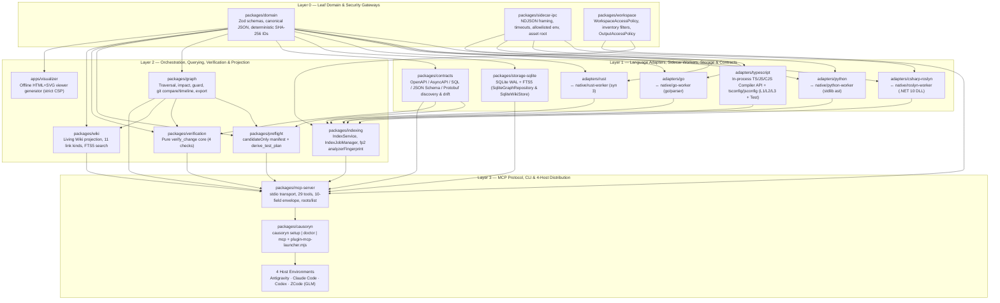

# Causoryn Architecture Overview (Code-Facing)

> **Language:** [Türkçe](../architecture.md) | **English**
>
> **Evidence base:** Technical Specification (TS) v2.1 §3, §5, §6, §8, §9, §10, §16A, §17, §25 · Internal mirror: `wiki/architecture.md`
>
> **Release scope:** Reflects the `v0.2.3` (**Pre-1.0 Public Preview**, `K-020`..`K-026`) open-source architecture (historical `v0.1.0` tag remains frozen at `4c9c188f`). The monorepo comprises **18 npm workspace packages** (`12 packages/*` + `5 adapters/*` + `1 integrations/zcode/causoryn`; **19 `package.json` manifests** including the monorepo root), standalone `apps/visualizer`, 4 `native/*` language sidecars, root 4-host plugin marketplace manifests, 5 GitHub Actions workflows (`.github/workflows/{ci,release,security,codeql,scorecard}.yml`), `.github/dependabot.yml`, and `integrations/antigravity/causoryn`. Every status column is governed by `ADR-010` honesty rules and cross-checked against [Implementation Status](implementation-status.md).

## End-to-End Pipeline

```
Workspace Gateway → File Inventory → Language/Framework Adapters → Normalization
  → Symbol/Contract Resolution → Unified Evidence Graph → Immutable Snapshot
  → Domain Queries → MCP structuredContent → Host-selected model
```

Static analysis runs locally inside Causoryn without LLM dependencies. A host model can act as an optional MCP client. [ADR-002](adr/ADR-002-no-llm.md)

### LLM-Free Engine, Universal Compatibility & Optional Host Annotations

Static analyzers and contract parsers build the graph. SQLite and FTS5 back queries. `SqliteGraphRepository` caches up to four snapshots and checks `PRAGMA data_version` for writes from other connections. Batched snapshot writes use O(1) position counters and transactions. Polyglot indexing merges shared pathless external or virtual nodes and rejects identity collisions for file-bound nodes.

The `v0.2.3` (`K-024`) universal compatibility layer adds full JavaScript/CommonJS analysis (`.js`/`.jsx`/`.mjs`/`.cjs`, `require`/`exports`/`module.exports`), a root-confined `tsconfig.json`/`jsconfig.json` path-alias loader (`configureConfinedCompilerHost`), automatic `.gitignore` + `.git/info/exclude` + nested `.gitignore` discovery, `.NET`-aware smart `bin/` refinement (preserving Node `bin/*.ts|js` and Rust `src/bin/*.rs`), and non-blocking `collectInventoryAsync`.

`packages/graph` produces offline architecture artifacts through adaptive module projection, Tarjan SCC, and Sugiyama-style SVG layout (`view="interactive"` defaults to `causoryn-architecture-interactive.html`, keeping zero-JS `causoryn-architecture.html` intact). The same renderer, snapshot including metadata, format, view, options, and annotation input produce byte-identical artifacts. New index builds can change timestamps and revision metadata. [ADR-002](adr/ADR-002-no-llm.md)

`causoryn_export_documentation` exposes rich JSON Schema `.describe()` guidance across all top-level and nested input fields (`K-026`), and the `architecture-blueprint` skill triggers from natural-language prompts to guide an external host LLM in drafting optional `annotations`. The server validates their schema, referenced IDs, and per-module file paths fail-closed; the prose remains caller-supplied input. [MCP Tool Contracts](tool-contracts.md) · [Prompting & Architecture Portals Guide](prompting-and-architecture-portals.md)

## Layered Dependency & Distribution Diagram



## Package & Directory Responsibility Map

| Package / Directory | Role | Spec Reference | Status |
|---|---|---|---|
| `packages/domain` | Graph & Evidence contracts, Zod schemas, canonical JSON, deterministic SHA-256 IDs | §8 | Done: 27 node + 20 edge kinds; `verified` edges require ≥1 evidence |
| `packages/sidecar-ipc` | Shared sidecar worker IPC core: line-delimited NDJSON framing, request timeouts, `responseMaxChars`/`stderrMaxChars` budgets, `stdin` EPIPE suppression, allowlisted child env builder, `resolveCausorynAssetRoot` | §7, K-020 | Done (zero external npm dependencies; shared across all 4 sidecar adapters) |
| `packages/workspace` | Workspace Gateway: trusted `allowRoots`, file inventory, polynomial zero-RegExp `ignore-matcher.ts`, symlink-escape rejection, binary/size filters, `OutputAccessPolicy` | §5, §9, §25/2 | Done (fail-closed policy; null-byte and symlink-escape hardened) |
| `packages/indexing` | IndexCoordinator: 5-language pipeline orchestration (TS/JS in-process + C#/Python/Go/Rust sidecar routing, 5 `INDEXED_ADAPTERS` entries), non-blocking `collectInventoryAsync`, `IndexJobManager`, `WorkspaceWatcher` (in-process), `fp2` fingerprint, `tsconfig`/`jsconfig` cache invalidation, `symbol_fts` population, multi-process SQLite race recovery | §9, §25/4-5, K-024 | Done; **B7 Partial remainder**: no per-file parse reuse and watcher is not exposed as an MCP tool (`refresh_index mode=full\|incremental` is active) |
| `packages/graph` | Snapshot queries, bounded traversal/cursor pagination, reverse-BFS impact, architecture guard (YAML policy DSL), read-only git compare/timeline, adaptive visual architecture projection + Sugiyama SVG layout + fail-closed Host-LLM `annotations` (JSON Schema `.describe()`) + multi-view export (`json`/`markdown`/`mermaid`/`html`/`snapshot`; `view: architecture\|interactive\|full`, default interactive file `causoryn-architecture-interactive.html`), onboarding/agent-context, evidence lookup | §8, §9, §12, §13, §15, §16, K-023, K-026 | Done (`view="architecture"` zero-JS layered SVG portal + `view="interactive"` offline portal + `format="snapshot"` guarded by `OutputAccessPolicy`) |
| `packages/storage-sqlite` | SQLite + FTS5 persistence (`SqliteGraphRepository` + `symbol_fts` + `PRAGMA data_version`-guarded warm snapshot cache + O(1) position counters), schema migrations (`user_version=2`), atomic snapshot publish + `SqliteWikiStore` (`wiki_*` tables, FTS/alias indexes, annotation CAS) | §9, §16A.7 | Done |
| `packages/contracts` | Read-only contract discovery: OpenAPI, AsyncAPI, SQL DDL, JSON Schema, Protobuf + parser safety quotas (1 MiB, depth, YAML alias cap) + static compatibility/drift classification | §11, §10.2 | Done (documented boundary: OpenAPI discovery models request schemas only — response-schema drift is not surfaced, K-015(5)) |
| `packages/preflight` | Candidate-only Preflight Manifest (`candidateOnly: true` — never edits source files) + `derive_test_plan` (`direct`/`call-site`/`naming` signals) | §10.2/§10.3, §15 | Done (TS `Test` nodes + `TESTS` edges power `direct` signal; sidecar `TESTS` edge extraction remains open) |
| `packages/verification` | Pure `verify_change` engine: 4 checks (`architecture`, `contracts`, `graph-diff`, `test-plan`), 8-rule verdict chain, test-status honesty (`not_run` vs `observed` + evidence), byte-deterministic output | §10.4 | Done (E3 `passed` status relies on caller-supplied test observation — K-016(3)) |
| `packages/wiki` | Living Wiki projection: 11-kind typed link resolution, FTS5 search, incremental invalidation, CAS annotation overlay, offline Markdown + HTML export | §16A | Done (link-level invalidation is bounded — `mcp-server` incremental publish rebuilds link/FTS indexes from the full graph) |
| `packages/mcp-server` | `stdio` transport, Zod input/output validation (including `.describe()` guidance), workspace authorization, non-blocking startup (`deferAutoIndex` + `.gitignore`/`.git/info/exclude`/nested `.gitignore` + smart `bin/`), zero-config `--allow-cwd` + MCP `roots/list` + `--auto-data-dir`, persistent `storage.dataDbPath` / default `InMemoryGraphRepository`, 29 tools + MCP `annotations` (`readOnlyHint`) + `outputSchemaProfile`, 10-field envelope + fixed error catalog, F1 bundle entry | §5, §10, K-024, K-026 | Done (`tools/list` publishes EXACTLY 29 tools; `@modelcontextprotocol/sdk` `^1.32.2` v1.x line — K-009 deviation; 35-file `bundle-manifest.json`) |
| `packages/causoryn` | Publishable open-source multi-host CLI & plugin distribution package (`causoryn` `v0.2.3` Pre-1.0 Public Preview, `MIT`, zero external npm `dependencies`): `causoryn mcp\|setup\|doctor`, `plugin-mcp-launcher.mjs`, staged `dist/mcp-server.mjs` + `mcp-server.mjs.LEGAL.txt` + `better-sqlite3` (`better-sqlite3/LICENSE`) + `dist/typescript-lib/lib*.d.ts` + 4 `native/` workers + 5 `skills/` (including `architecture-blueprint`) + 4 host plugin manifests + `THIRD-PARTY-NOTICES.md` | §17, K-021..K-026 | Done (verified end-to-end from packed `.tgz` tarball across 4-host `setup`/`doctor` and zero-config `stdio` handshakes) |
| `adapters/typescript` | In-process TypeScript Compiler API AST + `TypeChecker` symbol resolution + JS/CJS (`require`/`exports`/`module.exports`) + confined `tsconfig.json`/`jsconfig.json` loader + Express/Next.js App Router framework linkers (TS/JS/CJS) + BDD `Test` node & `TESTS` edge extraction (L1/L2/L3) | §6, §7, §15, §25/4, K-024 | Done (cross-file Express receiver label boundary documented) |
| `adapters/csharp-roslyn` | C# Roslyn sidecar TS adapter: `dotnet exec` spawn, NDJSON v1 request/response, 30 s timeout, graceful L0/L1 fallback | §7 | Done (missing runtime degrades honestly to L0/L1; L3 `aspnet-core-route-attributes (L3)`) |
| `adapters/python` | Python stdlib `ast` sidecar TS adapter: `python -B` spawn, NDJSON v1 protocol, 30 s timeout, L0/L1 fallback | §7, §23 | Done (`decorator-route-pattern (L3)`; intra-module `verified`, imported symbols `heuristic`) |
| `adapters/go` | Go `go/parser`+`go/ast` sidecar TS adapter: `go run` / `goWorkerBinaryPath`, 120 s timeout, Windows process-tree termination, L0/L1 fallback | §7, §23 | Done (`heuristic-only (semantik L2 yok)`, `symbolResolution:false`; L3 HTTP/router registrations) |
| `adapters/rust` | Rust `syn 3` sidecar TS adapter: literal `cargo` build (`--locked` + `~/.causoryn/cache/rust-worker-target`) + worker spawn, framing/timeout, L0/L1 fallback | §7, §23 | Done (`heuristic-heavy`; L3 attribute-macro route extraction) |
| `apps/visualizer` | Offline HTML+SVG graph viewer generator: zero external dependencies, inline CSS/JS, strict CSP, resolution color coding, selection-to-evidence panel | §16 | Done (verified via DOM-level Vitest + static inspection; interactive HTML MCP export is exposed via `packages/graph` `view="interactive"` as `causoryn-architecture-interactive.html`, while real headless browser run remains open) |
| `native/roslyn-worker` | C# Roslyn sidecar (`Causoryn.RoslynWorker.csproj`, NDJSON v1 protocol; deterministic Release DLL build with zero `.pdb` or `.resources.dll` leakage) | §7, §23/B1 | Done (`.NET 10` runtime; built and verified across 3-OS CI matrix) |
| `native/python-worker` | Pure Python stdlib `ast` sidecar (`worker.py`, zero external packages, NDJSON v1 + `PROTOCOL.md`) | §7, §23 | Done |
| `native/go-worker` | Pure Go stdlib `go/parser`+`go/ast` sidecar (`cmd/worker`, NDJSON v1 + `PROTOCOL.md`) | §7, §23 | Done |
| `native/rust-worker` | Rust `syn 3` + `serde_json` Cargo sidecar (`causoryn-rust-worker`, NDJSON v1 + `PROTOCOL.md`) | §7, §23 | Done |
| `integrations/zcode/causoryn` | ZCode developer plugin package: `.zcode-plugin/plugin.json` (`mcpServers` + `userConfig`) + skills + dev marketplace (`.claude-plugin/marketplace.json`) | §17, §25/8, K-002 | Done (manifest validation; live ZCode GUI install not executed — red rule 6) |
| `integrations/antigravity/causoryn` | Antigravity plugin directory: schema-less `plugin.json` + `mcp_config.json` (primary local loader config) + `mcp.json` (portable §17.1 manifest) + `README.md` + `build:bundle`-staged `scripts/mcp-server.mjs` (+ vendored `better-sqlite3`) | §17.1, §22 | Partial — direct `stdio` handshake (29 tools) verified; `agy` CLI install/smoke NOT RUN; `skills/`/`agents/`/`rules/`/`hooks.json` tracked separately |
| `scripts/` | Root release, supply-chain, and security tooling: `scripts/secret-scan.mjs` (13 directory roots + 13 root text files credential & personal-path scanner), `scripts/generate-sbom.mjs` (CycloneDX 1.5 SBOM + `SHA256SUMS.txt`), `scripts/export-public-tree.mjs` (Option 1 clean open-source tree exporter) | §19, K-022 | Done |
| `examples/fixture-*` (8 directories) | 8 deterministic multi-language and contract-drift fixtures (`ts-orders`, `ts-express`, `ts-nextjs`, `csharp-orders`, `contract-drift`, `python-app`, `go-app`, `rust-app`) | §22, §25/4 | Done |
| `tests/` | End-to-end integration, smoke, security (`F6`), benchmark (`F7`), `secret-scan`, public-export, SBOM/release workflow, open-source distribution, and bilingual release-doc parity suites | §22 | Done (`tests/bench-release` is isolated from the default test run; see [Implementation Status](implementation-status.md)) |

Total monorepo inventory: **18 npm workspace packages** (`12 packages/*` + `5 adapters/*` +
`1 integrations/zcode/causoryn`, plus the monorepo root = **19 `package.json` manifests**),
standalone `apps/visualizer`, 4 `native/*` sidecars, root 4-host open-source marketplace manifests
(`marketplace.json`, `.claude-plugin/marketplace.json`, `.agents/plugins/marketplace.json`,
`plugin.json` + `mcp_config.json`, `mcp.json`, `server.json`, `skills/`),
5 GitHub Actions CI/CD and supply-chain security workflows (`.github/workflows/ci.yml`,
`.github/workflows/release.yml`, `.github/workflows/security.yml`, `.github/workflows/codeql.yml`,
`.github/workflows/scorecard.yml`), `.github/dependabot.yml`,
and `integrations/antigravity/causoryn`.

## Architectural Dependency Boundaries (Immutable — TS §5.1)

1. `packages/domain` never imports any MCP, language adapter, or host package (depends solely on internal modules and `zod`).
2. Language adapters conform to strict input/output snapshot interfaces; if any adapter or sidecar crashes or times out, the core engine stays alive and degrades that language honestly to L0/L1 file provenance (`partial` + explicit `warnings`).
3. `packages/mcp-server` consumes only application-level service interfaces; compiler/AST internals never leak into MCP tool handlers.
4. Visualization (`apps/visualizer`) renders published graph JSON verbatim without inventing synthetic edges or evidence.
5. Plugin skills (`skills/*/SKILL.md`) guide the host-selected LLM workflow without selecting, routing, or calling models.

## Unified Evidence & Knowledge Graph Contract (TS §8)

- **Node kinds (27):** `Workspace`, `Repository`, `Project`, `Module`, `File`, `Class`, `Interface`,
  `Type`, `Function`, `Method`, `Endpoint`, `Handler`, `Event`, `Database`, `ApiContract`, `Test`, `Config`,
  `UnknownExternal`, and domain-specific structural nodes (`packages/domain/src/graph-schema.ts`).
- **Edge kinds (20):** `CONTAINS`, `IMPORTS`, `DECLARES`, `CALLS`, `REFERENCES`, `IMPLEMENTS`,
  `INHERITS`, `INJECTS`, `ROUTES_TO`, `READS`, `WRITES`, `PUBLISHES`, `SUBSCRIBES`, `HANDLES`,
  `PRODUCES_CONTRACT`, `CONSUMES_CONTRACT`, `VALIDATES`, `TESTS`, `DEPENDS_ON`, `CONFIGURES`.
- **Resolution levels:** `verified | heuristic | unresolved`. `verified` denotes static compiler/AST binding certainty — never a runtime execution guarantee (see [5-Language Analyzers & Sidecar Protocol](language-analyzers.md)).
- **Evidence records:** Carry `relativePath`, `startLine`/`endLine`, `sourceHash`, `analyzerId`, `analyzerVersion`, and `rationale` (`ADR-004` Evidence First: every `verified` edge carries ≥1 evidence item).
- **Core invariants:** `verified` edge ≥1 evidence · zero dangling edges (unresolved external targets materialize as explicit `UnknownExternal` nodes) · deterministic canonical-JSON SHA-256 IDs (wall-clock time never enters node/edge/evidence/snapshot IDs) · deep-frozen immutable snapshots (`ADR-005`) · identical inputs produce byte-identical Graph JSON and deterministic base64url cursors (`{v:1,o:<int>}`).

## Storage & Read-Only Workspace Isolation (TS §9, ADR-008)

SQLite + FTS5 (`WAL`, `foreign_keys=ON`, `synchronous=NORMAL`, `busy_timeout=5000`, schema `user_version=2`).
Core tables: `workspaces`, `files`, `file_versions`, `snapshots`, `nodes`, `edges`, `evidence`,
`contracts`, `contract_versions`, `findings`, `tests`, `index_jobs`, `schema_migrations`, `symbol_fts`,
and the Living Wiki `wiki_*` (`wiki_fts`) family. Composite indexes accelerate `(snapshot_id, kind)`,
`(snapshot_id, from_id)`, `(snapshot_id, to_id)`, and `(snapshot_id, relative_path)` lookups.

- **Atomic snapshot publishing:** New builds start in `building` state (invisible to all readers) and transition atomically in a single SQLite transaction to `ready` or `partial` after integrity verification. Default queries serve the latest published snapshot and flag `stale=true` when a newer snapshot or active build exists.
- **Write boundaries:** Bare `stdio` defaults to `InMemoryGraphRepository`. Persistent graph and wiki database paths are validated outside authorized roots. Automatic configuration also places the export directory outside the workspace. An explicitly configured `output.allowedOutputDirs` is governed by a separate allowlist. [CLI & Configuration](cli-and-configuration.md)
- **SQL injection immunity:** All external inputs are bound via prepared statement parameters (`?`); SQL strings are never assembled by concatenation.

## Packaging, CI/CD & Supply-Chain Security Architecture

- **Multi-file deterministic bundle (`ADR-010`):** `packages/mcp-server/scripts/build-bundle.mjs` never claims single-file JS bundling because `better-sqlite3` loads native `.node` addons. Its **35-file** `bundle-manifest.json` locks SHA-256 digests for `mcp-server.mjs`, linked license notices in `mcp-server.mjs.LEGAL.txt`, `node_modules/better-sqlite3/LICENSE` (`better-sqlite3/LICENSE`), the `better-sqlite3` JS wrapper (`lib/**`, `package.json`), and N-API v10 `prebuilds/*.node` binaries across 8 OS/arch targets, staging identical copies into `integrations/antigravity/causoryn/scripts/`.
- **Unified npm distribution (`packages/causoryn`):** `build-package.mjs` bundles the zero-config CLI entrypoint (`src/cli-stdio.ts` → `dist/mcp-server.mjs`), TypeScript default library declarations (`dist/typescript-lib/lib*.d.ts`), portable Release Roslyn assemblies (`native/roslyn-worker/`), Python/Go/Rust sidecar sources, 5 canonical `skills/` (including `architecture-blueprint`), 4 host plugin manifests, and `THIRD-PARTY-NOTICES.md` + `licenses/`. `verify-package-ready.mjs` enforces SHA-256 parity, pure LF entry scripts, and clean Roslyn DLL binaries (zero user-profile paths, `.pdb`, or `.resources.dll` files) during `prepack`.
- **5 GitHub Actions Workflows & Supply-Chain Hardening (`K-025`):** All GitHub Actions are pinned to 40-character commit SHAs and all Linux jobs run with `step-security/harden-runner` (`egress-policy: audit`):
  - **`.github/workflows/ci.yml`:** 3-OS matrix (`ubuntu-latest`, `windows-latest`, pinned `macos-15`) provisioning all 5 language toolchains and enforcing `npm ci --ignore-scripts`, `npm audit --audit-level=high`, locked deterministic Roslyn build (`-p:RestoreLockedMode=true`), locked Rust build (`--locked`), typecheck, build, bundle, package verification, lint, `npm run secret-scan`, `node scripts/export-public-tree.mjs --verify-temp --ref HEAD`, and `npm test`.
  - **`.github/workflows/release.yml`:** 2-job SLSA supply-chain separation: isolated `build-and-verify` (`contents: read`, `package-manager-cache: false`, fail-closed tag and `main`-ancestry check, locked builds, `npm pack`, isolated tarball CLI/`doctor`/MCP `initialize` smoke test, CycloneDX 1.5 SBOM `causoryn-sbom.cdx.json` + `SHA256SUMS.txt` via `scripts/generate-sbom.mjs`) → `attest-and-publish` (`environment: release`, `id-token: write`, `attestations: write`, `contents: write`, `sha256sum -c SHA256SUMS.txt`, `actions/attest-build-provenance`, tokenless npm OIDC Trusted Publishing via `npm publish --provenance --access public`, and GitHub Release upload).
  - **`.github/workflows/security.yml`:** `zizmor` workflow security audit (`strict-collection: true`, `min-severity: medium`), PR `dependency-review` (`fail-on-severity: high`, GPL/AGPL/LGPL copyleft denylist, OpenSSF Scorecard summary), and multi-ecosystem vulnerability audit (`npm audit --audit-level=high` + fail-closed NuGet JSON audit across all severities with `dotnet restore --locked-mode`; Rust `Cargo.lock` is locked via `--locked` in `ci.yml`/`release.yml` and inspected on PRs by `dependency-review`).
  - **`.github/workflows/codeql.yml`:** 5-language CodeQL SAST (`javascript-typescript`, `python`, `csharp`, `actions` with `build-mode: none`, and `go` with `build-mode: manual` compiling `native/go-worker`) running `security-extended` queries.
  - **`.github/workflows/scorecard.yml`:** OpenSSF Scorecard (`ossf/scorecard-action`) analysis uploading SARIF results to GitHub Code Scanning.
  - **`.github/dependabot.yml`:** Weekly grouped updates with a **7-day cooldown** (`default-days: 7`, plus `semver-major-days: 14` on package ecosystems) across all external-dependency ecosystems (`npm` via unified root `directory: "/"` workspace resolution with `typescript` major-bump guard, `cargo` for `/native/rust-worker`, `nuget` for `/native/roslyn-worker`, and `github-actions`; pure-stdlib Python and Go workers carry zero external dependencies).
- **Clean Public Source Export:** `scripts/export-public-tree.mjs` exports a clean public tree from `git archive` while excluding internal working notes and running fail-closed secret/path leak verification (`--verify-temp`).

## Technology Stack (TS §6, Locked Repository Versions)

| Domain | Design Choice | Locked in Repository |
|---|---|---|
| Core runtime | TypeScript strict, Node.js LTS | TypeScript `5.9.3` (strict), Node.js `>= 24` |
| MCP protocol | Official `@modelcontextprotocol/sdk` | `^1.32.2` (`packages/mcp-server`) — **v1.x line; SDK v2 upgrade deferred due to offline `npm install` constraint (`K-009`)** |
| Bundling | Multi-file deterministic ESM bundle | `esbuild` `^0.28.2` (`better-sqlite3` external — 35-file `bundle-manifest.json`, `ADR-010`) |
| Validation | Zod + JSON Schema | `zod` `^4` (`packages/domain`, `workspace`, `contracts`, `wiki`, `mcp-server`) |
| TypeScript analysis | In-process TypeScript Compiler API | `adapters/typescript` + bundled `dist/typescript-lib/lib*.d.ts` |
| Multi-language sidecars | C# Roslyn, Python `ast`, Go `go/parser`, Rust `syn 3` | `native/{roslyn,python,go,rust}-worker` + `adapters/*` + `packages/sidecar-ipc` |
| Graph & Wiki store | SQLite + FTS5, WAL | `better-sqlite3` `^13.2.0` + `@types/better-sqlite3` (`packages/storage-sqlite`) |
| Git integration | Read-only CLI; `checkout`/`reset`/`clean` forbidden | `packages/graph/src/git-read.ts` (`execFile` allowlist: `cat-file`, `ls-tree`, `shell: false`) |
| Testing | Vitest + golden fixtures + MCP stdio integration | `vitest` `5.1.0` |
| Linting | `typescript-eslint` recommended | `eslint` `^10.15.0` + `typescript-eslint` `^8.73.0` |

Version lock note: TypeScript `5.9.3` is intentionally pinned because `typescript-eslint` requires `typescript >=4.8.4 <6.1.0`.

## Build, Typecheck, Test & Security Gate Contract

- `npm run test` → Runs Vitest across `packages/*/test`, `adapters/*/test`, `integrations/**`, and `tests/**` (**excluding `tests/bench-release/**`**, which measures wall-clock latency rather than functional correctness).
- `npm run bench` → Runs `tests/bench-release/` exclusively (`vitest.bench.config.ts`); pass `CAUSORYN_BENCH_WRITE_DOCS=1 npm run bench` to refresh `docs/benchmarks.md`.
- `npm run build` → Runs `tsc -b` over the root solution `tsconfig.json` (**14** direct project references: 9 core packages `domain`, `sidecar-ipc`, `workspace`, `indexing`, `graph`, `storage-sqlite`, `mcp-server`, `causoryn`, `wiki` + 5 language adapters `typescript`, `csharp-roslyn`, `rust`, `python`, `go`; `contracts`, `preflight`, and `verification` compile transitively).
- `npm run build:bundle --workspace packages/mcp-server` → Produces `dist/mcp-server.mjs`, `dist/mcp-server.mjs.LEGAL.txt`, vendored `better-sqlite3` (`better-sqlite3/LICENSE`), the 35-file `dist/bundle-manifest.json`, and stages Antigravity's `scripts/mcp-server.mjs`.
- `npm run build:package` (`npm run build:package --workspace packages/causoryn`) → Stages the complete `causoryn` npm distribution package; `node packages/causoryn/scripts/verify-package-ready.mjs` verifies release readiness.
- `npm run typecheck` → `tsc -p tsconfig.typecheck.json` (`noEmit` across source, tests, and configs).
- `npm run lint` → ESLint flat config (`typescript-eslint` recommended).
- `npm run secret-scan` → `node scripts/secret-scan.mjs` (scans **13** directory roots + **13** root text files for credentials, API tokens, personal emails, and non-generic local user-profile paths; exits `1` on any match or missing root).
- Module resolution: `NodeNext` — all relative TypeScript imports use explicit `.js` specifiers.

## Related Documentation

- [Documentation Hub](README.md) · [Bilingual Project Overview (TR · EN)](../project-overview.tr-en.md)
- [Prompting & Architecture Portals Guide](prompting-and-architecture-portals.md)
- [CLI & Configuration Reference](cli-and-configuration.md)
- [5-Language Analyzers & Sidecar Protocol](language-analyzers.md)
- [MCP Tool Contracts (29 Tools)](tool-contracts.md) · [Living Wiki Specification](wiki-spec.md)
- [Host Compatibility Matrix](compatibility-matrix.md) · [Security Audit](security-pass.md) · [Benchmarks](benchmarks.md)
- [Implementation Status](implementation-status.md) · [ADR-002: No-LLM Strict Boundary](adr/ADR-002-no-llm.md)
