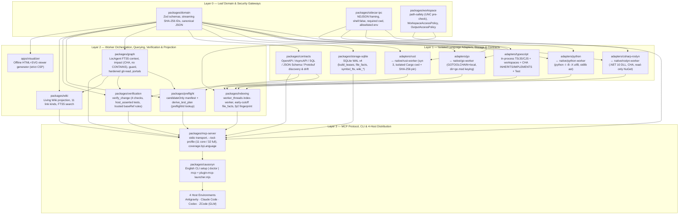

# Causoryn Architecture Overview (Code-Facing)

> **Language:** [Türkçe](../architecture.md) | **English** · [Documentation Hub](README.md)
>
> **Release scope:** Reflects the `v0.2.4` (**Pre-1.0**) monorepo and open-source distribution architecture (historical `v0.1.0` tag remains frozen at `4c9c188f`). The monorepo comprises **18 npm workspace packages** (`12 packages/*` + `5 adapters/*` + `1 integrations/zcode/causoryn`; **19 `package.json` manifests** including the monorepo root), standalone `apps/visualizer`, 4 `native/*` language sidecars, root 4-host plugin marketplace manifests, 5 GitHub Actions workflows (`.github/workflows/{ci,release,security,codeql,scorecard}.yml`), `.github/dependabot.yml`, and `integrations/antigravity/causoryn`.

## End-to-End Pipeline

```text
Workspace Gateway (UNC pre-check + allowRoots)
  -> Non-Blocking File Inventory (collectInventoryAsync)
  -> Background worker_threads WAL Pipeline (file_facts early cutoff + isolated adapters)
  -> Normalization & Symbol / CHA / Contract Resolution
  -> Unified Evidence Graph -> Streaming SHA-256 Immutable Snapshot (shared graph.sqlite)
  -> Domain Queries & Verification -> MCP structuredContent (11-tool core profile)
```

Static analysis runs locally inside Causoryn without LLM dependencies. A host coding agent acts strictly as an external MCP client ([No-LLM Architecture Policy](adr/ADR-002-no-llm.md)).

### Non-Blocking Runtime, Early-Cutoff Incremental Indexing & Shared WAL Storage

- **Single shared workspace DB (`graph.sqlite`):** All MCP hosts opening the same repository share `~/.causoryn/workspaces/<slug>-<hash12>/graph.sqlite` (SQLite WAL, `PRAGMA page_size = 4096`, `PRAGMA busy_timeout = 5000`, schema `user_version = 4`). Single-writer coordination uses the `build_leases` heartbeat table (`lease_id`, `owner_pid`, `host_label`, `heartbeat_at`, `expires_at`) with automatic dead-PID / expired orphan `building` recovery (`recoverOrphanBuilds`) and explicit `waiting_for_peer` reporting.
- **`worker_threads` background indexing & MCP progress:** `packages/indexing/src/index-worker.ts` (bundled as `dist/index-worker.mjs`) runs full and incremental analysis off the MCP event loop and streams `notifications/progress` when clients pass `_meta.progressToken`. Warm startup reads lightweight `getLatestSnapshotMeta` metadata (`MAX_PUBLISHED_CACHE_ENTRIES = 1`, `PRAGMA data_version`-guarded cache) without blocking MCP requests.
- **Per-file incremental indexing (`file_facts`) with early cutoff:** SQLite schema v4 stores per-file facts (`content_hash`, `analyzer_fingerprint`, `public_interface_hash`, serialized nodes/edges/evidence, `imported_paths_json`) in `file_facts`. When a file edit preserves its `public_interface_hash` (comments, formatting, or body-only changes), reverse dependents are skipped (early cutoff) and TypeScript reuses the previous `ts.Program` (`oldProgram`), while producing the exact same streaming SHA-256 snapshot ID (`computeStreamingSnapshotId`) as a clean full build.
- **Retention GC:** Publishing a new snapshot triggers `pruneOldSnapshots` (keeping the latest 2 published snapshots, cleaning orphan `symbol_fts` entries, and checkpointing WAL).
- **Universal JS/TS, CHA & NuGet fidelity:** `adapters/typescript` analyzes `.ts/.tsx/.mts/.cts/.js/.jsx/.mjs/.cjs` (ESM + CommonJS), resolves in-root monorepo workspace packages (`package.json` `name`/`exports`/`types`/`main`/`workspaces`) and confined `tsconfig.json`/`jsconfig.json` aliases, and emits `TypeChecker`-verified `INHERITS`/`IMPLEMENTS` edges. `adapters/csharp-roslyn` + `native/roslyn-worker` emit Roslyn `INHERITS`/`IMPLEMENTS` edges and perform bounded, symlink/UNC-guarded read-only NuGet discovery from `obj/project.assets.json`.
- **Visual architecture portals:** `packages/graph` produces deterministic offline artifacts via adaptive module projection, Tarjan SCC, and Sugiyama-style SVG layout. `view="architecture"` is zero-JS (`default-src 'none'`); `view="interactive"` (`causoryn-architecture-interactive.html`) enforces a deterministic `script-src 'sha256-...'` CSP with zero `'unsafe-inline'` script permission and collects up to 25 annotation validation errors in a single pass.

## Layered Dependency & Distribution Diagram



## Package & Directory Responsibility Map

| Package / Directory | Role | Status |
|---|---|---|
| `packages/domain` | Graph & Evidence contracts, Zod schemas, canonical JSON, deterministic streaming SHA-256 IDs (`computeStreamingSnapshotId`), 27 node + 20 edge kinds | Done |
| `packages/sidecar-ipc` | Shared zero-dep sidecar worker IPC core: line-delimited NDJSON framing, timeouts, `responseMaxChars`/`stderrMaxChars` budgets, `stdin` EPIPE suppression, `shell: false`, `windowsHide: true`, required non-empty `cwd`, allowlisted child env | Done |
| `packages/workspace` | Workspace Gateway: lexical `assertNotUncOrDevicePath` (`path-safety.ts`), trusted `allowRoots`, zero-RegExp polynomial `ignore-matcher.ts`, symlink-escape rejection, binary/size filters, `OutputAccessPolicy` | Done |
| `packages/indexing` | 5-language pipeline orchestration, `worker_threads` `index-worker.ts`, non-blocking `collectInventoryAsync`, `file_facts` early-cutoff incremental planner, `build_leases` / orphan recovery, `IndexJobManager`, in-process `WorkspaceWatcher`, `fp2` fingerprint | Done *(in-process FS watcher is not yet exposed as an MCP tool)* |
| `packages/graph` | Snapshot queries, cursor pagination, reverse-BFS impact (no `CONTAINS`, includes `INHERITS`/`IMPLEMENTS`, deduplicated `evidenceMap`), Architecture Guard (linear NFA glob + Tarjan SCC), hardened read-only `git-read.ts` (`HEAD~N`/`HEAD^`), LocAgent identifier/path FTS5 BM25 localization (`agent-context.ts`), offline portals (`script-src 'sha256-...'` interactive CSP, multi-error annotation validation) | Done |
| `packages/storage-sqlite` | SQLite WAL + FTS5 persistence (schema `user_version = 4`: `build_leases`, `file_facts`, tokenized `symbol_fts`, `PRAGMA page_size = 4096`, `getLatestSnapshotMeta`, `MAX_PUBLISHED_CACHE_ENTRIES = 1`, `pruneOldSnapshots`, `SqliteWikiStore`) | Done |
| `packages/contracts` | Read-only contract discovery (OpenAPI, AsyncAPI, SQL DDL, JSON Schema, Protobuf) with parser safety quotas (1 MiB, depth, YAML alias cap) + static compatibility/drift classification | Done *(OpenAPI response-schema drift & event-version rules remain open for 1.0)* |
| `packages/preflight` | Candidate-only Preflight Manifest (`candidateOnly: true`) + `derive_test_plan` (`direct`/`call-site`/`naming` signals, resolving `preflightId`) | Done *(TS/JS `TESTS` edges active; sidecar `TESTS` edges remain open for 1.0)* |
| `packages/verification` | Pure `verify_change` engine: 4 checks (`architecture`, `graph-diff`, `test-plan`, optional `contracts`), 8-rule deterministic verdict chain, trusted Git `baseRef` rule loading, strict `state: "host_asserted"` (`engineVerified: false`) test honesty | Done |
| `packages/wiki` | Living Wiki projection: 12-category taxonomy, 11-kind typed link resolution, FTS5 search, incremental invalidation, CAS annotation overlay, offline Markdown + HTML export | Done *(extra `wiki_search` filters & narrowed incremental SQLite link/FTS writes remain open for 1.0)* |
| `packages/mcp-server` | `stdio` transport, selectable `--tool-profile core\|wiki\|history\|full` (11 core / 32 full, `<= 15K` chars default wire budget), `notifications/progress`, per-language `coverage.byLanguage`, zero-config `--allow-cwd` + MCP `roots/list` + shared `--auto-data-dir` `graph.sqlite`, 10-field envelope + 15 active error codes | Done (`@modelcontextprotocol/sdk` `^1.32.2` v1.x; v2 upgrade tracked for 1.0) |
| `packages/causoryn` | Publishable multi-host CLI & plugin package (`causoryn` `v0.2.4`, `MIT`, zero external npm `dependencies`): English `causoryn mcp\|setup\|doctor`, `plugin-mcp-launcher.mjs`, staged `dist/mcp-server.mjs` + `dist/index-worker.mjs` + `better-sqlite3` + `dist/typescript-lib/` + 4 `native/` workers + 5 `skills/` + 4 host manifests + `THIRD-PARTY-NOTICES.md` | Done |
| `adapters/typescript` | In-process TS Compiler API + `TypeChecker` + JS/CJS + in-root monorepo workspace resolution + CHA `INHERITS`/`IMPLEMENTS` + `oldProgram` reuse + confined `tsconfig.json`/`jsconfig.json` + Express/Next.js L3 + BDD `Test`/`TESTS` | Done |
| `adapters/csharp-roslyn` & `native/roslyn-worker` | Isolated `dotnet exec` (`DOTNET_STARTUP_HOOKS=""`, worker `cwd`) deterministic Release Roslyn sidecar: `SemanticModel`, CHA `INHERITS`/`IMPLEMENTS`, read-only `obj/project.assets.json` NuGet discovery, ASP.NET Core L3 routes | Done |
| `adapters/python` & `native/python-worker` | Isolated `python -I -B -X utf8` stdlib `ast` sidecar (zero pip packages, decorator L3 routes) | Done |
| `adapters/go` & `native/go-worker` | Isolated Go stdlib `go/parser`+`go/ast` sidecar (`GOTOOLCHAIN=local`, `GOWORK=off`, `GOPROXY=off`, directory + `go.mod` package keying, HTTP/router L3 routes) | Done |
| `adapters/rust` & `native/rust-worker` | Isolated Rust `syn` 3 sidecar (trusted Cargo `cwd`, `CARGO_BUILD_RUSTC_WRAPPER=""`, `causoryn-rust-worker.sha256.json` binary pinning, honest `heuristic` 2-segment suffix matching, attribute-macro L3 routes) | Done |
| `apps/visualizer` | Zero-dependency offline HTML+SVG graph viewer generator with strict CSP | Done *(real browser acceptance remains open for 1.0)* |
| `integrations/zcode/causoryn` & `integrations/antigravity/causoryn` | Monorepo host plugin fixtures (`plugin.json`, `mcp_config.json`, `mcp.json`, dev marketplace, staged `scripts/mcp-server.mjs`) | Manifest & `stdio` verified; live desktop GUI / `agy` CLI smoke remain open |
| `scripts/` | `scripts/secret-scan.mjs` (13 directory roots + 13 root text files), `scripts/generate-sbom.mjs` (CycloneDX 1.5 SBOM + `SHA256SUMS.txt`), `scripts/export-public-tree.mjs` (clean public tree exporter) | Done |
| `examples/fixture-*` (8 directories) | Deterministic multi-language & contract-drift fixtures (`ts-orders`, `ts-express`, `ts-nextjs`, `csharp-orders`, `contract-drift`, `python-app`, `go-app`, `rust-app`) | Done |

## Immutable Dependency Boundaries

1. `packages/domain` never imports any MCP, language adapter, or host package (depends solely on internal modules and `zod`).
2. Language adapters conform to strict input/output snapshot contracts; if any adapter or sidecar crashes or times out, the core engine degrades that language honestly to L0/L1 file provenance (`partial` + explicit `warnings` + per-language `coverage.byLanguage`).
3. `packages/mcp-server` consumes only application-level service interfaces; compiler/AST internals never leak into MCP handlers.
4. Visualization renders published graph JSON verbatim without fabricating edges or evidence.
5. Plugin skills (`skills/*/SKILL.md`) guide the host-selected LLM workflow without selecting, routing, or invoking models.

## Packaging, CI/CD & Supply-Chain Security Architecture

- **Multi-file deterministic bundle:** `packages/mcp-server/scripts/build-bundle.mjs` never claims single-file JS bundling because `better-sqlite3` loads native `.node` addons. Its **36-file** `bundle-manifest.json` locks SHA-256 digests for `mcp-server.mjs`, `index-worker.mjs`, `mcp-server.mjs.LEGAL.txt`, `node_modules/better-sqlite3/LICENSE`, the `better-sqlite3` wrapper (`lib/**`, `package.json`), and N-API v10 `prebuilds/*.node` binaries across 8 OS/arch targets.
- **5 SHA-pinned GitHub Actions Workflows:** Every action is pinned to a 40-character commit SHA and all Linux jobs run with `step-security/harden-runner` (`egress-policy: audit`):
  - **`.github/workflows/ci.yml`:** 3-OS matrix (`ubuntu-latest`, `windows-latest`, `macos-15`) enforcing `npm ci --ignore-scripts`, `npm audit --audit-level=high`, locked Roslyn (`-p:RestoreLockedMode=true`) and Rust (`--locked`) builds, typecheck, build, bundle, package verification, lint, `npm run secret-scan`, `export-public-tree.mjs --verify-temp --ref HEAD`, and `npm test`.
  - **`.github/workflows/release.yml`:** Hermetic **3-job** release pipeline:
    1. `verify-and-test` (`contents: read`): tag/version/`origin/main` ancestry checks, `npm ci --ignore-scripts`, lint, typecheck, `secret-scan`, `npm test`, and `export-public-tree.mjs --verify-temp`.
    2. `build-and-pack` (`needs: verify-and-test`, zero test execution): clean checkout, locked builds, `build:bundle`, `build:package`, `verify-package-ready.mjs` immediately before `npm pack`, isolated tarball smoke, CycloneDX 1.5 SBOM, and `SHA256SUMS.txt`.
    3. `publish` (`needs: build-and-pack`, `environment: release`): `sha256sum -c SHA256SUMS.txt`, `actions/attest-build-provenance`, tokenless npm OIDC Trusted Publishing (`npm publish --provenance --access public`), and GitHub Release upload.
  - **`.github/workflows/security.yml`:** Fail-closed `zizmor`, PR `dependency-review`, `npm audit --audit-level=high`, and fail-closed `--locked-mode` NuGet JSON vulnerability audit.
  - **`.github/workflows/codeql.yml`:** 5-language CodeQL v4 SAST (`javascript-typescript`, `python`, `csharp`, `go`, `actions`).
  - **`.github/workflows/scorecard.yml`:** OpenSSF Scorecard SARIF upload.
  - **`.github/dependabot.yml`:** Weekly grouped updates with a 7-day supply-chain cooldown across npm, Cargo, NuGet, and GitHub Actions.

## Build, Typecheck, Test & Security Gate Contract

- `npm run test` -> Vitest across `packages/*/test`, `adapters/*/test`, `integrations/**`, and `tests/**` (**excluding `tests/bench-release/**`**).
- `npm run bench` -> Runs `tests/bench-release/` exclusively (`vitest.bench.config.ts`).
- `npm run build` -> `tsc -b` over root `tsconfig.json` (**14** direct project references; `contracts`, `preflight`, and `verification` compile transitively).
- `npm run build:bundle --workspace packages/mcp-server` -> Produces `dist/mcp-server.mjs`, `dist/index-worker.mjs`, `dist/mcp-server.mjs.LEGAL.txt`, vendored `better-sqlite3`, and `dist/bundle-manifest.json`.
- `npm run build:package --workspace packages/causoryn` + `node packages/causoryn/scripts/verify-package-ready.mjs` -> Stages and verifies the publishable npm package.
- `npm run typecheck`, `npm run lint`, `npm run secret-scan` -> Strict TypeScript typecheck, ESLint, and 13-root secret/profile-path scan.

## Related Documentation

- [5-Minute Quickstart Tutorial](tutorial-5-minutes.md) · [Documentation Hub](README.md)
- [Prompting & Architecture Portals Guide](prompting-and-architecture-portals.md)
- [CLI & Configuration Reference](cli-and-configuration.md) · [5-Language Analyzers](language-analyzers.md)
- [MCP Tool Contracts](tool-contracts.md) · [Living Wiki Specification](wiki-spec.md)
- [Host Compatibility Matrix](compatibility-matrix.md) · [Security Audit](security-pass.md) · [Benchmarks](benchmarks.md)
- [Implementation Status](implementation-status.md) · [No-LLM Architecture Policy](adr/ADR-002-no-llm.md)
