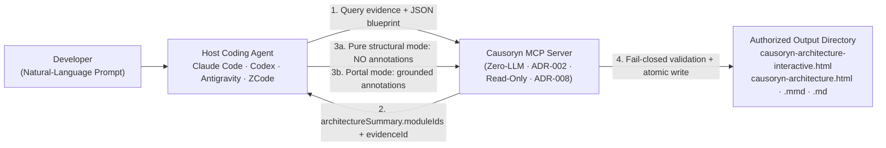

# Prompting & Architecture Portals Guide

> **Dil / Language:** [Türkçe](../prompting-and-architecture-portals.md) | **English** · [Documentation Hub](README.md) · [Root README](../../README.md)

This guide explains how to prompt your AI coding agent in natural language to use **Causoryn** both for **pure deterministic, zero-LLM static analysis** and for **Host-LLM annotated interactive architecture portals** (`causoryn-architecture-interactive.html`).

> **Architectural boundary (`ADR-002` & `ADR-008`):** Causoryn's core engine makes zero LLM calls, requires zero model credentials, and uses zero embeddings; source workspace analysis is strictly read-only. When rich architectural narratives are requested, **your coding agent acts as the host LLM** (Claude Code, Codex, Antigravity, or ZCode), while Causoryn validates every reference fail-closed and renders the offline portal deterministically.

---

## 1. Two Ways to Use Causoryn

Causoryn supports two explicit modes across everyday engineering and visual architecture exports:

| Dimension | Pure Deterministic / Zero-LLM Mode (`annotations` omitted) | Host-LLM Annotated Portal Mode (`annotations` provided) |
|---|---|---|
| **Best for** | Codebase exploration, pre-edit blast-radius & contract checks, post-edit verification, CI/archival structural diagrams | Team onboarding, architecture reviews, domain boundary mapping, end-to-end request flows, and structural risk audits |
| **Engine boundary (`ADR-002`)** | 100% local, LLM-free static graph query and export | Causoryn remains 100% LLM-free; only the external host coding agent synthesizes the optional narrative layer |
| **Reproducibility** | Same snapshot + `format` + `view` + `options` → **byte-identical output** | Same snapshot + `format` + `view` + `options` + same `annotations` input → **byte-identical output** (host-generated prose may vary across sessions) |
| **Grounding & validation (`ADR-010`)** | Static graph evidence only (`verified` / `heuristic` / `unresolved`) | Every `moduleId`, `nodeId`, `evidenceId`, and `keyFiles` path is validated fail-closed against the snapshot; fabricated references fail with `INVALID_ARGUMENT` |
| **Typical artifacts** | MCP JSON envelopes or pure structural `causoryn-architecture.html` / `causoryn-architecture-interactive.html` / `.mmd` / `.md` / `.json` | Enriched `causoryn-architecture-interactive.html` (pan/zoom, live search, evidence drawer), zero-JS `causoryn-architecture.html`, `.mmd`, and `.md` Architecture Brief |



---

## 2. Natural-Language Prompting Without Memorizing Skill Names

When Causoryn is installed, your host agent receives two complementary discovery signals:

1. **Bilingual skill frontmatter & routing (`skills/architecture-blueprint/SKILL.md` and `skills/causoryn/SKILL.md`):** `skills/architecture-blueprint/SKILL.md` ships English and Turkish natural-language triggers (*"architecture diagram"*, *"interactive architecture portal"*, *"system blueprint"*, *"visual onboarding guide"*, *"mimari diyagram"*, *"etkileşimli mimari portal"*, *"görsel mimari harita"*) and explicitly instructs the agent never to refuse because Causoryn is LLM-free — the host agent *is* the host LLM; the primary `skills/causoryn/SKILL.md` runbook routes visual architecture and interactive portal requests directly to `architecture-blueprint`.
2. **MCP `tools/list` JSON Schema `.describe()` guidance:** Even in hosts where skills are disabled, the `causoryn_export_documentation` description and input schema expose the 2-step **Blueprint (`format: "json"`) → Validated Render (`format: "html"`, `view: "interactive"`)** workflow directly inside the host LLM context.

As a result, you do not need to memorize any skill name or MCP tool name — ask directly for the outcome you want.

### A. Everyday Deterministic Engineering Prompts (`annotations` omitted)

| Goal | Copy-Paste Prompt (English) | Kopyala-Yapıştır Prompt (Türkçe) | Primary MCP Tools |
|---|---|---|---|
| **Discover** | `"Use Causoryn to map the top-level modules, entrypoints, and highest-centrality components of this repository with evidence."` | `"Causoryn ile bu projenin yüksek seviye modül haritasını çıkar, ana giriş noktalarını ve en merkezi bileşenleri kanıtlarıyla listele."` | `causoryn_workspace_summary`, `causoryn_map_system`, `causoryn_find_symbols` |
| **Preflight** | `"Before adding idempotencyKey to OrderService.createOrder, run Causoryn preflight to list blast-radius candidates, contract impacts, and a candidate test plan."` | `"OrderService.createOrder fonksiyonuna idempotencyKey eklemeden önce Causoryn ile etki alanını, kontrat risklerini ve aday test planını çıkar."` | `causoryn_preflight_change`, `causoryn_check_contracts`, `causoryn_derive_test_plan` |
| **Verify** | `"Verify our working-tree edits with Causoryn: check for architecture rule violations, new cycles, or contract drift."` | `"Yaptığımız değişiklikleri Causoryn ile doğrula: mimari kural ihlali, yeni döngü veya kontrat kayması var mı?"` | `causoryn_verify_change`, `causoryn_check_architecture`, `causoryn_detect_contract_drift` |
| **Living Wiki** | `"Build the Causoryn Living Wiki and summarize the pages related to authentication with source evidence references."` | `"Causoryn Living Wiki'yi oluştur ve kimlik doğrulama akışıyla ilgili sayfaları kanıt bağlantılarıyla özetle."` | `causoryn_wiki_build`, `causoryn_wiki_search`, `causoryn_wiki_get_page` |
| **Pure Structural Export (Model-Free)** | `"Export a purely structural, model-free interactive architecture diagram of this repo using Causoryn without annotations."` | `"Causoryn ile anotasyon eklemeden bu reponun tamamen yapısal, modelsiz etkileşimli mimari diyagramını dışa aktar."` | `causoryn_export_documentation` (`annotations` omitted) |

### B. Host-LLM Annotated Interactive Architecture Portal Prompts

| Scenario | Copy-Paste Prompt (English) | Kopyala-Yapıştır Prompt (Türkçe) | Recommended View & Options |
|---|---|---|---|
| **Full System Portal** | `"Create a comprehensive, evidence-grounded interactive architecture portal for this project using Causoryn."` | `"Causoryn kullanarak bu projenin kapsamlı, kanıta dayalı etkileşimli mimari portalını oluştur."` | `format: "html"`, `view: "interactive"` → `causoryn-architecture-interactive.html` |
| **Visual Onboarding Guide** | `"Build a visual onboarding architecture guide with core domains, request flows, guided tour, and structural risks using Causoryn."` | `"Causoryn ile projenin görsel mimari haritasını, ana iş akışlarını, okuma sırasını ve yapısal risklerini çıkar."` | Populate `domains`, `flows`, `guidedTour`, `risks` in `annotations` |
| **Subsystem Focus (`pathPrefix`)** | `"Use Causoryn to generate an interactive architecture portal and Mermaid diagram focused strictly on the src/billing subsystem."` | `"Causoryn kullanarak yalnızca src/billing alt sistemine odaklanan etkileşimli mimari portal ve Mermaid diyagramı üret."` | `options: { pathPrefix: "src/billing", maxModules: 24 }` |
| **Risk & Cycle Audit** | `"Use Causoryn to produce an annotated architecture portal highlighting circular dependencies, fan-in hotspots, and unresolved boundaries backed by evidence IDs."` | `"Causoryn ile döngüsel bağımlılıkları, yüksek fan-in sıcak noktalarını ve çözümlenmemiş sınırları kanıt kimlikleriyle birlikte bir mimari risk raporuna dönüştür."` | `annotations.risks` + `annotations.decisions` + `evidenceIds` |
| **Strict Zero-JS Archive + PR Brief** | `"Generate a zero-JavaScript archival HTML architecture portal, a PR-ready Mermaid diagram, and a Markdown architecture brief using Causoryn."` | `"Causoryn ile sıfır JavaScript içeren arşivlenebilir mimari HTML portalı, PR'a yapıştırılabilir Mermaid diyagramı ve Markdown mimari özeti üret."` | `view: "architecture"` → `causoryn-architecture.html`, `.mmd`, `.md` |

---

## 3. Export Formats, Views & Default Filenames

`causoryn_export_documentation` writes atomically (`.tmp` + `rename`) **only** into directories authorized in `output.allowedOutputDirs` (with `--auto-data-dir`, Causoryn automatically authorizes `<data-dir>/workspaces/<slug>-<hash12>/exports`).

| `format` | `view` | Default Filename | Offline Security & Key Capabilities |
|---|---|---|---|
| `html` | `interactive` | `causoryn-architecture-interactive.html` | Offline interactive viewer: mouse-wheel zoom & drag pan, live search, language/domain/cycle filters, floating **Evidence Inspector Drawer**, 1-hop neighborhood highlighting, one-click **Copy Mermaid**. Offline CSP (`default-src 'none'; script-src 'unsafe-inline'; style-src 'unsafe-inline'; base-uri 'none'; form-action 'none'`), zero CDN, zero `fetch`, zero `innerHTML`. |
| `html` | `architecture` *(default)* | `causoryn-architecture.html` | **Zero JavaScript** (`0` `<script>` tags), strict offline CSP (`default-src 'none'; style-src 'unsafe-inline'; base-uri 'none'; form-action 'none'`), 5 pure-CSS tabs, Sugiyama layered SVG diagram, zoom presets, Tarjan SCC cycle highlights, inline SVG flow strips. Distinct default filename prevents overwriting the interactive portal. |
| `mermaid` | `architecture` *(default)* | `causoryn-architecture.mmd` | Clean, renderable subgraph-grouped `flowchart TB` for GitHub, VS Code, and pull requests, with weighted cross-module edges (`verified` solid, `heuristic`/`unresolved` dashed) and cycle styling. |
| `markdown` | `architecture` *(default)* | `causoryn-architecture.md` | Architecture Brief with executive summary, embedded Mermaid diagram, domain breakdown, module responsibilities, critical flows, guided tour, entrypoints, decisions, and risks. |
| `json` | `architecture` *(default)* | `causoryn-architecture.json` | Compact blueprint returning canonical `architectureSummary.moduleIds`, aggregated module metrics, cross-module edges, and `evidenceCatalog`. |
| `snapshot` | *(omitted)* | `architecture-snapshot.json` | Canonical snapshot artifact for read-only Git comparison (`causoryn_compare_architecture`). |
| `html` / `mermaid` / `markdown` / `json` | `full` | Format default | Unfiltered raw node, edge, and evidence dump. Cannot be combined with `options` or `annotations` (`INVALID_ARGUMENT`). |

### Projection Options (`options`)

Available on `view: "architecture"` and `view: "interactive"`:

- `maxModules` (`2–100`, default `32`): Maximum number of aggregated modules produced by adaptive directory-tree clustering.
- `pathPrefix` (relative POSIX directory prefix, e.g., `"src/api"` or `"packages/domain"`): Focuses the architecture projection on a single subsystem; rejects `..` and NUL bytes.
- `includeTests` (`boolean`, default `true`): Includes test files and test modules in the projected architecture graph; set `false` to exclude test modules.

### 2-Step Blueprint → Render Workflow (Summary)

1. **Step 1 — Collect Evidence & Canonical `moduleId`s:** The host LLM inspects snapshot health and graph facts (`causoryn_index_status`, `causoryn_workspace_summary`, `causoryn_generate_onboarding`, `causoryn_map_system`, `causoryn_trace_business_flow` / `causoryn_trace_execution`, `causoryn_get_evidence`) and calls `causoryn_export_documentation({ format: "json", view: "architecture", outputDir, options })` to obtain the exact **`architectureSummary.moduleIds`** list.
2. **Step 2 — Render Fail-Closed Validated Portal:** The host LLM populates `annotations` strictly from Step 1's canonical IDs and calls `causoryn_export_documentation({ format: "html", view: "interactive", outputDir, options, annotations })` (and optionally renders `view: "architecture"`, `mermaid`, and `markdown` with the exact same `options` and `annotations`).

---

## 4. Complete `annotations` Contract Reference (Fail-Closed Validated)

Every field in `annotations` is validated against a strict (`strictObject`) Zod schema and verified against the active projection and published snapshot. Unknown properties, blank strings, duplicate IDs, or non-existent graph references fail closed with `INVALID_ARGUMENT`.

| Top-Level Field | Type & Budget Limit | Subfields | Fail-Closed Validation Rule |
|---|---|---|---|
| `title` | `string` (≤ 160 chars) | — | Non-empty trimmed string |
| `architectureStyle` | `string` (≤ 120 chars) | — | Observed architecture pattern label (e.g., `"Modular Monolith"`) |
| `executiveSummary` | `string` (≤ 2,000 chars) | — | 2–4 sentence synthesis; should explicitly note `partial` coverage or unresolved boundaries |
| `domains` | `array` (≤ 24 items) | `id`, `name`, `description`, `layer?`, `moduleIds[]` (`1..100`) | Unique `id`; every `moduleId` must exist in `architectureSummary.moduleIds` and belong to **at most one domain** (disjoint partition) |
| `moduleNotes` | `array` (≤ 120 items) | `moduleId`, `summary`, `responsibility?`, `layer?`, `keyFiles?` (≤ 12) | Unique `moduleId` in `architectureSummary.moduleIds`; every `keyFiles` path must match a real relative file in that module |
| `flows` | `array` (≤ 20 items) | `id`, `title`, `description`, `steps[]` (`1..24`: `moduleId?`, `nodeId?`, `label`, `explanation`) | Unique `id`; step order preserved; every `moduleId` must exist in the projection and every `nodeId` in active snapshot nodes (excluding `Workspace`, `Repository`, `UnknownExternal`) |
| `guidedTour` | `array` (≤ 30 items) | `step` (`1..1000`), `title`, `targetModuleId?`, `targetNodeId?`, `explanation` | Canonically sorted by `step` ascending; `targetModuleId` and `targetNodeId` validated against active projection/snapshot |
| `decisions` | `array` (≤ 24 items) | `id`, `title`, `summary`, `rationale?`, `relatedModuleIds?` (≤ 24), `evidenceIds?` (≤ 24) | Unique `id`; every `relatedModuleId` in `architectureSummary.moduleIds` and every `evidenceId` in snapshot evidence |
| `risks` | `array` (≤ 24 items) | `id`, `title`, `severity` (`"low" \| "medium" \| "high"`), `summary`, `relatedModuleIds?` (≤ 24), `evidenceIds?` (≤ 24) | Unique `id`; `relatedModuleIds` and `evidenceIds` validated fail-closed |

### Compact Valid `annotations` JSON Example

Every `moduleId`, `keyFiles` path, and `evidenceId` below illustrates values extracted verbatim from Step 1's `architectureSummary.moduleIds` and Causoryn MCP evidence calls:

```json
{
  "title": "Orders Service — Architecture Portal",
  "architectureStyle": "Layered TypeScript API",
  "executiveSummary": "HTTP routes under src/routes delegate order mutations to domain services under src/services. Static coverage is L2 (96.8% resolved); dynamic plugin hooks remain labeled unresolved.",
  "domains": [
    {
      "id": "api-layer",
      "name": "HTTP API & Routing",
      "description": "Validates incoming requests and maps HTTP endpoints to service handlers.",
      "layer": "Presentation",
      "moduleIds": ["mod:src/routes"]
    },
    {
      "id": "order-core",
      "name": "Order Domain Services",
      "description": "Encapsulates order creation, idempotency, and persistence coordination.",
      "layer": "Application",
      "moduleIds": ["mod:src/services"]
    }
  ],
  "moduleNotes": [
    {
      "moduleId": "mod:src/services",
      "summary": "Core transactional order orchestration and validation rules.",
      "responsibility": "Order lifecycle orchestration",
      "layer": "Application",
      "keyFiles": ["src/services/orders-service.ts"]
    }
  ],
  "flows": [
    {
      "id": "create-order",
      "title": "POST /orders Request Flow",
      "description": "Traces order submission from HTTP route validation through domain persistence.",
      "steps": [
        {
          "moduleId": "mod:src/routes",
          "label": "Accept POST /orders",
          "explanation": "Parses request payload and invokes createOrder."
        },
        {
          "moduleId": "mod:src/services",
          "label": "Persist order",
          "explanation": "Validates invariants and records the order entity."
        }
      ]
    }
  ],
  "guidedTour": [
    {
      "step": 1,
      "title": "Start at HTTP routes",
      "targetModuleId": "mod:src/routes",
      "explanation": "Review public API surface and request schemas first."
    },
    {
      "step": 2,
      "title": "Inspect core order logic",
      "targetModuleId": "mod:src/services",
      "explanation": "Follow business invariants and downstream dependencies."
    }
  ],
  "decisions": [
    {
      "id": "DEC-01",
      "title": "Unidirectional Routes → Services Boundary",
      "summary": "Route handlers call service modules without reverse imports.",
      "rationale": "Keeps HTTP transport concerns isolated from domain logic.",
      "relatedModuleIds": ["mod:src/routes", "mod:src/services"],
      "evidenceIds": ["evidence:7d09d378..."]
    }
  ],
  "risks": [
    {
      "id": "RISK-01",
      "title": "High Fan-In on Orders Service",
      "severity": "medium",
      "summary": "Multiple routes and entrypoints depend directly on orders-service.ts; signature changes require preflight checks.",
      "relatedModuleIds": ["mod:src/services"],
      "evidenceIds": ["evidence:7d09d378..."]
    }
  ]
}
```

---

## 5. Troubleshooting

| Error Code | Typical Cause | Recovery Action |
|---|---|---|
| `EXPORT_NOT_ALLOWED` | Target `outputDir` is not listed in `output.allowedOutputDirs` (default-deny export policy). | Target the automatic `--auto-data-dir` exports folder (`<data-dir>/workspaces/<slug>-<hash12>/exports`) or explicitly configure `output.allowedOutputDirs` in `CAUSORYN_CONFIG`. |
| `INVALID_ARGUMENT` | (1) Unknown `moduleId` not in `architectureSummary.moduleIds`, out-of-scope `nodeId`, unknown `evidenceId`, or `keyFiles` path outside that module; (2) a `moduleId` assigned to more than one domain; (3) `view: "wiki"` passed to `causoryn_export_documentation` (belongs to Living Wiki tools); (4) `view: "interactive"` used with a non-HTML format; (5) `options` or `annotations` combined with `view: "full"`. | Read the exact offending path/ID in `error.message`, verify canonical IDs against Step 1's JSON blueprint output, fix the payload, and retry once. |
| `PATH_DENIED` | `fileName` contains `/` or `\` path separators, `..` traversal, NUL bytes, or a symlink escape. | Pass a plain filename with no separators (e.g., `"custom-architecture.html"`) or omit `fileName` to use the format/view default. |
| `WORKSPACE_NOT_AUTHORIZED` | Active workspace root is not authorized via `--allow-cwd`, MCP `roots/list`, or `CAUSORYN_CONFIG.allowRoots`. | Ensure the server is launched from a safe project root or bound via MCP `roots/list`; run `npx causoryn@latest doctor` to inspect configuration. |
| `INDEX_NOT_READY` | No published snapshot exists yet for the workspace, or indexing is still running. | Call `causoryn_refresh_index` and confirm `ready` status via `causoryn_index_status`. |

To run a 100% read-only health check across runtime, language sidecars, and installed host configs/skills:

```bash
npx causoryn@latest doctor
```

---

## Related Documentation

- [MCP Tool Contracts (29 Tools)](tool-contracts.md)
- [CLI & Configuration](cli-and-configuration.md)
- [ADR-002: No-LLM Strict Boundary](adr/ADR-002-no-llm.md)
- [Architecture Overview](architecture.md)
- [Documentation Hub (EN)](README.md) · [Dokümantasyon Merkezi (TR)](../README.md)
