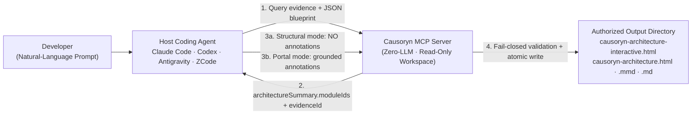

# Prompting & Architecture Portals Guide

> **Language:** [Türkçe](../prompting-and-architecture-portals.md) | **English** · [Documentation Hub](README.md) · [Root README](../../README.md)
>
> **Status:** reflects Causoryn 0.3.0. Tool names below are those of the default `core` profile (11 tools); rows marked with a profile need the server to be started with `--tool-profile wiki`, `history` or `full` (see [Tool Profiles](tool-contracts.md#tool-profiles---tool-profile--causoryn_tool_profile)).

This guide explains how to prompt your AI coding agent in natural language to use **Causoryn** both for **purely deterministic, zero-LLM static analysis** and for **host-LLM annotated interactive architecture portals** (`causoryn-architecture-interactive.html`).

> **Zero-LLM and read-only boundary:** Causoryn's engine makes no LLM calls, needs no model credentials and uses no embeddings (see the [No-LLM Architecture Policy](adr/ADR-002-no-llm.md)); the analyzed workspace is read-only. When you ask for architectural narrative, **your coding agent acts as the host LLM** (Claude Code, Codex, Antigravity or ZCode). Causoryn checks every reference the agent supplies fail-closed and renders the offline portal deterministically.

---

## 1. Two Ways to Use Causoryn

| Dimension | Deterministic / zero-LLM mode (`annotations` omitted) | Host-LLM annotated portal mode (`annotations` provided) |
|---|---|---|
| **Best for** | Codebase exploration, pre-edit blast radius and contract checks, post-edit verification, CI or archival structural diagrams | Team onboarding, architecture reviews, domain boundary maps, end-to-end request flows, structural risk audits |
| **Engine boundary** | Local, zero-LLM graph queries and export | Causoryn stays zero-LLM; only the external host agent writes the optional narrative layer |
| **Reproducibility** | Same snapshot + `format` + `view` + `options` → **byte-identical output** | Same snapshot + `format` + `view` + `options` + same `annotations` → **byte-identical output** (the host's prose itself can differ between sessions) |
| **Grounding & validation** | Static graph evidence only (`verified` / `heuristic` / `unresolved`) | Every `moduleId`, `nodeId`, `evidenceId` and `keyFiles` path is checked against the snapshot in one pass; up to 25 errors are reported together under `INVALID_ARGUMENT`, and invented references are rejected |
| **Typical artifacts** | MCP JSON envelopes, or structural `causoryn-architecture.html` / `causoryn-architecture-interactive.html` / `.mmd` / `.md` / `.json` | Annotated `causoryn-architecture-interactive.html` (pan/zoom, live search, evidence drawer, hash-pinned CSP), zero-JS `causoryn-architecture.html`, `.mmd`, and the `.md` Architecture Brief |



---

## 2. Natural-Language Prompting Without Memorizing Skill Names

After `npx causoryn@latest setup`, your host agent gets two complementary signals:

1. **Skill frontmatter and routing** (`skills/architecture-blueprint/SKILL.md`, `skills/causoryn/SKILL.md`): `architecture-blueprint` carries English and Turkish triggers (*"architecture diagram"*, *"interactive architecture portal"*, *"system blueprint"*, *"visual onboarding guide"*, *"mimari diyagram"*, *"etkileşimli mimari portal"*, *"görsel mimari harita"*) and tells the agent never to refuse because Causoryn is LLM-free — the agent *is* the host LLM. The main `causoryn` skill routes visual architecture and portal requests to `architecture-blueprint`. The full annotation template lives in the skill, so the MCP tool list stays small (core `tools/list` ≤ 15,000 characters).
2. **MCP `tools/list` descriptions:** even with skills disabled, the `causoryn_export_documentation` description states the 2-step **blueprint (`format: "json"`) → validated render (`format: "html"`, `view: "interactive"`)** workflow, and every input field has a one-line description.

You therefore do not need to know any skill or tool name — ask for the outcome. Some installed skills still mention legacy tool names (for example `causoryn_index_status` or `causoryn_generate_onboarding`) next to the core names; in the default `core` profile the agent should use the core tools listed below. The mapping is in [Legacy Tool Replacements](tool-contracts.md#legacy-tool-replacements).

### A. Everyday Deterministic Engineering Prompts (`annotations` omitted)

| Goal | Copy-paste prompt (English) | Kopyala-yapıştır prompt (Türkçe) | Primary MCP tools (`core` profile) |
|---|---|---|---|
| **Discover** | `"Use Causoryn to map the top-level modules, entrypoints, and highest-centrality components of this repository with evidence."` | `"Causoryn ile bu projenin yüksek seviye modül haritasını çıkar, ana giriş noktalarını ve en merkezi bileşenleri kanıtlarıyla listele."` | `causoryn_status`, `causoryn_map_system` (`profile: "onboarding"`), `causoryn_find_symbols` |
| **Localize & trace** | `"Locate where POST /orders is handled and trace its full execution chain with source evidence."` | `"POST /orders isteğinin nerede işlendiğini bul ve tüm çağrı zincirini kaynak kanıtlarıyla izle."` | `causoryn_get_agent_context`, `causoryn_trace`, `causoryn_get_evidence` |
| **Preflight** | `"Before adding idempotencyKey to OrdersService.create, run Causoryn preflight to list blast-radius candidates, contract impacts, and a candidate test plan."` | `"OrdersService.create fonksiyonuna idempotencyKey eklemeden önce Causoryn ile etki alanını, kontrat risklerini ve aday test planını çıkar."` | `causoryn_preflight_change`, `causoryn_contracts` |
| **Verify** | `"Verify our working-tree edits with Causoryn: check for architecture rule violations, new cycles, or contract drift."` | `"Yaptığımız değişiklikleri Causoryn ile doğrula: mimari kural ihlali, yeni döngü veya kontrat kayması var mı?"` | `causoryn_verify_change` (architecture, graph diff, test plan), `causoryn_contracts` (`action: "drift"`) |
| **Refresh after edits** | `"Re-index this workspace with Causoryn and tell me when the new snapshot is ready."` | `"Causoryn ile bu çalışma alanını yeniden indeksle ve yeni snapshot hazır olunca haber ver."` | `causoryn_status` (`action: "refresh"`, then `action: "inspect"`) |
| **Structural export (model-free)** | `"Export a purely structural, model-free interactive architecture diagram of this repo using Causoryn without annotations."` | `"Causoryn ile anotasyon eklemeden bu reponun tamamen yapısal, modelsiz etkileşimli mimari diyagramını dışa aktar."` | `causoryn_export_documentation` (`annotations` omitted) |

`causoryn_verify_change` never runs tests; it lists candidate tests and records host-reported results only as `host_asserted`. For contract drift, the agent should call `causoryn_contracts` with before/after spec files, because the `contracts` check inside `causoryn_verify_change` cannot be evaluated without them.

### B. Host-LLM Annotated Interactive Architecture Portal Prompts

| Scenario | Copy-paste prompt (English) | Kopyala-yapıştır prompt (Türkçe) | Recommended view & options |
|---|---|---|---|
| **Full system portal** | `"Create a comprehensive, evidence-grounded interactive architecture portal for this project using Causoryn."` | `"Causoryn kullanarak bu projenin kapsamlı, kanıta dayalı etkileşimli mimari portalını oluştur."` | `format: "html"`, `view: "interactive"` → `causoryn-architecture-interactive.html` |
| **Visual onboarding guide** | `"Build a visual onboarding architecture guide with core domains, request flows, guided tour, and structural risks using Causoryn."` | `"Causoryn ile projenin görsel mimari haritasını, ana iş akışlarını, okuma sırasını ve yapısal risklerini çıkar."` | Fill `domains`, `flows`, `guidedTour`, `risks` in `annotations` |
| **Subsystem focus (`pathPrefix`)** | `"Use Causoryn to generate an interactive architecture portal and Mermaid diagram focused strictly on the src/billing subsystem."` | `"Causoryn kullanarak yalnızca src/billing alt sistemine odaklanan etkileşimli mimari portal ve Mermaid diyagramı üret."` | `options: { pathPrefix: "src/billing", maxModules: 24 }` |
| **Risk & cycle audit** | `"Use Causoryn to produce an annotated architecture portal highlighting circular dependencies, fan-in hotspots, and unresolved boundaries backed by evidence IDs."` | `"Causoryn ile döngüsel bağımlılıkları, yüksek fan-in sıcak noktalarını ve çözümlenmemiş sınırları kanıt kimlikleriyle birlikte bir mimari risk raporuna dönüştür."` | `annotations.risks` + `annotations.decisions` + `evidenceIds` |
| **Zero-JS archive + PR brief** | `"Generate a zero-JavaScript archival HTML architecture portal, a PR-ready Mermaid diagram, and a Markdown architecture brief using Causoryn."` | `"Causoryn ile sıfır JavaScript içeren arşivlenebilir mimari HTML portalı, PR'a yapıştırılabilir Mermaid diyagramı ve Markdown mimari özeti üret."` | `view: "architecture"` → `causoryn-architecture.html`, `.mmd`, `.md` |

### C. Prompts That Need Another Tool Profile

These tools are not registered in the default `core` profile. Add the profile to the server arguments in your host config (for example `causoryn mcp --allow-cwd --auto-data-dir --tool-profile wiki`) or set `CAUSORYN_TOOL_PROFILE`, then restart the host; `npx causoryn@latest setup --tool-profile wiki --yes` writes the flag into the host entries for you. Without the profile the agent will not see these tools at all.

| Goal | Copy-paste prompt (English) | Kopyala-yapıştır prompt (Türkçe) | Tools | Required profile |
|---|---|---|---|---|
| **Living Wiki** | `"Build the Causoryn Living Wiki and summarize the pages related to authentication with source evidence references."` | `"Causoryn Living Wiki'yi oluştur ve kimlik doğrulama akışıyla ilgili sayfaları kanıt bağlantılarıyla özetle."` | `causoryn_wiki_build`, `causoryn_wiki_search`, `causoryn_wiki_get_page` | `--tool-profile wiki` (or `full`) |
| **Architecture history** | `"Compare the architecture of main and HEAD~5 with Causoryn and list added, removed, and renamed modules."` | `"Causoryn ile main ve HEAD~5 arasındaki mimariyi karşılaştır; eklenen, silinen ve yeniden adlandırılan modülleri listele."` | `causoryn_compare_architecture`, `causoryn_architecture_timeline` | `--tool-profile history` (or `full`) |
| **Old prompts with legacy tool names** | Prompts or scripts that call `causoryn_index_status`, `causoryn_trace_execution`, `causoryn_check_contracts`, ... by name | — | The 29 legacy names (deprecated where a core replacement exists) | `--tool-profile full` |

The history tools use the published local index for a ref when it provably matches that ref's content (and for `working-tree`). Any other commit is analyzed from its git objects (read-only; source files from the commit, project files and installed packages from the working tree) and cached under the data root. One call runs at most `CAUSORYN_HISTORY_MAX_ANALYSES` fresh analyses (compare 2, timeline 4); points over that budget report `analysis-budget-exceeded` and are analyzed on the next call. A `.causoryn/architecture-snapshot.json` committed at the ref (written with `causoryn_export_documentation` `format: "snapshot"`) is only the last fallback and adds the trust warning `snapshot-loaded-from-committed-git-blob`. A ref that cannot be resolved or analyzed returns `INVALID_REVISION` with the reason.

---

## 3. Export Formats, Views & Default Filenames

`causoryn_export_documentation` writes atomically (a `.tmp` file created with `flag: "wx"`, then `rename`) **only** into directories listed in `output.allowedOutputDirs`. With `--auto-data-dir`, Causoryn authorizes `<data-dir>/workspaces/<slug>-<hash12>/exports` automatically (for example `~/.causoryn/workspaces/<slug>-<hash12>/exports`).

| `format` | `view` | Default filename | Offline security & key capabilities |
|---|---|---|---|
| `html` | `interactive` | `causoryn-architecture-interactive.html` | Offline interactive viewer: mouse-wheel zoom and drag pan, live search, language/domain/cycle filters, floating **Evidence Inspector Drawer**, 1-hop neighborhood highlighting, one-click **Copy Mermaid**. Hash-pinned offline CSP (`default-src 'none'; script-src 'sha256-<hash>'; style-src 'unsafe-inline'; base-uri 'none'; form-action 'none'`): no `'unsafe-inline'` scripts, no CDN, no `fetch`, no `innerHTML`. |
| `html` | `architecture` *(default)* | `causoryn-architecture.html` | **Zero JavaScript** (no `<script>` tags), offline CSP (`default-src 'none'; style-src 'unsafe-inline'; base-uri 'none'; form-action 'none'`), 5 pure-CSS tabs, layered (Sugiyama) SVG diagram, zoom presets, Tarjan SCC cycle highlights, inline SVG flow strips. The separate default filename keeps it from overwriting the interactive portal. |
| `mermaid` | `architecture` *(default)* | `causoryn-architecture.mmd` | Renderable subgraph-grouped `flowchart TB` for GitHub, VS Code and pull requests, with weighted cross-module edges (`verified` solid, `heuristic`/`unresolved` dashed) and cycle styling. |
| `markdown` | `architecture` *(default)* | `causoryn-architecture.md` | Architecture Brief: executive summary, embedded Mermaid diagram, domains, module responsibilities, critical flows, guided tour, entrypoints, decisions, risks. |
| `json` | `architecture` *(default)* | `causoryn-architecture.json` | Compact blueprint with the canonical `architectureSummary.moduleIds`, aggregated module metrics, cross-module edges and `evidenceCatalog`. |
| `snapshot` | *(omitted)* | `architecture-snapshot.json` | Canonical snapshot content set for read-only Git comparison (`causoryn_compare_architecture`, `causoryn_architecture_timeline`; history profile). |
| `html` / `mermaid` / `markdown` / `json` | `full` | Format default | Unfiltered raw node, edge and evidence dump. Cannot be combined with `options` or `annotations` (`INVALID_ARGUMENT`). |

The tool response (`data`) returns `path`, `format`, `bytes`, `atomic: true`, `view` and, for the `architecture` and `interactive` views, `architectureSummary` (`moduleCount`, `edgeCount`, `cycleCount`, `entrypointCount`, `contractCount`, `flowCount`, `annotated`, `moduleIds`).

### Projection Options (`options`)

Available with `view: "architecture"` and `view: "interactive"`:

- `maxModules` (`2–100`, default `32`): maximum number of aggregated modules from the adaptive directory-tree clustering. Values outside the range return `INVALID_ARGUMENT`.
- `pathPrefix` (relative POSIX directory prefix such as `"src/api"` or `"packages/domain"`, at most 260 characters): focuses the projection on one subsystem; `..` and NUL bytes are rejected.
- `includeTests` (`boolean`, default `true`): includes test files and test modules in the projection; set `false` to leave test modules out.

### 2-Step Blueprint → Render Workflow

1. **Step 1 — Collect evidence and canonical `moduleId`s.** The host agent checks snapshot health and graph facts with `causoryn_status` (refresh first if the snapshot is missing or stale), `causoryn_map_system` (`profile: "onboarding"`, then `level: "L1"` / `"L2"` with `filters.pathPrefix`), `causoryn_trace` (`mode: "execution"` or `"business-flow"`) and `causoryn_get_evidence`, and optionally `causoryn_verify_change` with `checks: ["architecture"]` when the repository has `.causoryn/architecture.rules.yaml`. It then calls `causoryn_export_documentation({ format: "json", view: "architecture", outputDir, options })` to get the exact **`architectureSummary.moduleIds`**. (In the `full` profile the legacy names such as `causoryn_index_status`, `causoryn_workspace_summary`, `causoryn_generate_onboarding` or `causoryn_trace_business_flow` still work.)
2. **Step 2 — Render the validated portal.** The host agent fills `annotations` using only IDs from Step 1 and calls `causoryn_export_documentation({ format: "html", view: "interactive", outputDir, options, annotations })`. It can render `view: "architecture"` HTML, `mermaid` and `markdown` with exactly the same `options` and `annotations` to get a matching zero-JS portal, diagram and brief.

---

## 4. Complete `annotations` Contract Reference (Fail-Closed, Multi-Error Validation)

Every field in `annotations` is validated against a strict (`strictObject`) Zod schema and then checked against the active projection and the published snapshot. Unknown properties, blank or whitespace-only strings, duplicate IDs and non-existent graph references are rejected. Validation collects up to **25** schema and graph-reference errors in one pass and returns them together under `INVALID_ARGUMENT`; further errors are summarized as a count.

| Top-level field | Type & budget limit | Subfields | Fail-closed validation rule |
|---|---|---|---|
| `title` | `string` (≤ 160 chars) | — | Non-empty trimmed string |
| `architectureStyle` | `string` (≤ 120 chars) | — | Observed architecture pattern label (for example `"Modular Monolith"`) |
| `executiveSummary` | `string` (≤ 2,000 chars) | — | 2–4 sentence synthesis; should state `partial` coverage or unresolved boundaries explicitly |
| `domains` | `array` (≤ 24 items) | `id`, `name`, `description`, `layer?`, `moduleIds[]` (`1..100`) | Unique `id`; every `moduleId` must exist in `architectureSummary.moduleIds` and belong to **at most one domain** (disjoint partition) |
| `moduleNotes` | `array` (≤ 120 items) | `moduleId`, `summary`, `responsibility?`, `layer?`, `keyFiles?` (≤ 12) | Unique `moduleId` from `architectureSummary.moduleIds`; every `keyFiles` path must be a real relative file inside that module |
| `flows` | `array` (≤ 20 items) | `id`, `title`, `description`, `steps[]` (`1..24`: `moduleId?`, `nodeId?`, `label`, `explanation`) | Unique `id`; step order is preserved; every `moduleId` must be in the projection and every `nodeId` among the active snapshot nodes (excluding `Workspace`, `Repository`, `UnknownExternal`) |
| `guidedTour` | `array` (≤ 30 items) | `step` (`1..1000`), `title`, `targetModuleId?`, `targetNodeId?`, `explanation` | Sorted by `step` ascending; `targetModuleId` and `targetNodeId` are checked against the projection/snapshot |
| `decisions` | `array` (≤ 24 items) | `id`, `title`, `summary`, `rationale?`, `relatedModuleIds?` (≤ 24), `evidenceIds?` (≤ 24) | Unique `id`; every `relatedModuleId` in `architectureSummary.moduleIds` and every `evidenceId` in the snapshot evidence |
| `risks` | `array` (≤ 24 items) | `id`, `title`, `severity` (`"low" \| "medium" \| "high"`), `summary`, `relatedModuleIds?` (≤ 24), `evidenceIds?` (≤ 24) | Unique `id`; `relatedModuleIds` and `evidenceIds` checked fail-closed |

**Nested text budgets** (`packages/graph/src/architecture-annotations.ts`): `id` and `layer` ≤ 80 characters; domain `name` ≤ 120; `title` and step `label` ≤ 160; `responsibility`, module/node references, `keyFiles` entries and `evidenceIds` ≤ 240; `description`, `summary`, `explanation` and `rationale` ≤ 1,200.

### Compact Valid `annotations` JSON Example

Every `moduleId`, `keyFiles` path and `evidenceId` below stands for a value copied verbatim from Step 1's `architectureSummary.moduleIds` and from Causoryn evidence calls (the shortened `evidence:7d09d378...` must be replaced by a full ID). The file and symbol names follow the `examples/fixture-ts-orders` sample project; the real module IDs depend on the clustering of your snapshot.

```json
{
  "title": "Orders Service — Architecture Portal",
  "architectureStyle": "Layered TypeScript API",
  "executiveSummary": "HTTP routes under src/routes delegate order mutations to domain services under src/services. Static coverage is L2 (96.8% resolved); dynamic plugin hooks remain labeled unresolved.",
  "domains": [
    {
      "id": "api-layer",
      "name": "HTTP API & Routing",
      "description": "Validates incoming requests and maps HTTP endpoints to service handlers.",
      "layer": "Presentation",
      "moduleIds": ["mod:src/routes"]
    },
    {
      "id": "order-core",
      "name": "Order Domain Services",
      "description": "Encapsulates order creation, idempotency, and persistence coordination.",
      "layer": "Application",
      "moduleIds": ["mod:src/services"]
    }
  ],
  "moduleNotes": [
    {
      "moduleId": "mod:src/services",
      "summary": "Core transactional order orchestration and validation rules.",
      "responsibility": "Order lifecycle orchestration",
      "layer": "Application",
      "keyFiles": ["src/services/orders-service.ts"]
    }
  ],
  "flows": [
    {
      "id": "create-order",
      "title": "POST /orders Request Flow",
      "description": "Traces order submission from HTTP route validation through domain persistence.",
      "steps": [
        {
          "moduleId": "mod:src/routes",
          "label": "Accept POST /orders",
          "explanation": "Parses request payload and invokes OrdersService.create."
        },
        {
          "moduleId": "mod:src/services",
          "label": "Persist order",
          "explanation": "Validates invariants and records the order entity."
        }
      ]
    }
  ],
  "guidedTour": [
    {
      "step": 1,
      "title": "Start at HTTP routes",
      "targetModuleId": "mod:src/routes",
      "explanation": "Review public API surface and request schemas first."
    },
    {
      "step": 2,
      "title": "Inspect core order logic",
      "targetModuleId": "mod:src/services",
      "explanation": "Follow business invariants and downstream dependencies."
    }
  ],
  "decisions": [
    {
      "id": "DEC-01",
      "title": "Unidirectional Routes -> Services Boundary",
      "summary": "Route handlers call service modules without reverse imports.",
      "rationale": "Keeps HTTP transport concerns isolated from domain logic.",
      "relatedModuleIds": ["mod:src/routes", "mod:src/services"],
      "evidenceIds": ["evidence:7d09d378..."]
    }
  ],
  "risks": [
    {
      "id": "RISK-01",
      "title": "High Fan-In on Orders Service",
      "severity": "medium",
      "summary": "Multiple routes and entrypoints depend directly on orders-service.ts; signature changes require preflight checks.",
      "relatedModuleIds": ["mod:src/services"],
      "evidenceIds": ["evidence:7d09d378..."]
    }
  ]
}
```

---

## 5. Troubleshooting

| Error code / symptom | Typical cause | Recovery action |
|---|---|---|
| `EXPORT_NOT_ALLOWED` | `outputDir` is not in `output.allowedOutputDirs` (default-deny export policy), or the server was started without `--auto-data-dir` and without a configured list. | Use `<data-dir>/workspaces/<slug>-<hash12>/exports` (requires `--auto-data-dir`) or set `output.allowedOutputDirs` in `CAUSORYN_CONFIG`. |
| `INVALID_ARGUMENT` | (1) a `moduleId` that is not in `architectureSummary.moduleIds`, a `nodeId` outside the active snapshot, an unknown `evidenceId`, or a `keyFiles` path outside its module; (2) a `moduleId` assigned to more than one domain; (3) `view: "wiki"` (wiki pages belong to the wiki tools); (4) `view: "interactive"` with a non-HTML format; (5) `options` or `annotations` combined with `view: "full"`; (6) `maxModules` outside 2–100. | Read the full error list in `error.message` (up to 25 entries), align the IDs with Step 1's JSON blueprint, fix the payload, and retry once. |
| `PATH_DENIED` | `fileName` contains `/` or `\`, `..` traversal, NUL bytes, or a symlink escape. | Pass a plain filename (for example `"custom-architecture.html"`) or omit `fileName` to use the format/view default. |
| `WORKSPACE_NOT_AUTHORIZED` | No authorized root: not bound via `--root`, `--allow-cwd`, MCP `roots/list` or `CAUSORYN_CONFIG.allowRoots`. | Start the host from a safe project directory or let it send `roots/list`; `causoryn_status` shows `authorized: false` in this state. Run `npx causoryn@latest doctor` to inspect the configuration. |
| `INDEX_NOT_READY`, or `status: "partial"` with `data.status: "indexing"` | No published snapshot yet, or the first index is still running. | Wait `retryAfterMs` and call `causoryn_status` (`action: "inspect"`); if no job is running, start one with `causoryn_status({ action: "refresh" })`. |
| Agent says a wiki or history tool does not exist | The server runs the default `core` profile. | Add `--tool-profile wiki`, `history` or `wiki,history` (or set `CAUSORYN_TOOL_PROFILE`) and restart the host ([§2.C](#c-prompts-that-need-another-tool-profile)). |
| `INVALID_REVISION` from a history tool | The ref does not resolve to a commit, or its commit could not be analyzed; the message names the reason (for example `analysis-budget-exceeded` or `commit-analysis-failed: … index.maxFiles`). | Check the ref. For `analysis-budget-exceeded`, call again (analyzed commits are cached) or raise `CAUSORYN_HISTORY_MAX_ANALYSES`; for `index.maxFiles`, raise the limit. |

To run a read-only health check of the runtime, the language sidecars and the installed host configs and skills:

```bash
npx causoryn@latest doctor
```

---

## Related Documentation

- [5-Minute Quickstart Tutorial](tutorial-5-minutes.md) · [MCP Tool Contracts](tool-contracts.md)
- [CLI & Configuration](cli-and-configuration.md) · [No-LLM Architecture Policy](adr/ADR-002-no-llm.md)
- [Architecture Overview](architecture.md) · [Living Wiki Specification](wiki-spec.md)
- [Documentation Hub (EN)](README.md) · [Dokümantasyon Merkezi (TR)](../README.md)
