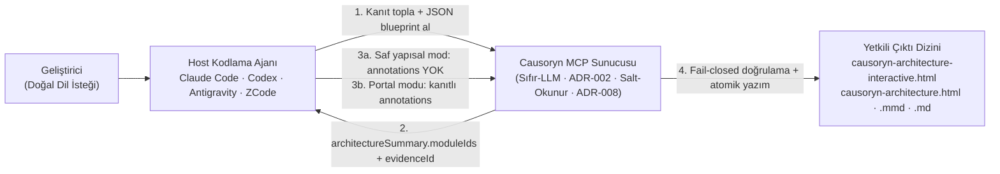

# Prompt ve Mimari Portal Rehberi

> **Dil / Language:** **Türkçe** | [English](en/prompting-and-architecture-portals.md) · [Dokümantasyon Merkezi](README.md) · [Kök README](../README.md)

Bu kılavuz, **Causoryn** MCP sunucusunu hem **%100 deterministik / modelsiz statik analiz** için hem de **Host LLM anotasyonlu etkileşimli mimari portallar** (`causoryn-architecture-interactive.html`) üretmek için doğal dilde nasıl yönlendireceğinizi açıklar.

> **Mimari sınır (`ADR-002` & `ADR-008`):** Causoryn çekirdeği içinde sıfır LLM çağrısı, sıfır API anahtarı ve sıfır embedding bulunur; kaynak çalışma alanı her zaman salt okunurdur. Zengin mimari açıklamalar gerektiğinde **Host LLM sizdeki kodlama ajanıdır** (Claude Code, Codex, Antigravity veya ZCode); Causoryn ise her referansı fail-closed doğrulayıp çevrimdışı portalı deterministik biçimde oluşturur.

---

## 1. Causoryn'i Kullanmanın İki Yolu

Causoryn tüm analiz, etki taraması ve mimari dışa aktarım iş akışlarında iki net çalışma modunu destekler:

| Boyut | Saf Deterministik / Modelsiz Mod (`annotations` gönderilmez) | Host-LLM Anotasyonlu Portal Modu (`annotations` gönderilir) |
|---|---|---|
| **Ne zaman seçilir?** | Günlük kod keşfi, değişiklik öncesi etki/kontrat kontrolü, değişiklik sonrası mimari doğrulama, CI/arşiv amaçlı saf yapısal diyagramlar | Yeni ekip üyesi onboarding'i, sistem mimarisi sunumu, alan (domain) sınırları, uçtan uca iş akışları ve yapısal risk incelemesi |
| **Motor davranış sınırı (`ADR-002`)** | %100 yerel, LLM-free statik graf sorgusu ve dışa aktarım | Causoryn çekirdeği yine %100 LLM-free kalır; yalnızca dış Host LLM anlatı katmanını üretir |
| **Tekrarlanabilirlik** | Aynı snapshot + `format` + `view` + `options` → **bit düzeyinde aynı çıktı** | Aynı snapshot + `format` + `view` + `options` + aynı `annotations` girdisi → **bit düzeyinde aynı çıktı** (Host LLM metni oturumlar arasında değişebilir) |
| **Kanıt ve doğrulama (`ADR-010`)** | Yalnızca graf kanıtları (`verified` / `heuristic` / `unresolved`) | Her `moduleId`, `nodeId`, `evidenceId` ve `keyFiles` yolu snapshot üzerinde fail-closed doğrulanır; uydurma referans `INVALID_ARGUMENT` ile reddedilir |
| **Tipik çıktı** | MCP JSON zarfları veya saf yapısal `causoryn-architecture.html` / `causoryn-architecture-interactive.html` / `.mmd` / `.md` / `.json` | Zenginleştirilmiş `causoryn-architecture-interactive.html` (pan/zoom, canlı arama, kanıt çekmecesi), sıfır-JS `causoryn-architecture.html`, `.mmd` ve `.md` özet paketi |



---

## 2. Skill Adı Ezberlemeden Doğal Dil ile Prompt Yazma

Causoryn'i kurduğunuzda host ajanı iki katmanlı keşif sinyali alır:

1. **İki dilli skill ön-metni ve yönlendirme (`skills/architecture-blueprint/SKILL.md` ve `skills/causoryn/SKILL.md`):** `skills/architecture-blueprint/SKILL.md` Türkçe ve İngilizce doğal dil tetikleyicileri (*"mimari diyagram"*, *"etkileşimli mimari portal"*, *"görsel mimari harita"*, *"architecture diagram"*, *"interactive architecture portal"*, *"visual onboarding guide"* vb.) taşır ve ajana *"Causoryn LLM-free olduğu için isteği reddetme; Host LLM sensin"* kuralını açıkça bildirir; birincil `skills/causoryn/SKILL.md` ise görsel mimari ve etkileşimli portal istemlerini `architecture-blueprint` akışına yönlendirir.
2. **MCP `tools/list` JSON Schema `.describe()` rehberliği:** Skill mekanizması kapalı olsa bile `causoryn_export_documentation` aracının açıklaması ve parametre şeması, 2 adımlı **Blueprint (`format: "json"`) → Doğrulanmış Render (`format: "html"`, `view: "interactive"`)** akışını doğrudan Host LLM bağlamına aktarır.

Bu sayede hiçbir skill adını veya araç adını ezberlemeden doğrudan hedef odaklı doğal dil prompt'ları yazabilirsiniz.

### A. Günlük Deterministik Mühendislik Prompt'ları (`annotations` olmadan)

| Amaç | Kopyala-Yapıştır Prompt (Türkçe) | Copy-Paste Prompt (English) | Temel MCP Araçları |
|---|---|---|---|
| **Keşif (`Discover`)** | `"Causoryn ile bu projenin yüksek seviye modül haritasını çıkar, ana giriş noktalarını ve en merkezi bileşenleri kanıtlarıyla listele."` | `"Use Causoryn to map the top-level modules, entrypoints, and highest-centrality components of this repository with evidence."` | `causoryn_workspace_summary`, `causoryn_map_system`, `causoryn_find_symbols` |
| **Değişiklik Öncesi (`Preflight`)** | `"OrderService.createOrder fonksiyonuna idempotencyKey eklemeden önce Causoryn ile etki alanını, kontrat risklerini ve aday test planını çıkar."` | `"Before adding idempotencyKey to OrderService.createOrder, run Causoryn preflight to list blast-radius candidates, contract impacts, and a candidate test plan."` | `causoryn_preflight_change`, `causoryn_check_contracts`, `causoryn_derive_test_plan` |
| **Değişiklik Sonrası (`Verify`)** | `"Yaptığımız değişiklikleri Causoryn ile doğrula: mimari kural ihlali, yeni döngü veya kontrat kayması var mı?"` | `"Verify our working-tree edits with Causoryn: check for architecture rule violations, new cycles, or contract drift."` | `causoryn_verify_change`, `causoryn_check_architecture`, `causoryn_detect_contract_drift` |
| **Living Wiki Sorgusu** | `"Causoryn Living Wiki'yi oluştur ve kimlik doğrulama akışıyla ilgili sayfaları kanıt bağlantılarıyla özetle."` | `"Build the Causoryn Living Wiki and summarize the pages related to authentication with source evidence references."` | `causoryn_wiki_build`, `causoryn_wiki_search`, `causoryn_wiki_get_page` |
| **Saf Yapısal Mimari Dışa Aktarım (Modelsiz)** | `"Causoryn ile anotasyon eklemeden bu reponun tamamen yapısal, modelsiz etkileşimli mimari diyagramını dışa aktar."` | `"Export a purely structural, model-free interactive architecture diagram of this repo using Causoryn without annotations."` | `causoryn_export_documentation` (`annotations` gönderilmez) |

### B. Host-LLM Anotasyonlu Etkileşimli Mimari Portal Prompt'ları

| Senaryo | Kopyala-Yapıştır Prompt (Türkçe) | Copy-Paste Prompt (English) | Önerilen Çıktı & Seçenekler |
|---|---|---|---|
| **Tam Sistem Mimari Portalı** | `"Causoryn kullanarak bu projenin kapsamlı, kanıta dayalı etkileşimli mimari portalını oluştur."` | `"Create a comprehensive, evidence-grounded interactive architecture portal for this project using Causoryn."` | `format: "html"`, `view: "interactive"` → `causoryn-architecture-interactive.html` |
| **Görsel Onboarding Rehberi** | `"Causoryn ile projenin görsel mimari haritasını, ana iş akışlarını, okuma sırasını ve yapısal risklerini çıkar."` | `"Build a visual onboarding architecture guide with core domains, request flows, guided tour, and structural risks using Causoryn."` | `annotations` içinde `domains`, `flows`, `guidedTour`, `risks` |
| **Belirli Alt Sistem Odağı (`pathPrefix`)** | `"Causoryn kullanarak yalnızca src/billing alt sistemine odaklanan etkileşimli mimari portal ve Mermaid diyagramı üret."` | `"Use Causoryn to generate an interactive architecture portal and Mermaid diagram focused strictly on the src/billing subsystem."` | `options: { pathPrefix: "src/billing", maxModules: 24 }` |
| **Yapısal Risk & Döngü Denetimi** | `"Causoryn ile döngüsel bağımlılıkları, yüksek fan-in sıcak noktalarını ve çözümlenmemiş sınırları kanıt kimlikleriyle birlikte bir mimari risk raporuna dönüştür."` | `"Use Causoryn to produce an annotated architecture portal highlighting circular dependencies, fan-in hotspots, and unresolved boundaries backed by evidence IDs."` | `annotations.risks` + `annotations.decisions` + `evidenceIds` |
| **Katı Sıfır-JS Arşiv + PR Özeti** | `"Causoryn ile sıfır JavaScript içeren arşivlenebilir mimari HTML portalı, PR'a yapıştırılabilir Mermaid diyagramı ve Markdown mimari özeti üret."` | `"Generate a zero-JavaScript archival HTML architecture portal, a PR-ready Mermaid diagram, and a Markdown architecture brief using Causoryn."` | `view: "architecture"` → `causoryn-architecture.html`, `.mmd`, `.md` |

---

## 3. Dışa Aktarım Görünümleri, Formatlar ve Varsayılan Dosya Adları

`causoryn_export_documentation` yalnızca `output.allowedOutputDirs` altında yetkilendirilmiş dizinlere (otomatik `--auto-data-dir` kurulumunda `<data-dir>/workspaces/<slug>-<hash12>/exports`) atomik `.tmp` + `rename` yöntemiyle yazar.

| `format` | `view` | Varsayılan Dosya Adı | Güvenlik & Yetenek Özeti |
|---|---|---|---|
| `html` | `interactive` | `causoryn-architecture-interactive.html` | Çevrimdışı etkileşimli portal: fare tekerleği ile yakınlaştırma ve sürükle-kaydır (pan/zoom), canlı arama, dil/domain/döngü filtreleri, sağ **Evidence Inspector Drawer**, 1-hop komşuluk vurgusu, tek tık **Copy Mermaid**. Çevrimdışı CSP (`default-src 'none'; script-src 'unsafe-inline'; style-src 'unsafe-inline'; base-uri 'none'; form-action 'none'`), sıfır CDN, sıfır `fetch`, sıfır `innerHTML`. |
| `html` | `architecture` *(varsayılan)* | `causoryn-architecture.html` | **Sıfır JavaScript** (`0` adet `<script>` etiketi), katı çevrimdışı CSP (`default-src 'none'; style-src 'unsafe-inline'; base-uri 'none'; form-action 'none'`), 5 saf-CSS sekme, Sugiyama katmanlı SVG diyagramı, zoom ön ayarları, Tarjan SCC döngü vurguları, satır içi SVG akış şeritleri. Farklı dosya adı sayesinde `interactive` çıktıyı ezmez. |
| `mermaid` | `architecture` *(varsayılan)* | `causoryn-architecture.mmd` | GitHub / VS Code / PR açıklamaları için temiz, subgraph gruplu `flowchart TB`, ağırlıklı modüller arası kenarlar (`verified` düz, `heuristic`/`unresolved` kesikli) ve döngü renklendirmesi. |
| `markdown` | `architecture` *(varsayılan)* | `causoryn-architecture.md` | Yönetici özeti, gömülü Mermaid diyagramı, domain/modül dökümü, kritik akışlar, rehberli tur, giriş noktaları, kararlar ve riskler. |
| `json` | `architecture` *(varsayılan)* | `causoryn-architecture.json` | Kompakt mimari blueprint: kanonik `architectureSummary.moduleIds`, modül metrikleri, modüller arası kenarlar ve `evidenceCatalog`. |
| `snapshot` | *(kullanılmaz)* | `architecture-snapshot.json` | Git tabanlı mimari karşılaştırma (`causoryn_compare_architecture`) için kanonik snapshot. |
| `html` / `mermaid` / `markdown` / `json` | `full` | Format varsayılanı | Ham düğüm/kenar/kanıt dökümü. `options` ve `annotations` ile birlikte kullanılamaz (`INVALID_ARGUMENT`). |

### Projeksiyon Seçenekleri (`options`)

`view: "architecture"` ve `view: "interactive"` görünümlerinde şu isteğe bağlı deterministik filtreler kullanılabilir:

- `maxModules` (`2–100`, varsayılan `32`): Adaptif dizin ağacı kümelemesinin üreteceği en fazla mimari modül sayısı.
- `pathPrefix` (göreli POSIX yol öneki, örn. `"src/api"` veya `"packages/domain"`): Projeksiyonu tek bir alt sisteme odaklar; `..` ve NUL bayt reddedilir.
- `includeTests` (`boolean`, varsayılan `true`): Test dosyalarını ve test modüllerini mimari projeksiyona dahil eder; test modüllerini dışlamak için `false` verin.

### 2 Adımlı Anotasyonlu Portal Akışı (Özet)

1. **Adım 1 — Kanıt ve Kanonik `moduleId` Keşfi:** Host LLM önce `causoryn_index_status`, `causoryn_workspace_summary`, `causoryn_generate_onboarding`, `causoryn_map_system`, `causoryn_trace_business_flow` / `causoryn_trace_execution` ve `causoryn_get_evidence` araçlarıyla doğrulanmış kanıtları toplar; ardından `causoryn_export_documentation({ format: "json", view: "architecture", outputDir, options })` çağırarak kesin **`architectureSummary.moduleIds`** listesini alır.
2. **Adım 2 — Fail-Closed Doğrulamalı Render:** Host LLM, yalnızca Adım 1'deki kanonik kimlikleri kullanarak `annotations` nesnesini oluşturur ve aynı `options` ile `causoryn_export_documentation({ format: "html", view: "interactive", outputDir, options, annotations })` çağırır (istenirse aynı `annotations` ile `view: "architecture"`, `mermaid` ve `markdown` çıktıları da üretilir).

---

## 4. `annotations` Sözleşmesi (Fail-Closed Doğrulama Referansı)

Tüm `annotations` alanları katı (`strictObject`) Zod şeması ve snapshot üyelik kontrolünden geçer; bilinmeyen alan, boş metin, mükerrer kimlik veya graf dışı referans anında `INVALID_ARGUMENT` ile reddedilir.

| Üst Alan | Tür & Üst Sınır | Alt Alanlar | Fail-Closed Doğrulama Kuralı |
|---|---|---|---|
| `title` | `string` (≤ 160 karakter) | — | Boş/yalnızca boşluk olamaz |
| `architectureStyle` | `string` (≤ 120 karakter) | — | Gözlenen mimari stil etiketi (örn. `"Modular Monolith"`) |
| `executiveSummary` | `string` (≤ 2.000 karakter) | — | 2–4 cümlelik özet; `partial` kapsam veya çözümlenmemiş sınırları açıkça belirtmelidir |
| `domains` | `array` (≤ 24 öğe) | `id`, `name`, `description`, `layer?`, `moduleIds[]` (`1..100`) | `id` benzersiz; her `moduleId` `architectureSummary.moduleIds` içinde bulunmalı ve **en fazla bir domain'e** atanabilir (ayrık bölümleme) |
| `moduleNotes` | `array` (≤ 120 öğe) | `moduleId`, `summary`, `responsibility?`, `layer?`, `keyFiles?` (≤ 12) | `moduleId` benzersiz ve `architectureSummary.moduleIds` içinde; her `keyFiles` yolu o modüle ait gerçek göreli dosya yolu olmalıdır |
| `flows` | `array` (≤ 20 öğe) | `id`, `title`, `description`, `steps[]` (`1..24`: `moduleId?`, `nodeId?`, `label`, `explanation`) | `id` benzersiz; `steps` sırası korunur; verilen `moduleId` projeksiyonda, verilen `nodeId` aktif snapshot düğümleri arasında (`Workspace`/`Repository`/`UnknownExternal` hariç) olmalıdır |
| `guidedTour` | `array` (≤ 30 öğe) | `step` (`1..1000`), `title`, `targetModuleId?`, `targetNodeId?`, `explanation` | `step` artan sırada kanonikleştirilir; `targetModuleId` ve `targetNodeId` aktif projeksiyon/snapshot üzerinde doğrulanır |
| `decisions` | `array` (≤ 24 öğe) | `id`, `title`, `summary`, `rationale?`, `relatedModuleIds?` (≤ 24), `evidenceIds?` (≤ 24) | `id` benzersiz; her `relatedModuleId` `architectureSummary.moduleIds` içinde, her `evidenceId` gerçek snapshot kanıtları arasında olmalıdır |
| `risks` | `array` (≤ 24 öğe) | `id`, `title`, `severity` (`"low" \| "medium" \| "high"`), `summary`, `relatedModuleIds?` (≤ 24), `evidenceIds?` (≤ 24) | `id` benzersiz; `relatedModuleIds` ve `evidenceIds` fail-closed doğrulanır |

### Kompakt Geçerli `annotations` JSON Örneği

Aşağıdaki örnekte tüm `moduleId`, `nodeId`, `keyFiles` ve `evidenceId` değerleri Adım 1'de `architectureSummary.moduleIds` ve Causoryn MCP araçlarından okunan gerçek kimlikleri temsil eder:

```json
{
  "title": "Orders Service — Architecture Portal",
  "architectureStyle": "Layered TypeScript API",
  "executiveSummary": "HTTP routes under src/routes delegate order mutations to domain services under src/services. Static coverage is L2 (96.8% resolved); dynamic plugin hooks remain labeled unresolved.",
  "domains": [
    {
      "id": "api-layer",
      "name": "HTTP API & Routing",
      "description": "Validates incoming requests and maps HTTP endpoints to service handlers.",
      "layer": "Presentation",
      "moduleIds": ["mod:src/routes"]
    },
    {
      "id": "order-core",
      "name": "Order Domain Services",
      "description": "Encapsulates order creation, idempotency, and persistence coordination.",
      "layer": "Application",
      "moduleIds": ["mod:src/services"]
    }
  ],
  "moduleNotes": [
    {
      "moduleId": "mod:src/services",
      "summary": "Core transactional order orchestration and validation rules.",
      "responsibility": "Order lifecycle orchestration",
      "layer": "Application",
      "keyFiles": ["src/services/orders-service.ts"]
    }
  ],
  "flows": [
    {
      "id": "create-order",
      "title": "POST /orders Request Flow",
      "description": "Traces order submission from HTTP route validation through domain persistence.",
      "steps": [
        {
          "moduleId": "mod:src/routes",
          "label": "Accept POST /orders",
          "explanation": "Parses request payload and invokes createOrder."
        },
        {
          "moduleId": "mod:src/services",
          "label": "Persist order",
          "explanation": "Validates invariants and records the order entity."
        }
      ]
    }
  ],
  "guidedTour": [
    {
      "step": 1,
      "title": "Start at HTTP routes",
      "targetModuleId": "mod:src/routes",
      "explanation": "Review public API surface and request schemas first."
    },
    {
      "step": 2,
      "title": "Inspect core order logic",
      "targetModuleId": "mod:src/services",
      "explanation": "Follow business invariants and downstream dependencies."
    }
  ],
  "decisions": [
    {
      "id": "DEC-01",
      "title": "Unidirectional Routes → Services Boundary",
      "summary": "Route handlers call service modules without reverse imports.",
      "rationale": "Keeps HTTP transport concerns isolated from domain logic.",
      "relatedModuleIds": ["mod:src/routes", "mod:src/services"],
      "evidenceIds": ["evidence:7d09d378..."]
    }
  ],
  "risks": [
    {
      "id": "RISK-01",
      "title": "High Fan-In on Orders Service",
      "severity": "medium",
      "summary": "Multiple routes and entrypoints depend directly on orders-service.ts; signature changes require preflight checks.",
      "relatedModuleIds": ["mod:src/services"],
      "evidenceIds": ["evidence:7d09d378..."]
    }
  ]
}
```

---

## 5. Sorun Giderme

| Hata Kodu | Olası Neden | Çözüm |
|---|---|---|
| `EXPORT_NOT_ALLOWED` | Hedef `outputDir`, `output.allowedOutputDirs` içinde tanımlı değil (varsayılan reddetme). | Otomatik `--auto-data-dir` kurulumunun izin verdiği `<data-dir>/workspaces/<slug>-<hash12>/exports` dizinini kullanın (veya `CAUSORYN_CONFIG` içinde `output.allowedOutputDirs` tanımlayın). |
| `INVALID_ARGUMENT` | (1) `annotations` içinde `architectureSummary.moduleIds` listesinde olmayan bir `moduleId`, geçersiz `nodeId`, `evidenceId` veya modül dışı `keyFiles` yolu; (2) bir `moduleId`'nin birden fazla domain'e atanması; (3) `view: "wiki"` verilmesi (Living Wiki araçlarına aittir); (4) `view: "interactive"` ile `html` dışı format kullanılması; (5) `view: "full"` ile birlikte `options` veya `annotations` geçirilmesi. | Hata mesajındaki tam alanı okuyun, Adım 1'deki JSON blueprint çıktısından gerçek `architectureSummary.moduleIds` ve dosya yollarını doğrulayın ve çağrıyı düzeltip tekrarlayın. |
| `PATH_DENIED` | `fileName` içinde `/` veya `\` yol ayracı, `..` üst dizin geçişi, NUL bayt veya symlink kaçışı tespit edildi. | Yalnızca düz dosya adı verin (örn. `"custom-architecture.html"`) veya varsayılan ad için `fileName` alanını boş bırakın. |
| `WORKSPACE_NOT_AUTHORIZED` | Çalışma alanı yetkili kökler arasında değil (`--allow-cwd`, MCP `roots/list` veya `CAUSORYN_CONFIG.allowRoots` eksik). | Projenin güvenli bir kök dizininde olduğunuzu doğrulayın; kurulumu `npx causoryn@latest doctor` ile denetleyin. |
| `INDEX_NOT_READY` | Seçili çalışma alanı için henüz yayınlanmış snapshot yok veya indeksleme sürüyor. | Önce `causoryn_refresh_index` çağırın, ardından `causoryn_index_status` ile `ready` durumunu doğrulayın. |

Kurulum sağlığını, sidecar zincirlerini ve host skill eşlemesini salt okunur biçimde denetlemek için:

```bash
npx causoryn@latest doctor
```

---

## İlgili Belgeler

- [MCP Araç Sözleşmeleri (29 Araç)](tool-contracts.md)
- [CLI ve Konfigürasyon](cli-and-configuration.md)
- [ADR-002: No-LLM Strict Boundary](adr/ADR-002-no-llm.md)
- [Mimari Özeti](architecture.md)
- [Dokümantasyon Merkezi (TR)](README.md) · [Documentation Hub (EN)](en/README.md)
