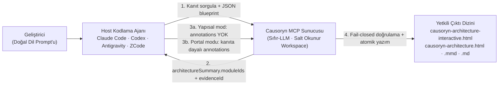

# Prompt ve Mimari Portal Rehberi

> **Dil / Language:** **Türkçe** | [English](en/prompting-and-architecture-portals.md) · [Dokümantasyon Merkezi](README.md) · [Kök README](../README.md)
>
> **Durum:** Causoryn 0.3.0'ı yansıtır. Aşağıdaki araç adları varsayılan `core` profilinin (11 araç) adlarıdır; bir profille işaretlenmiş satırlar, sunucunun `--tool-profile wiki`, `history` veya `full` ile başlatılmasını gerektirir (bkz. [Araç Profilleri](tool-contracts.md)).

Bu rehber, yapay zekâ kodlama ajanınızı doğal dille yönlendirerek **Causoryn**'i hem **tamamen deterministik, sıfır-LLM statik analiz** için hem de **host LLM anotasyonlu etkileşimli mimari portallar** (`causoryn-architecture-interactive.html`) için nasıl kullanacağınızı açıklar.

> **Sıfır-LLM ve salt okunur sınır:** Causoryn motoru hiçbir LLM çağrısı yapmaz, model kimlik bilgisine ihtiyaç duymaz ve embedding kullanmaz (bkz. [No-LLM Mimari Politikası](adr/ADR-002-no-llm.md)); analiz edilen workspace salt okunurdur. Mimari bir anlatı istediğinizde **host LLM rolünü kodlama ajanınız üstlenir** (Claude Code, Codex, Antigravity veya ZCode). Causoryn, ajanın verdiği her referansı fail-closed denetler ve çevrimdışı portalı deterministik biçimde oluşturur.

---

## 1. Causoryn'i Kullanmanın İki Yolu

| Boyut | Deterministik / sıfır-LLM mod (`annotations` gönderilmez) | Host-LLM anotasyonlu portal modu (`annotations` gönderilir) |
|---|---|---|
| **En uygun olduğu işler** | Kod tabanı keşfi, düzenleme öncesi etki alanı (blast radius) ve kontrat kontrolleri, düzenleme sonrası doğrulama, CI veya arşiv amaçlı yapısal diyagramlar | Ekibe katılım (onboarding), mimari incelemeler, domain sınırı haritaları, uçtan uca istek akışları, yapısal risk denetimleri |
| **Motor sınırı** | Yerel, sıfır-LLM graf sorguları ve dışa aktarım | Causoryn sıfır-LLM kalır; isteğe bağlı anlatı katmanını yalnızca dıştaki host ajan yazar |
| **Tekrarlanabilirlik** | Aynı snapshot + `format` + `view` + `options` → **bayt düzeyinde aynı çıktı** | Aynı snapshot + `format` + `view` + `options` + aynı `annotations` → **bayt düzeyinde aynı çıktı** (host'un yazdığı metnin kendisi oturumlar arasında değişebilir) |
| **Dayanak ve doğrulama** | Yalnızca statik graf kanıtı (`verified` / `heuristic` / `unresolved`) | Her `moduleId`, `nodeId`, `evidenceId` ve `keyFiles` yolu tek geçişte snapshot'a karşı denetlenir; en fazla 25 hata `INVALID_ARGUMENT` altında birlikte raporlanır ve uydurulmuş referanslar reddedilir |
| **Tipik çıktılar** | MCP JSON envelope'ları veya yapısal `causoryn-architecture.html` / `causoryn-architecture-interactive.html` / `.mmd` / `.md` / `.json` | Anotasyonlu `causoryn-architecture-interactive.html` (pan/zoom, canlı arama, kanıt çekmecesi, hash ile sabitlenmiş CSP), sıfır-JS `causoryn-architecture.html`, `.mmd` ve `.md` Mimari Özeti (Architecture Brief) |



---

## 2. Skill Adı Ezberlemeden Doğal Dille Prompt Yazma

`npx causoryn@latest setup` sonrasında host ajanınız birbirini tamamlayan iki sinyal alır:

1. **Skill ön-metni (frontmatter) ve yönlendirme** (`skills/architecture-blueprint/SKILL.md`, `skills/causoryn/SKILL.md`): `architecture-blueprint` İngilizce ve Türkçe tetikleyiciler taşır (*"architecture diagram"*, *"interactive architecture portal"*, *"system blueprint"*, *"visual onboarding guide"*, *"mimari diyagram"*, *"etkileşimli mimari portal"*, *"görsel mimari harita"*) ve ajana, Causoryn LLM içermediği için isteği asla reddetmemesini söyler — host LLM ajanın *kendisidir*. Ana `causoryn` skill'i görsel mimari ve portal isteklerini `architecture-blueprint`'e yönlendirir. Anotasyon şablonunun tamamı skill içinde durur; böylece MCP araç listesi küçük kalır (core `tools/list` ≤ 15,000 karakter).
2. **MCP `tools/list` açıklamaları:** skill'ler kapalı olsa bile `causoryn_export_documentation` açıklaması 2 adımlı **blueprint (`format: "json"`) → doğrulanmış render (`format: "html"`, `view: "interactive"`)** iş akışını belirtir ve her girdi alanının tek satırlık bir açıklaması vardır.

Bu nedenle hiçbir skill veya araç adını bilmeniz gerekmez — sonucu isteyin. Kurulu bazı skill'ler core adlarının yanında hâlâ legacy araç adlarından (örneğin `causoryn_index_status` veya `causoryn_generate_onboarding`) söz eder; varsayılan `core` profilinde ajan aşağıda listelenen core araçları kullanmalıdır. Eşleme [Legacy Araç Karşılıkları](tool-contracts.md) bölümündedir.

### A. Günlük Deterministik Mühendislik Prompt'ları (`annotations` gönderilmez)

| Amaç | Kopyala-yapıştır prompt (Türkçe) | Copy-paste prompt (English) | Temel MCP araçları (`core` profili) |
|---|---|---|---|
| **Keşif** | `"Causoryn ile bu projenin yüksek seviye modül haritasını çıkar, ana giriş noktalarını ve en merkezi bileşenleri kanıtlarıyla listele."` | `"Use Causoryn to map the top-level modules, entrypoints, and highest-centrality components of this repository with evidence."` | `causoryn_status`, `causoryn_map_system` (`profile: "onboarding"`), `causoryn_find_symbols` |
| **Yerini bulma ve izleme** | `"POST /orders isteğinin nerede işlendiğini bul ve tüm çağrı zincirini kaynak kanıtlarıyla izle."` | `"Locate where POST /orders is handled and trace its full execution chain with source evidence."` | `causoryn_get_agent_context`, `causoryn_trace`, `causoryn_get_evidence` |
| **Değişiklik öncesi (preflight)** | `"OrdersService.create fonksiyonuna idempotencyKey eklemeden önce Causoryn ile etki alanını, kontrat risklerini ve aday test planını çıkar."` | `"Before adding idempotencyKey to OrdersService.create, run Causoryn preflight to list blast-radius candidates, contract impacts, and a candidate test plan."` | `causoryn_preflight_change`, `causoryn_contracts` |
| **Doğrulama** | `"Yaptığımız değişiklikleri Causoryn ile doğrula: mimari kural ihlali, yeni döngü veya kontrat kayması var mı?"` | `"Verify our working-tree edits with Causoryn: check for architecture rule violations, new cycles, or contract drift."` | `causoryn_verify_change` (mimari, graf farkı, test planı), `causoryn_contracts` (`action: "drift"`) |
| **Düzenleme sonrası yenileme** | `"Causoryn ile bu çalışma alanını yeniden indeksle ve yeni snapshot hazır olunca haber ver."` | `"Re-index this workspace with Causoryn and tell me when the new snapshot is ready."` | `causoryn_status` (`action: "refresh"`, ardından `action: "inspect"`) |
| **Yapısal dışa aktarım (modelsiz)** | `"Causoryn ile anotasyon eklemeden bu reponun tamamen yapısal, modelsiz etkileşimli mimari diyagramını dışa aktar."` | `"Export a purely structural, model-free interactive architecture diagram of this repo using Causoryn without annotations."` | `causoryn_export_documentation` (`annotations` gönderilmez) |

`causoryn_verify_change` hiçbir zaman test çalıştırmaz; aday testleri listeler ve host'un bildirdiği sonuçları yalnızca `host_asserted` olarak kaydeder. Kontrat kayması için ajan `causoryn_contracts` aracını önceki/sonraki spec dosyalarıyla çağırmalıdır; çünkü `causoryn_verify_change` içindeki `contracts` kontrolü bu dosyalar olmadan değerlendirilemez.

### B. Host-LLM Anotasyonlu Etkileşimli Mimari Portal Prompt'ları

| Senaryo | Kopyala-yapıştır prompt (Türkçe) | Copy-paste prompt (English) | Önerilen view ve seçenekler |
|---|---|---|---|
| **Tam sistem portalı** | `"Causoryn kullanarak bu projenin kapsamlı, kanıta dayalı etkileşimli mimari portalını oluştur."` | `"Create a comprehensive, evidence-grounded interactive architecture portal for this project using Causoryn."` | `format: "html"`, `view: "interactive"` → `causoryn-architecture-interactive.html` |
| **Görsel onboarding rehberi** | `"Causoryn ile projenin görsel mimari haritasını, ana iş akışlarını, okuma sırasını ve yapısal risklerini çıkar."` | `"Build a visual onboarding architecture guide with core domains, request flows, guided tour, and structural risks using Causoryn."` | `annotations` içinde `domains`, `flows`, `guidedTour`, `risks` alanlarını doldurun |
| **Alt sistem odağı (`pathPrefix`)** | `"Causoryn kullanarak yalnızca src/billing alt sistemine odaklanan etkileşimli mimari portal ve Mermaid diyagramı üret."` | `"Use Causoryn to generate an interactive architecture portal and Mermaid diagram focused strictly on the src/billing subsystem."` | `options: { pathPrefix: "src/billing", maxModules: 24 }` |
| **Risk ve döngü denetimi** | `"Causoryn ile döngüsel bağımlılıkları, yüksek fan-in sıcak noktalarını ve çözümlenmemiş sınırları kanıt kimlikleriyle birlikte bir mimari risk raporuna dönüştür."` | `"Use Causoryn to produce an annotated architecture portal highlighting circular dependencies, fan-in hotspots, and unresolved boundaries backed by evidence IDs."` | `annotations.risks` + `annotations.decisions` + `evidenceIds` |
| **Sıfır-JS arşiv + PR özeti** | `"Causoryn ile sıfır JavaScript içeren arşivlenebilir mimari HTML portalı, PR'a yapıştırılabilir Mermaid diyagramı ve Markdown mimari özeti üret."` | `"Generate a zero-JavaScript archival HTML architecture portal, a PR-ready Mermaid diagram, and a Markdown architecture brief using Causoryn."` | `view: "architecture"` → `causoryn-architecture.html`, `.mmd`, `.md` |

### C. Başka bir araç profili gerektiren prompt'lar

Bu araçlar varsayılan `core` profilinde kayıtlı değildir. Profili host yapılandırmanızdaki sunucu argümanlarına ekleyin (örneğin `causoryn mcp --allow-cwd --auto-data-dir --tool-profile wiki`) veya `CAUSORYN_TOOL_PROFILE` değişkenini ayarlayın, ardından host'u yeniden başlatın; `npx causoryn@latest setup --tool-profile wiki --yes` bayrağı host kayıtlarına sizin yerinize yazar. Profil olmadan ajan bu araçları hiç görmez.

| Amaç | Kopyala-yapıştır prompt (Türkçe) | Copy-paste prompt (English) | Araçlar | Gereken profil |
|---|---|---|---|---|
| **Living Wiki** | `"Causoryn Living Wiki'yi oluştur ve kimlik doğrulama akışıyla ilgili sayfaları kanıt bağlantılarıyla özetle."` | `"Build the Causoryn Living Wiki and summarize the pages related to authentication with source evidence references."` | `causoryn_wiki_build`, `causoryn_wiki_search`, `causoryn_wiki_get_page` | `--tool-profile wiki` (veya `full`) |
| **Mimari geçmişi** | `"Causoryn ile main ve HEAD~5 arasındaki mimariyi karşılaştır; eklenen, silinen ve yeniden adlandırılan modülleri listele."` | `"Compare the architecture of main and HEAD~5 with Causoryn and list added, removed, and renamed modules."` | `causoryn_compare_architecture`, `causoryn_architecture_timeline` | `--tool-profile history` (veya `full`) |
| **Legacy araç adları kullanan eski prompt'lar** | `causoryn_index_status`, `causoryn_trace_execution`, `causoryn_check_contracts`, ... araçlarını adıyla çağıran prompt'lar veya betikler | — | 29 legacy ad (core karşılığı olanlar deprecated) | `--tool-profile full` |

Geçmiş (history) araçları bir ref için, o ref'in içeriğiyle eşleştiği kanıtlandığında (ve `working-tree` için) yayımlanmış yerel indeksi kullanır; aksi hâlde o ref'te commit edilmiş `.causoryn/architecture-snapshot.json` dosyasını okur (bu dosyalar `causoryn_export_documentation` `format: "snapshot"` ile yazılır) ve `snapshot-loaded-from-committed-git-blob` güven uyarısını ekler. İki kaynağı da olmayan bir ref `INVALID_REVISION` döner.

---

## 3. Dışa Aktarım Formatları, View'lar ve Varsayılan Dosya Adları

`causoryn_export_documentation` atomik olarak yazar (önce `flag: "wx"` ile bir `.tmp` dosyası oluşturulur, ardından `rename` yapılır) ve **yalnızca** `output.allowedOutputDirs` içinde listelenen dizinlere yazar. `--auto-data-dir` ile Causoryn `<data-dir>/workspaces/<slug>-<hash12>/exports` dizinini otomatik olarak yetkilendirir (örneğin `~/.causoryn/workspaces/<slug>-<hash12>/exports`).

| `format` | `view` | Varsayılan dosya adı | Çevrimdışı güvenlik ve temel yetenekler |
|---|---|---|---|
| `html` | `interactive` | `causoryn-architecture-interactive.html` | Çevrimdışı etkileşimli görüntüleyici: fare tekerleğiyle yakınlaştırma ve sürükleyerek kaydırma (pan), canlı arama, dil/domain/döngü filtreleri, yüzen **Evidence Inspector Drawer** (kanıt inceleme çekmecesi), 1-hop komşuluk vurgulama, tek tıkla **Copy Mermaid**. Hash ile sabitlenmiş çevrimdışı CSP (`default-src 'none'; script-src 'sha256-<hash>'; style-src 'unsafe-inline'; base-uri 'none'; form-action 'none'`): `'unsafe-inline'` script yok, CDN yok, `fetch` yok, `innerHTML` yok. |
| `html` | `architecture` *(varsayılan)* | `causoryn-architecture.html` | **Sıfır JavaScript** (`<script>` etiketi yok), çevrimdışı CSP (`default-src 'none'; style-src 'unsafe-inline'; base-uri 'none'; form-action 'none'`), 5 saf-CSS sekme, katmanlı (Sugiyama) SVG diyagramı, yakınlaştırma ön ayarları, Tarjan SCC döngü vurguları, satır içi SVG akış şeritleri. Ayrı varsayılan dosya adı, etkileşimli portalın üzerine yazılmasını önler. |
| `mermaid` | `architecture` *(varsayılan)* | `causoryn-architecture.mmd` | GitHub, VS Code ve pull request'ler için render edilebilir, subgraph gruplu `flowchart TB`; ağırlıklı modüller arası kenarlar (`verified` düz, `heuristic`/`unresolved` kesikli) ve döngü stillendirmesi. |
| `markdown` | `architecture` *(varsayılan)* | `causoryn-architecture.md` | Mimari Özeti (Architecture Brief): yönetici özeti, gömülü Mermaid diyagramı, domain'ler, modül sorumlulukları, kritik akışlar, rehberli tur, giriş noktaları, kararlar, riskler. |
| `json` | `architecture` *(varsayılan)* | `causoryn-architecture.json` | Kanonik `architectureSummary.moduleIds`, toplulaştırılmış modül metrikleri, modüller arası kenarlar ve `evidenceCatalog` içeren kompakt blueprint. |
| `snapshot` | *(verilmez)* | `architecture-snapshot.json` | Salt okunur Git karşılaştırması (`causoryn_compare_architecture`, `causoryn_architecture_timeline`; history profili) için kanonik snapshot içerik kümesi. |
| `html` / `mermaid` / `markdown` / `json` | `full` | Format varsayılanı | Filtrelenmemiş ham düğüm, kenar ve kanıt dökümü. `options` veya `annotations` ile birlikte kullanılamaz (`INVALID_ARGUMENT`). |

Araç yanıtı (`data`) `path`, `format`, `bytes`, `atomic: true`, `view` alanlarını ve `architecture` ile `interactive` view'larında `architectureSummary` (`moduleCount`, `edgeCount`, `cycleCount`, `entrypointCount`, `contractCount`, `flowCount`, `annotated`, `moduleIds`) alanını döner.

### Projeksiyon Seçenekleri (`options`)

`view: "architecture"` ve `view: "interactive"` ile kullanılabilir:

- `maxModules` (`2–100`, varsayılan `32`): uyarlamalı dizin ağacı kümelemesinden çıkan en fazla toplulaştırılmış modül sayısı. Aralık dışındaki değerler `INVALID_ARGUMENT` döner.
- `pathPrefix` (`"src/api"` veya `"packages/domain"` gibi göreli POSIX dizin öneki, en fazla 260 karakter): projeksiyonu tek bir alt sisteme odaklar; `..` ve NUL baytları reddedilir.
- `includeTests` (`boolean`, varsayılan `true`): test dosyalarını ve test modüllerini projeksiyona dahil eder; test modüllerini dışarıda bırakmak için `false` verin.

### 2 Adımlı Blueprint → Render İş Akışı

1. **Adım 1 — Kanıtı ve kanonik `moduleId`'leri toplayın.** Host ajan snapshot sağlığını ve graf olgularını `causoryn_status` (snapshot yoksa veya bayatsa önce yenileyin), `causoryn_map_system` (`profile: "onboarding"`, ardından `filters.pathPrefix` ile `level: "L1"` / `"L2"`), `causoryn_trace` (`mode: "execution"` veya `"business-flow"`) ve `causoryn_get_evidence` ile denetler; depoda `.causoryn/architecture.rules.yaml` varsa isteğe bağlı olarak `checks: ["architecture"]` ile `causoryn_verify_change` çağırır. Ardından kesin **`architectureSummary.moduleIds`** listesini almak için `causoryn_export_documentation({ format: "json", view: "architecture", outputDir, options })` çağırır. (`full` profilinde `causoryn_index_status`, `causoryn_workspace_summary`, `causoryn_generate_onboarding` veya `causoryn_trace_business_flow` gibi legacy adlar hâlâ çalışır.)
2. **Adım 2 — Doğrulanmış portalı render edin.** Host ajan `annotations` alanlarını yalnızca Adım 1'deki kimliklerle doldurur ve `causoryn_export_documentation({ format: "html", view: "interactive", outputDir, options, annotations })` çağırır. Eşleşen bir sıfır-JS portal, diyagram ve özet elde etmek için `view: "architecture"` HTML, `mermaid` ve `markdown` çıktılarını tamamen aynı `options` ve `annotations` ile render edebilir.

---

## 4. `annotations` Sözleşmesinin Tam Başvurusu (Fail-Closed, Çok Hatalı Doğrulama)

`annotations` içindeki her alan katı (`strictObject`) bir Zod şemasına göre doğrulanır, ardından etkin projeksiyona ve yayımlanmış snapshot'a karşı denetlenir. Bilinmeyen özellikler, boş veya yalnızca boşluktan oluşan metinler, mükerrer kimlikler ve var olmayan graf referansları reddedilir. Doğrulama tek geçişte **25**'e kadar şema ve graf referansı hatası toplar ve bunları `INVALID_ARGUMENT` altında birlikte döner; fazlası bir sayı olarak özetlenir.

| Üst düzey alan | Tür ve bütçe sınırı | Alt alanlar | Fail-closed doğrulama kuralı |
|---|---|---|---|
| `title` | `string` (≤ 160 karakter) | — | Kırpıldıktan sonra boş olmayan metin |
| `architectureStyle` | `string` (≤ 120 karakter) | — | Gözlenen mimari desen etiketi (örneğin `"Modular Monolith"`) |
| `executiveSummary` | `string` (≤ 2,000 karakter) | — | 2–4 cümlelik sentez; `partial` kapsamı veya çözümlenmemiş sınırları açıkça belirtmelidir |
| `domains` | `array` (≤ 24 öğe) | `id`, `name`, `description`, `layer?`, `moduleIds[]` (`1..100`) | Benzersiz `id`; her `moduleId` `architectureSummary.moduleIds` içinde bulunmalı ve **en fazla bir domain'e** ait olmalıdır (ayrık bölümleme) |
| `moduleNotes` | `array` (≤ 120 öğe) | `moduleId`, `summary`, `responsibility?`, `layer?`, `keyFiles?` (≤ 12) | `architectureSummary.moduleIds` içinden benzersiz `moduleId`; her `keyFiles` yolu o modülün içinde gerçek bir göreli dosya olmalıdır |
| `flows` | `array` (≤ 20 öğe) | `id`, `title`, `description`, `steps[]` (`1..24`: `moduleId?`, `nodeId?`, `label`, `explanation`) | Benzersiz `id`; adım sırası korunur; her `moduleId` projeksiyonda, her `nodeId` etkin snapshot düğümleri arasında olmalıdır (`Workspace`, `Repository`, `UnknownExternal` hariç) |
| `guidedTour` | `array` (≤ 30 öğe) | `step` (`1..1000`), `title`, `targetModuleId?`, `targetNodeId?`, `explanation` | `step`'e göre artan sırada sıralanır; `targetModuleId` ve `targetNodeId` projeksiyona/snapshot'a karşı denetlenir |
| `decisions` | `array` (≤ 24 öğe) | `id`, `title`, `summary`, `rationale?`, `relatedModuleIds?` (≤ 24), `evidenceIds?` (≤ 24) | Benzersiz `id`; her `relatedModuleId` `architectureSummary.moduleIds` içinde, her `evidenceId` snapshot kanıtları içinde olmalıdır |
| `risks` | `array` (≤ 24 öğe) | `id`, `title`, `severity` (`"low" \| "medium" \| "high"`), `summary`, `relatedModuleIds?` (≤ 24), `evidenceIds?` (≤ 24) | Benzersiz `id`; `relatedModuleIds` ve `evidenceIds` fail-closed denetlenir |

**İç içe metin bütçeleri** (`packages/graph/src/architecture-annotations.ts`): `id` ve `layer` ≤ 80 karakter; domain `name` ≤ 120; `title` ve adım `label` ≤ 160; `responsibility`, modül/düğüm referansları, `keyFiles` girdileri ve `evidenceIds` ≤ 240; `description`, `summary`, `explanation` ve `rationale` ≤ 1,200.

### Kompakt Geçerli `annotations` JSON Örneği

Aşağıdaki her `moduleId`, `keyFiles` yolu ve `evidenceId`, Adım 1'deki `architectureSummary.moduleIds` listesinden ve Causoryn kanıt çağrılarından birebir kopyalanmış bir değeri temsil eder (kısaltılmış `evidence:7d09d378...` tam bir kimlikle değiştirilmelidir). Dosya ve sembol adları `examples/fixture-ts-orders` örnek projesini izler; gerçek modül kimlikleri snapshot'ınızın kümelemesine bağlıdır.

```json
{
  "title": "Orders Service — Architecture Portal",
  "architectureStyle": "Layered TypeScript API",
  "executiveSummary": "HTTP routes under src/routes delegate order mutations to domain services under src/services. Static coverage is L2 (96.8% resolved); dynamic plugin hooks remain labeled unresolved.",
  "domains": [
    {
      "id": "api-layer",
      "name": "HTTP API & Routing",
      "description": "Validates incoming requests and maps HTTP endpoints to service handlers.",
      "layer": "Presentation",
      "moduleIds": ["mod:src/routes"]
    },
    {
      "id": "order-core",
      "name": "Order Domain Services",
      "description": "Encapsulates order creation, idempotency, and persistence coordination.",
      "layer": "Application",
      "moduleIds": ["mod:src/services"]
    }
  ],
  "moduleNotes": [
    {
      "moduleId": "mod:src/services",
      "summary": "Core transactional order orchestration and validation rules.",
      "responsibility": "Order lifecycle orchestration",
      "layer": "Application",
      "keyFiles": ["src/services/orders-service.ts"]
    }
  ],
  "flows": [
    {
      "id": "create-order",
      "title": "POST /orders Request Flow",
      "description": "Traces order submission from HTTP route validation through domain persistence.",
      "steps": [
        {
          "moduleId": "mod:src/routes",
          "label": "Accept POST /orders",
          "explanation": "Parses request payload and invokes OrdersService.create."
        },
        {
          "moduleId": "mod:src/services",
          "label": "Persist order",
          "explanation": "Validates invariants and records the order entity."
        }
      ]
    }
  ],
  "guidedTour": [
    {
      "step": 1,
      "title": "Start at HTTP routes",
      "targetModuleId": "mod:src/routes",
      "explanation": "Review public API surface and request schemas first."
    },
    {
      "step": 2,
      "title": "Inspect core order logic",
      "targetModuleId": "mod:src/services",
      "explanation": "Follow business invariants and downstream dependencies."
    }
  ],
  "decisions": [
    {
      "id": "DEC-01",
      "title": "Unidirectional Routes -> Services Boundary",
      "summary": "Route handlers call service modules without reverse imports.",
      "rationale": "Keeps HTTP transport concerns isolated from domain logic.",
      "relatedModuleIds": ["mod:src/routes", "mod:src/services"],
      "evidenceIds": ["evidence:7d09d378..."]
    }
  ],
  "risks": [
    {
      "id": "RISK-01",
      "title": "High Fan-In on Orders Service",
      "severity": "medium",
      "summary": "Multiple routes and entrypoints depend directly on orders-service.ts; signature changes require preflight checks.",
      "relatedModuleIds": ["mod:src/services"],
      "evidenceIds": ["evidence:7d09d378..."]
    }
  ]
}
```

---

## 5. Sorun Giderme

| Hata kodu / belirti | Tipik neden | Çözüm |
|---|---|---|
| `EXPORT_NOT_ALLOWED` | `outputDir`, `output.allowedOutputDirs` içinde değil (varsayılan olarak reddeden dışa aktarım politikası) ya da sunucu hem `--auto-data-dir` olmadan hem de yapılandırılmış bir liste olmadan başlatıldı. | `<data-dir>/workspaces/<slug>-<hash12>/exports` dizinini kullanın (`--auto-data-dir` gerektirir) veya `CAUSORYN_CONFIG` içinde `output.allowedOutputDirs` ayarlayın. |
| `INVALID_ARGUMENT` | (1) `architectureSummary.moduleIds` içinde olmayan bir `moduleId`, etkin snapshot dışında bir `nodeId`, bilinmeyen bir `evidenceId` veya modülünün dışında kalan bir `keyFiles` yolu; (2) birden fazla domain'e atanmış bir `moduleId`; (3) `view: "wiki"` (wiki sayfaları wiki araçlarına aittir); (4) HTML dışı bir formatla `view: "interactive"`; (5) `view: "full"` ile birlikte `options` veya `annotations`; (6) 2–100 aralığı dışında `maxModules`. | `error.message` içindeki hata listesinin tamamını (en fazla 25 girdi) okuyun, kimlikleri Adım 1'deki JSON blueprint ile hizalayın, yükü düzeltin ve bir kez yeniden deneyin. |
| `PATH_DENIED` | `fileName` içinde `/` veya `\`, `..` geçişi, NUL baytları veya symlink kaçışı var. | Düz bir dosya adı verin (örneğin `"custom-architecture.html"`) ya da format/view varsayılanını kullanmak için `fileName` alanını boş bırakın. |
| `WORKSPACE_NOT_AUTHORIZED` | Yetkili kök yok: `--root`, `--allow-cwd`, MCP `roots/list` veya `CAUSORYN_CONFIG.allowRoots` ile bağlanmamış. | Host'u güvenli bir proje dizininden başlatın veya `roots/list` göndermesine izin verin; bu durumda `causoryn_status` `authorized: false` gösterir. Yapılandırmayı incelemek için `npx causoryn@latest doctor` çalıştırın. |
| `INDEX_NOT_READY` veya `data.status: "indexing"` ile `status: "partial"` | Henüz yayımlanmış snapshot yok veya ilk indeksleme hâlâ sürüyor. | `retryAfterMs` kadar bekleyip `causoryn_status` (`action: "inspect"`) çağırın; çalışan bir iş yoksa `causoryn_status({ action: "refresh" })` ile bir tane başlatın. |
| Ajan bir wiki veya history aracının olmadığını söylüyor | Sunucu varsayılan `core` profilini çalıştırıyor. | `--tool-profile wiki`, `history` veya `wiki,history` ekleyin (ya da `CAUSORYN_TOOL_PROFILE` ayarlayın) ve host'u yeniden başlatın ([§2.C](#c-başka-bir-araç-profili-gerektiren-promptlar)). |
| Bir history aracından `INVALID_REVISION` | Ref, yerel indeksin eşleştiği kanıtlanan revizyon değil ve ref'te commit edilmiş bir `.causoryn/architecture-snapshot.json` yok. | `format: "snapshot"` ile dışa aktarın, karşılaştırmak istediğiniz ref'lerde commit edin ve yeniden deneyin. |

Çalışma zamanının, dil sidecar'larının ve kurulu host yapılandırmaları ile skill'lerin salt okunur sağlık kontrolünü çalıştırmak için:

```bash
npx causoryn@latest doctor
```

---

## İlgili Belgeler

- [5 Dakikalık Hızlı Başlangıç Rehberi](en/tutorial-5-minutes.md) (İngilizce) · [MCP Araç Sözleşmeleri](tool-contracts.md)
- [CLI ve Yapılandırma](cli-and-configuration.md) · [No-LLM Mimari Politikası](adr/ADR-002-no-llm.md)
- [Mimari Genel Bakış](architecture.md) · [Living Wiki Spesifikasyonu](wiki-spec.md)
- [Dokümantasyon Merkezi (TR)](README.md) · [Documentation Hub (EN)](en/README.md)
