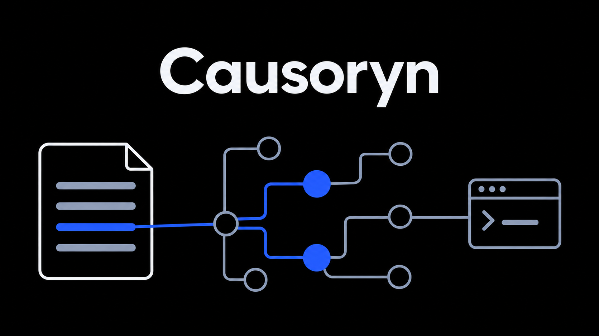

<p align="center">
  
</p>

# Causoryn

**Causoryn** is a **local, deterministic, LLM-free MCP engine (`ADR-002`)** for codebase and change intelligence. It builds evidence-backed graphs for **TypeScript / JavaScript**, **C# / Roslyn**, **Python**, **Go**, and **Rust**, serves **29 MCP tools** over `stdio`, and ships **5 canonical agent skills** over read-only workspace analysis (`ADR-008`).

> **Release status (`ADR-010`):** `0.2.4` is a **Pre-1.0 Public Preview** (not `1.0.0`).
> Package architecture note: `causoryn` is a multi-file runtime package (`dist/mcp-server.mjs`
> + vendored N-API v10 `better-sqlite3` prebuild binaries + `dist/typescript-lib/` +
> `native/` sidecar workers + 5 canonical `skills/`), not a single-file JS artifact.

---

## Why Causoryn?

- **LLM-free analysis (`ADR-002`):** Static analysis, search, verification, and export run locally without model calls, model credentials, or embeddings. The bundled `architecture-blueprint` skill guides your host coding agent to supply optional `annotations`; Causoryn validates schema and graph references fail-closed while prose remains caller-provided.
- **Reproducible exports:** The same snapshot (including metadata) with identical format, view, options, and annotations produces byte-identical artifacts under the same renderer version. Build timestamps, MCP request IDs, job progress, and host-generated annotations can vary ([ADR-002](https://github.com/MrBekoX/Causoryn/blob/main/docs/en/adr/ADR-002-no-llm.md)).
- **Evidence-backed results (`ADR-010`):** Edges report `verified`, `heuristic`, or `unresolved` resolution. Every `verified` edge carries source-span evidence.
- **Read-only source analysis (`ADR-008`):** SQLite graph and wiki databases live outside analyzed roots. Automatic setup also isolates exports outside your workspace; custom `output.allowedOutputDirs` governs explicit export destinations independently of analyzed roots.
- **Offline visual architecture portals:** Zero-JS layered SVG HTML (`view: "architecture"`, default `causoryn-architecture.html`), interactive pan/zoom/search/Evidence Inspector portal (`view: "interactive"`, default `causoryn-architecture-interactive.html`), subgraph Mermaid diagrams, Architecture Brief Markdown, and fail-closed Host-LLM `annotations`.
- **Universal repository compatibility & warm snapshot reads:** Analyzes `.ts/.tsx/.mts/.cts` and `.js/.jsx/.mjs/.cjs` (ESM + CommonJS) with read-only `tsconfig.json`/`jsconfig.json` path-alias resolution, honors root `.gitignore`, `.git/info/exclude`, and nested `.gitignore`, preserves `bin/*.ts|js` and `src/bin/*.rs` while ignoring `.NET` `bin/` outputs, yields during async inventory scans, defers automatic indexing until after MCP initialization, and checks `PRAGMA data_version` before reusing cached SQLite snapshots. Historical medians on a 1,000-file TypeScript fixture were `11.8 ms` for `workspace_summary`, `13.0 ms` for `get_symbol_context`, and `10.7 ms` for `map_system` ([Benchmarks](https://github.com/MrBekoX/Causoryn/blob/main/docs/en/benchmarks.md)).

---

## Requirements & Component Runtime Matrix

| Component | Runtime Requirement | Compilation | Offline Behavior |
|---|---|---|---|
| **Core MCP server & SQLite** (`dist/mcp-server.mjs` + N-API v10 `better-sqlite3` prebuilds) | **Node.js >= 24** | Zero-compile | 100% offline |
| **TypeScript / JavaScript** (L2 + L3: `.ts/.tsx/.mts/.cts/.js/.jsx/.mjs/.cjs`, ESM + CJS, `tsconfig`/`jsconfig` paths) | In-process TS Compiler API + bundled `dist/typescript-lib/lib*.d.ts` | Zero-compile | 100% offline |
| **C# / Roslyn** (L2 + L3) | **.NET 10 runtime** (`dotnet exec`) | Prebuilt deterministic Release Roslyn DLL (zero-compile) | 100% offline |
| **Python** (L2 + L3) | **Python 3.10+** (`python -B`, stdlib `ast`) | Zero-compile | 100% offline |
| **Go** (L1/heuristic + L3) | **Go 1.22+** (stdlib `go/parser`) | On-demand `go run` (or `CAUSORYN_GO_WORKER_BIN`) | 100% offline |
| **Rust** (L1/heuristic + L3) | **Rust / Cargo** (`syn` 3 sidecar) | On-demand `cargo build --locked` into `~/.causoryn/cache/rust-worker-target` | An uncached build can fetch locked crates from `crates.io`; a populated cache supports offline use |

If an optional language sidecar toolchain (`dotnet`, `python`, `go`, `cargo`) is unavailable on a machine, Causoryn degrades gracefully and honestly to L0/L1 file-level provenance (`npx causoryn@latest doctor` inspects sidecar readiness).

---

## Installation Across All 4 Supported Hosts

You can install Causoryn either via the **interactive/scriptable CLI wizard (`npx causoryn setup`)** or via **each host's native Plugin Marketplace**.

### Option A: One-Command CLI Setup (`npx causoryn setup`)

```bash
# Preview planned changes without writing any files
npx causoryn@latest setup --all-detected --dry-run

# Configure all detected hosts on your machine (creates .causoryn.backup files and stages a persistent ~/.causoryn/runtime copy)
npx causoryn@latest setup --all-detected --yes

# Or target specific hosts explicitly
npx causoryn@latest setup --client antigravity --yes
npx causoryn@latest setup --client claude-code --yes
npx causoryn@latest setup --client codex --yes
npx causoryn@latest setup --client zcode --yes

# Verify installation health (read-only)
npx causoryn@latest doctor

# Cleanly remove Causoryn from a host (cleans up ~/.causoryn/runtime when no remaining host points to it)
npx causoryn@latest setup --client claude-code --uninstall --yes
```

### Option B: Native Host Plugin Marketplaces

1. **Antigravity** (`agy` / Antigravity IDE):
   - Add the repository (`https://github.com/MrBekoX/Causoryn`) or extracted `causoryn` plugin folder containing `plugin.json` and `mcp_config.json`, or run `npx causoryn@latest setup --client antigravity --yes` (writes `~/.gemini/config/mcp_config.json`, updates `~/.gemini/antigravity/mcp_config.json` when present, and installs the 5 skills into `~/.gemini/config/skills/`).
2. **Claude Code**:
   - In Claude Code, register the GitHub marketplace and install the plugin:
     ```text
     /plugin marketplace add MrBekoX/Causoryn
     /plugin install causoryn@causoryn
     ```
   - Or run `npx causoryn@latest setup --client claude-code --yes` (`~/.claude.json` + `~/.claude/skills/`).
3. **Codex** (Codex CLI / Desktop):
   - Add the repository marketplace (`.agents/plugins/marketplace.json` + `.codex-plugin/plugin.json`) via Codex plugin management, or run `npx causoryn@latest setup --client codex --yes` (`$CODEX_HOME/config.toml` `[mcp_servers.causoryn]` with `startup_timeout_sec = 30` + `~/.agents/skills/`).
4. **ZCode (GLM)**:
   - Open **Plugin Marketplace -> New / Discover**, add `https://github.com/MrBekoX/Causoryn` (uses root `marketplace.json` and `.zcode-plugin/plugin.json`), and install `causoryn`.
   - Or run `npx causoryn@latest setup --client zcode --yes` (writes `~/.zcode/cli/config.json` `mcp.servers.causoryn` while preserving any existing `~/.agents/mcp.json` fallback servers, plus `~/.zcode/skills/`).

---

## Example Prompts: Deterministic vs. Annotated

- **Deterministic / Pure Structural (no `annotations`):**
  - `"Use Causoryn to run a preflight impact and contract check before modifying src/services/orders-service.ts."`
  - `"Export a purely structural, model-free interactive architecture diagram of this repo using Causoryn without annotations."`
- **Host-LLM Annotated Interactive Portal (no skill name needed):**
  - `"Create a comprehensive, evidence-grounded interactive architecture portal for this project using Causoryn."`
  - `"Causoryn kullanarak bu projenin kapsamlı, kanıta dayalı etkileşimli mimari portalını oluştur."`

Full prompting recipes and `annotations` contract reference:
**[Prompting & Architecture Portals Guide (EN)](https://github.com/MrBekoX/Causoryn/blob/main/docs/en/prompting-and-architecture-portals.md)** · **[Prompt ve Mimari Portal Rehberi (TR)](https://github.com/MrBekoX/Causoryn/blob/main/docs/prompting-and-architecture-portals.md)**

---

## Read-Only Workspace & Zero-Config Authorization

- **Storage and export paths:** Automatic setup uses `~/.causoryn/workspaces/<slug>-<hash>/` or the supported `ZCODE_PLUGIN_DATA` / `--data-dir` override. With manual configuration, keep `output.allowedOutputDirs` outside the source tree for an out-of-tree export workflow ([CLI & Configuration](https://github.com/MrBekoX/Causoryn/blob/main/docs/en/cli-and-configuration.md)).
- **Zero-config CLI flags (`--allow-cwd --auto-data-dir`):** When launched inside a safe project directory, `--allow-cwd` authorizes that project root automatically; when launched by a desktop IDE from `$HOME`, filesystem root, or the plugin cache directory, Causoryn rejects unsafe roots and dynamically binds the active workspace via MCP `roots/list` (`notifications/roots/list_changed`).
- **Explicit `CAUSORYN_CONFIG` (`allowRoots`):** Bare `node dist/mcp-server.mjs` without CLI flags preserves strict default-deny (`{"allowRoots":[]}`) until a project path such as `{"allowRoots":["/work/my-service"]}` is explicitly declared.

---

## Published MCP Tools (29 Tools — `TOOL_NAMES`)

Every tool advertised below is genuinely implemented and registered by the compiled server (`ADR-010`):

1. `causoryn_get_capabilities` — Adapter levels (L0–L3), server limits, protocol version, and published tool list.
2. `causoryn_workspace_summary` — Language, project, entrypoint, and edge-resolution summary of the published snapshot.
3. `causoryn_index_status` — Background/completed indexing job status, snapshot freshness, and diagnostics.
4. `causoryn_refresh_index` — Starts a full or incremental workspace indexing job into the external data root.
5. `causoryn_map_system` — Paginated L0–L3 architecture hierarchy map with kind/path filters and cursor pagination.
6. `causoryn_find_symbols` — Deterministic ranked symbol lookup with candidate disambiguation.
7. `causoryn_get_symbol_context` — Neighborhood graph and source-span evidence around a symbol or node ID.
8. `causoryn_trace_execution` — Bounded deterministic call/route chain tracing with per-edge resolution.
9. `causoryn_trace_business_flow` — Cross-component business and contract flow tracing with honest `gap` reporting.
10. `causoryn_analyze_impact` — Reverse-edge BFS blast-radius analysis keeping `certainty` and `resolution` separate.
11. `causoryn_check_architecture` — Evaluates `.causoryn/architecture.rules.yaml` (`no-cycles` SCC + forbidden dependencies).
12. `causoryn_compare_architecture` — Read-only git ref architectural comparison (`baseRef` vs `targetRef`).
13. `causoryn_get_agent_context` — Ranked, budget-bounded context retrieval across symbol, graph, contract, and FTS legs.
14. `causoryn_generate_onboarding` — Structural onboarding guide (entrypoints, high-centrality modules, SCC learning order).
15. `causoryn_export_documentation` — Atomic visual architecture portal & documentation export (`json`, `markdown`, `mermaid`, `html`, `snapshot`; `view: architecture | interactive | full`, optional fail-closed Host-LLM `annotations`) to `output.allowedOutputDirs`.
16. `causoryn_preflight_change` — Candidate-only pre-change impact, contract, and test-plan manifest (`candidateOnly: true`).
17. `causoryn_check_contracts` — Static compatibility classification across OpenAPI, AsyncAPI, JSON Schema, SQL, and Protobuf pairs.
18. `causoryn_detect_contract_drift` — Revision-to-revision contract drift and producer/consumer anchor impact detection.
19. `causoryn_verify_change` — Deterministic post-change verification across `architecture`, `contracts`, `graph-diff`, and `test-plan`.
20. `causoryn_derive_test_plan` — Content-addressed (`testplan:<sha256>`) candidate test plan without executing tests.
21. `causoryn_get_evidence` — Source file, line span, hash, and analyzer provenance lookup for nodes and edges.
22. `causoryn_architecture_timeline` — Sampled multi-revision architectural evolution over read-only git history.
23. `causoryn_wiki_build` — Projects the published graph snapshot into a deterministic Living Wiki SQLite snapshot (`wiki.dataDbPath`).
24. `causoryn_wiki_get_tree` — Paginated 12-category Living Wiki taxonomy tree with freshness and coverage metadata.
25. `causoryn_wiki_get_page` — Section-paginated Living Wiki page reader with `evidenceRefs` and `sourceRefs`.
26. `causoryn_wiki_search` — Escaped multi-field FTS5 search over Living Wiki pages.
27. `causoryn_wiki_get_links` — Outgoing links, reverse-indexed backlinks, and `brokenLinkDiagnostics`.
28. `causoryn_wiki_get_versions` — Read-only git/snapshot version availability for Living Wiki pages.
29. `causoryn_wiki_diff` — Structural diff (`changedSections`, `coverageDelta`, `contractChanges`) between two Living Wiki snapshots.

---

## Envelope Error Codes (`CAUSORYN_TOOL_ERROR_CODES` & Specification Catalog)

Active envelope error codes exported in `CAUSORYN_TOOL_ERROR_CODES` (15 codes):
- `WORKSPACE_NOT_AUTHORIZED`
- `PATH_DENIED`
- `INDEX_NOT_READY`
- `AMBIGUOUS_SYMBOL`
- `LIMIT_EXCEEDED`
- `INVALID_ARGUMENT`
- `EVIDENCE_NOT_FOUND`
- `SYMBOL_NOT_FOUND`
- `POLICY_INVALID`
- `INVALID_REVISION`
- `EXPORT_NOT_ALLOWED`
- `WIKI_PAGE_NOT_FOUND`
- `CONTRACT_PARSE_FAILED`
- `UNSUPPORTED_LANGUAGE`
- `INTERNAL_ERROR`

Reserved specification base identifiers not emitted as envelope errors in v0.2.4 (6 codes; 21 total catalog + extension identifiers):
- `UNRESOLVED_FLOW`
- `STALE_PREFLIGHT`
- `CANCELLED`
- `WIKI_REVISION_NOT_AVAILABLE`
- `WIKI_BROKEN_LINK`
- `WIKI_NOTE_CONFLICT`

---

## Documentation (English & Türkçe)

- **[English Documentation Hub](https://github.com/MrBekoX/Causoryn/blob/main/docs/en/README.md)** — [Prompting & Architecture Portals](https://github.com/MrBekoX/Causoryn/blob/main/docs/en/prompting-and-architecture-portals.md) · [Architecture](https://github.com/MrBekoX/Causoryn/blob/main/docs/en/architecture.md) · [CLI & Configuration](https://github.com/MrBekoX/Causoryn/blob/main/docs/en/cli-and-configuration.md) · [5-Language Analyzers](https://github.com/MrBekoX/Causoryn/blob/main/docs/en/language-analyzers.md) · [MCP Tool Contracts](https://github.com/MrBekoX/Causoryn/blob/main/docs/en/tool-contracts.md) · [Compatibility Matrix](https://github.com/MrBekoX/Causoryn/blob/main/docs/en/compatibility-matrix.md)
- **[Türkçe Dokümantasyon Merkezi](https://github.com/MrBekoX/Causoryn/blob/main/docs/README.md)** — [Prompt ve Mimari Portal Rehberi](https://github.com/MrBekoX/Causoryn/blob/main/docs/prompting-and-architecture-portals.md) · [Mimari Özeti](https://github.com/MrBekoX/Causoryn/blob/main/docs/architecture.md) · [CLI ve Konfigürasyon](https://github.com/MrBekoX/Causoryn/blob/main/docs/cli-and-configuration.md) · [5-Dil Analizörleri](https://github.com/MrBekoX/Causoryn/blob/main/docs/language-analyzers.md) · [MCP Araç Sözleşmeleri](https://github.com/MrBekoX/Causoryn/blob/main/docs/tool-contracts.md) · [Uyumluluk Matrisi](https://github.com/MrBekoX/Causoryn/blob/main/docs/compatibility-matrix.md)
- **[Bilingual Architecture & Project Overview (TR · EN)](https://github.com/MrBekoX/Causoryn/blob/main/docs/project-overview.tr-en.md)**

---

## Governance, Security & License

- **Security policy:** [SECURITY.md](https://github.com/MrBekoX/Causoryn/blob/main/SECURITY.md)
- **Contributing:** [CONTRIBUTING.md](https://github.com/MrBekoX/Causoryn/blob/main/CONTRIBUTING.md)
- **Code of Conduct:** [CODE_OF_CONDUCT.md](https://github.com/MrBekoX/Causoryn/blob/main/CODE_OF_CONDUCT.md)
- **Third-party notices:** `THIRD-PARTY-NOTICES.md` (included in package)
- **License:** [MIT](LICENSE)
